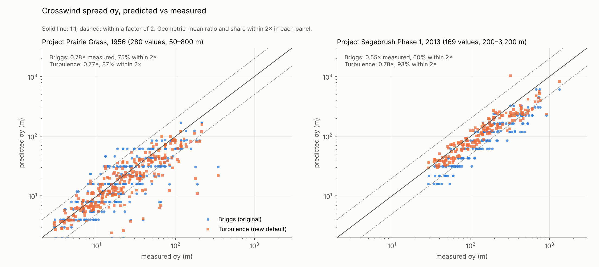
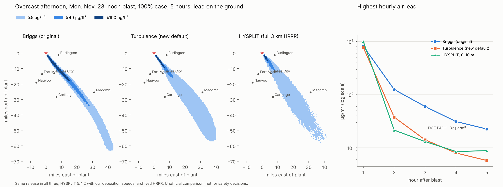
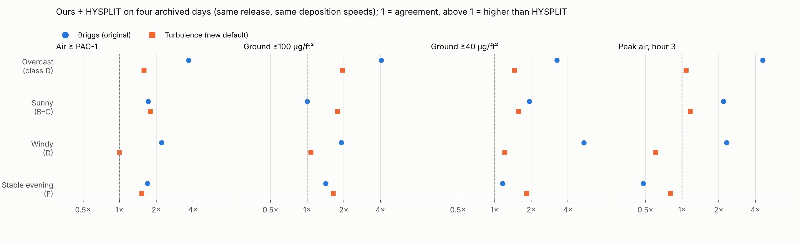
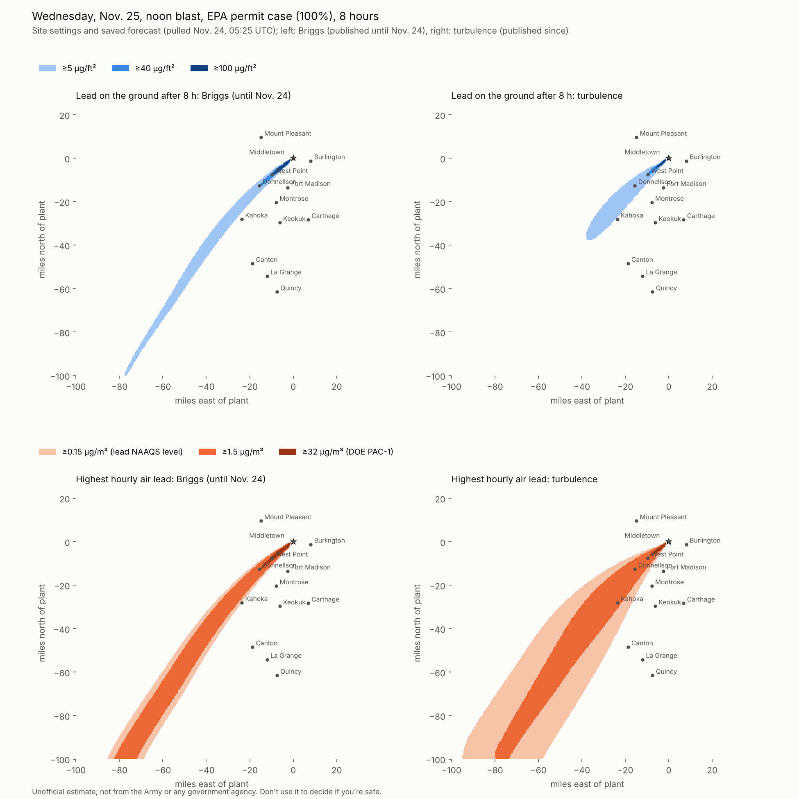
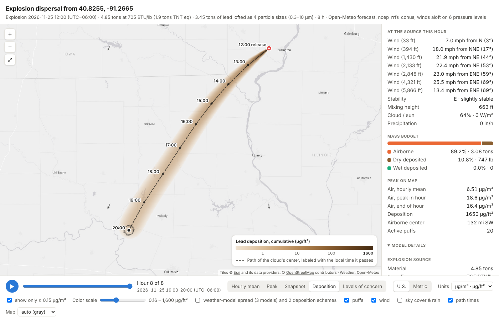
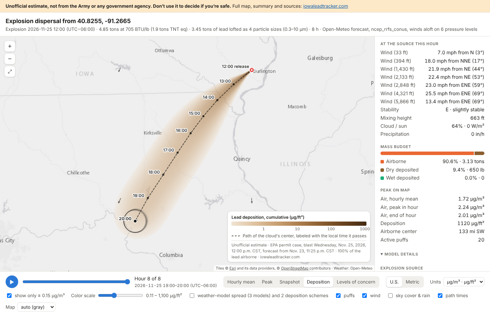

# Turbulence-based cloud spread

How fast the lead cloud widens and deepens decides how far each level on the map reaches
and how high the concentrations are. This document describes the model's two ways of
computing that spread, the original **Briggs** stability-class curves and the new
**turbulence-based** method, and everything we compared them against: NOAA's HYSPLIT
model on four past days, and measured spread in two tracer experiments (Project Prairie
Grass, 1956; Project Sagebrush, 2013). It goes with [`MODEL.md`](MODEL.md), which covers
the rest of the model.

> **Unofficial.** This is a screening model, not from the Army or any government agency.
> Don't use it to decide if you're safe; follow official instructions. HYSPLIT results
> here are this project's runs of NOAA's public software and are not official NOAA
> products.

**Status.** Since Nov. 24, 2026 the published maps on iowaleadtracker.com and the staged
maps use the turbulence-based method: the site build (`make_map_picker.py`, `MODEL_ARGS`)
passes `--spread turbulence`. The command line's default is still `--spread briggs`, so
earlier runs and scripts reproduce unchanged; pass `--spread turbulence` to match the
site. Saved forecasts pulled before the switch have no air temperature, so for those the
build uses 2 °C, the forecast at the plant over Wednesday's blast window
(`FALLBACK_AIR_TEMPERATURE_C`); refreshed forecasts include it. The site's Methodology and
References dialog describes the change in its change log.

Contents: [Summary](#summary) · [Using it](#using-it) · [Why change](#why-change) ·
[The method](#the-method) · [How other models do it](#how-other-models-do-it) ·
[Tracer data](#check-1-measured-spread-in-tracer-experiments) ·
[HYSPLIT](#check-2-noaa-hysplit-on-four-past-days) · [Sensitivity](#sensitivity) ·
[Wednesday's maps](#effect-on-wednesdays-maps) · [Stable nights](#stable-nights-and-meander) ·
[Limits](#limits) · [Reproducing](#reproducing-the-numbers) · [References](#references)

## Summary

- **The Briggs curves keep the cloud too narrow after the first hour.** They were fitted to
  short-range, short-sampling tracer data (mostly Project Prairie Grass, within 800 m). A
  modern repeat of those experiments, Project Sagebrush, measured crosswind spread about
  2× wider than the curves beyond 400 m (Finn et al. 2016). Against Sagebrush's 169
  measured values the curves give 0.55× the measured spread; the turbulence-based method
  gives 0.78× (93% within a factor of 2).
- **Against NOAA's HYSPLIT on four past days**, the Briggs curves put the high-level zones
  (air above DOE PAC-1, ground above 40 and 100 µg/ft²) 2–5× farther out than HYSPLIT in
  daytime neutral air (stability class D); the lowest ground zone (5 µg/ft²) is about the
  same. The turbulence-based
  method comes within 0.9–2.4× on every day, including a stable evening, while the cloud's
  path is the same. After the Nov. 25 weather fixes (HRRR's 80 m wind,
  the 1000 and 975 hPa levels) it comes within 0.8–1.9×; the stable evening moved from
  1.5–1.8× to 1.0–1.1× ([Rerun](#rerun-after-the-nov-25-weather-fixes)).
- **It leans toward higher concentrations on purpose.** The scheme's turbulence values
  are 1-hour values; the default scales the crosswind growth to a 10-minute basis with an
  averaging-time rule CALPUFF uses for its Pasquill–Gifford curves (not for its turbulence
  option), which keeps the cloud about 0.7× as wide. That puts it at 0.77–0.78× the
  measured spread in both tracer experiments, where the 1-hour basis fits them (1.07×,
  1.13×). A narrower cloud raises concentrations along its path and lengthens the high
  zones, but lowers them off to the sides and shortens the lowest zones. With it, the
  zone distances on the four HYSPLIT days are 0.9–2.4× HYSPLIT's (only three of 32 below
  1.0, all 0.9×), a moderate high bias where the Briggs curves are up to 5× high.
- **On Wednesday's forecast it changes the map's shape.** For the EPA permit case at
  noon, the high levels pull in (air above DOE PAC-1 from 19 to 10 miles; ground above
  100 µg/ft² from 12 to 7 miles), the 5 µg/ft² ground zone shortens from 127 to 53 miles,
  and the lowest air level (0.15 µg/m³) covers about 2.5× the area. Right next to the
  plant, at Middletown, the two methods differ several-fold in either direction depending
  on the blast hour. See [Effect on Wednesday's maps](#effect-on-wednesdays-maps).
- **Calm nights need more work.** Sagebrush's night tests found plumes that swing across
  50–150° of arc in light winds. Neither method represents that; the site's ±5° direction
  view is far narrower. See [Stable nights](#stable-nights-and-meander).

## Using it

```bash
python3 puff_dispersal.py ... --spread turbulence          # new method, defaults below
python3 puff_dispersal.py ... --spread briggs              # original method (default)
```

| Option | Default | Meaning |
|---|---|---|
| `--spread {briggs,turbulence}` | `briggs` | **Spread method.** `briggs`: Briggs (1973) rural curves by Pasquill stability class (the original). `turbulence`: growth from the turbulence at each puff, described here |
| `--sigma-v-min` | 0.2 | minimum crosswind turbulence σv, m/s (AERMOD's value; CALPUFF uses 0.5) |
| `--spread-averaging` | 10 | averaging time, minutes, for crosswind growth: σv × (minutes/60)^0.2. 10 gives a narrower cloud than 60 |
| `--air-temperature-c` | – | fix the air temperature (°C) instead of downloading it, so saved forecasts replay |

With `--spread turbulence` the model also downloads the 2 m air temperature from
Open-Meteo (unless `--air-temperature-c` is given; 15 °C where missing). The tuning options
need `--spread turbulence`. With a constant wind (`--wind`) there is no sunshine or cloud
data, so the turbulence method treats the run as an overcast night (stable), where the
Briggs curves use class D. Briggs runs request exactly what they
always did, so their saved forecasts and maps are unchanged. The map page's model note
names the method used.

## Why change

The Briggs (1973) curves give the crosswind spread σy and the vertical spread σz as
functions of distance for six Pasquill stability classes (A, very unstable, to F, very
stable). The model picks the class each hour from wind, sunshine and cloud (Turner 1970)
and grows each puff along its class's curve. The curves rest largely on Project Prairie
Grass (Nebraska, 1956): 10-minute releases sampled on arcs out to 800 m.

Three problems for a map that runs 8 hours and 100 miles:

1. **Range.** The curves are fits to data within about a kilometre; at tens of miles they
   are extrapolations.
2. **Spread over hours.** Real clouds keep widening over hours as the wind direction wanders
   and varies with height. The curves slow that growth (σy ∝ x^0.5 far out), so a cloud
   stays narrow and concentrated for too long.
3. **Measured spread is wider.** Sagebrush (Finn et al. 2016) found σy "consistently high by
   a factor of ~2 relative to the published dispersion curves" (Pasquill–Gifford, Markee,
   Briggs) for classes B–D beyond about 400 m, and wider also than AERMOD's scheme, "which
   still retains empirical parameters that are derived from the classical tracer studies."

Dispersion models in regulatory and emergency use (AERMOD, CALPUFF's turbulence option,
ADMS, HYSPLIT) have moved from stability classes to turbulence: they compute the spread
from the crosswind and vertical turbulence (σv, σw) estimated from boundary-layer theory.
The new method follows them, using their published formulas.

## The method

`dispersal/turbulence.py`. Every model time step (60 s on the site), for each puff:

### 1. Surface-layer scaling: u\*, L, w\*

From the weather at the puff: 10 m wind u, shortwave radiation, cloud cover n (fraction),
2 m air temperature T, mixing height z_i, and the roughness length z0 of the `--land-use`
(0.02 m for crops). The methods of AERMOD's meteorological preprocessor, AERMET (EPA
2026, Sec. 3):

- **Net radiation** (Holtslag and van Ulden), using the forecast's shortwave radiation R
  rather than AERMET's cloud-based estimate of it:
  R_n = [(1 − r) R + c1 T⁶ − σ T⁴ + c2 n] / (1 + c3), with c1 = 5.31×10⁻¹³ W m⁻² K⁻⁶,
  c2 = 60 W m⁻², c3 = 0.12, albedo r = 0.2 (assumed for harvested cropland). The printed
  AERMOD formulation shows "− c2 n"; its critical-angle equation and Holtslag and van
  Ulden's original use "+ c2 n", as here.
- **Day** (R_n > 0): sensible heat flux H = 0.9 R_n / (1 + 1/Bo), Bowen ratio Bo = 1
  (assumed for moist late-autumn fields); u\* and L by Monin–Obukhov iteration,
  u\* = k u / [ln(z/z0) − Ψm(z/L) + Ψm(z0/L)], L = −ρc_p T u\*³ / (k g H) (eqs. 6–8);
  w\* = (g H z_i / (ρ c_p T))^(1/3) (eq. 9).
- **Night** (R_n ≤ 0): θ\* = 0.09 (1 − 0.5 n²) (eq. 16) and the stable u\* quadratic
  (eqs. 12–15, β_m = 5), both scaled by u/u_cr below the critical wind speed; heat loss
  capped at θ\* u\* ≤ 0.05 m s⁻¹ K (eq. 21); L = T u\*² / (k g θ\*), w\* = 0.

Typical values: overcast noon at 5 m/s, u\* 0.35 m/s, L −53 m, w\* 1.1 m/s; clear night at
2 m/s, u\* 0.06 m/s, L +5 m.

### 2. Turbulence at the puff's height: σv, σw

CALPUFF's similarity profiles (Scire et al. 2000, eqs. 2-52 to 2-64), with
a_n = exp(−0.9 z/h) and h the mixing height:

| | σv (crosswind) | σw (vertical) |
|---|---|---|
| Unstable, L < 0 (to 1.2h) | [4 u\*² a_n² + 0.35 w\*²]^½ | z ≤ 0.1h: [1.6 u\*² a_n² + 2.9 u\*² (−z/L)^⅔]^½; 0.1–0.8h: [1.15 u\*² a_n² + 0.35 w\*²]^½; entrainment layer 0.8–1.2h: [1.15 u\*² a_n² + a_c 0.35 w\*²]^½ with a_c = ½ + (h − z)/(0.4h) to h, ⅓ + (1.2h − z)/(1.2h) above (eqs. 2-58 to 2-61) |
| Neutral or stable, L > 0 | u\* [1.6 C_s z/L + 1.8 a_n] / (1 + z/L) | 1.3 u\* [C_s z/L + a_n] / (1 + z/L), C_s = (1 − z/h)^¾ |
| Above the boundary layer (1.2h unstable, h stable) | minimum | minimum |

Minimums: σv ≥ `--sigma-v-min` (0.2 m/s, at all heights: AERMOD's near-surface lower limit,
EPA 2026 eq. 115; AERMOD itself uses 0.5 m/s above the mixed layer, which in this model
overspread the stable evening, see [Sensitivity](#sensitivity)); σw ≥ CALPUFF's
defaults by class, 0.20, 0.12, 0.08, 0.06, 0.03, 0.016 m/s for A–F. Heights below 1 m are
taken as 1 m.

### 3. Growth: σy, σz

Taylor's theorem with Draxler's (1976) travel-time functions, as in CALPUFF (Scire et al.
2000, eqs. 2-39, 2-40, 2-65 to 2-67):

- σy = σv′ t f_y(t), f_y = 1 / (1 + 0.9 (t / 1000 s)^½)
- σz = σw t f_z(t), f_z = 1 / (1 + 0.9 (t / 500 s)^½) for L < 0, 1 / (1 + 0.945 (t / 100 s)^0.806) for L > 0
- σv′ = σv × (`--spread-averaging` / 60 min)^0.2. The turbulence values are 1-hour
  values; the default 10-minute basis multiplies σv by 0.70, including its minimum
  (0.2 → 0.14 m/s) and the linear growth beyond 550 m. The 0.2 exponent is CALPUFF's
  averaging-time rule (Scire et al. 2000, eq. 2-72), which CALPUFF applies to its
  Pasquill–Gifford σy, not to its turbulence option; it is borrowed here as a deliberate
  choice (see [Choices](#choices-made-and-why)).

Weather changes from step to step, so each puff advances from its present size by the
virtual-time method: find the travel time at which the curve for the current σv (or σw)
gives the puff's present σ, then step forward. Puffs never shrink.

**Long range.** Draxler's f_y slows growth to σy ∝ t^½ after about 15 minutes, which
underestimates spread over hours. CALPUFF switches puffs to Heffter's (1965) linear growth
(σy ∝ t) once σy reaches 550 m (its `SYTDEP`, Scire et al. 2000 p. 2-29). The new method
switches at the same size but grows at the local turbulence rate, dσy/dt = σv′, instead of
Heffter's fixed rate. That difference matters at night: a fixed 0.5 m/s rate tested here cut
stable-evening peak air to a tenth of HYSPLIT's ([Sensitivity](#sensitivity)).

Everything else in the model (transport, ground and lid reflection, the well-mixed limit,
the residual layer, settling, deposition, washout, the gridding) is unchanged.

### Choices made, and why

| Choice | Value | Why |
|---|---|---|
| σv minimum | 0.2 m/s (0.14 after the 10-minute factor) | AERMOD's near-surface lower limit, applied at all heights. CALPUFF's 0.5 m/s overspread the stable evening versus HYSPLIT (peak air 0.2×). Sagebrush suggests real night meander is larger still (see [Stable nights](#stable-nights-and-meander)); a minimum can't represent that well either way. |
| Averaging basis | 10 min | A deliberate lean toward higher concentrations, chosen by the maintainer: it keeps the zone distances on the four HYSPLIT days at about or above HYSPLIT's. It is 0.77–0.78× the measured spread of both tracer experiments, which the 1-hour basis fits (1.07×, 1.13×); the 1-hour basis falls below HYSPLIT on the windy day. Not CALPUFF's practice for its turbulence option, and the map's hourly means and the 60-minute PAC-1 are 1-hour quantities, so `--spread-averaging 60` is the physically consistent alternative. |
| Long-range switch | 550 m, at σv′ | CALPUFF's switch point; turbulence rate rather than Heffter's fixed rate so calm nights stay narrow. |
| Albedo, Bowen ratio | 0.2, 1.0 | Assumed for late-autumn cropland; not tuned. |

## How other models do it

From the documents themselves (read Nov. 24, 2026):

| Model | Crosswind spread | Crosswind turbulence σv | Minimum σv | Long range / meander |
|---|---|---|---|---|
| This model, `--spread briggs` | Briggs rural curves by class: σy = c x (1 + 0.0001x)^−½ (class D c = 0.08) | – | – | – |
| This model, `--spread turbulence` | σv′ t f_y(t), linear at σv′ beyond 550 m | CALPUFF similarity | 0.2 m/s | – (±5° direction view on the site) |
| CALPUFF `MDISP=2` (Scire et al. 2000) | σv t f_y(t), Draxler (eqs. 2-39, 2-65) | similarity (eqs. 2-52 to 2-64) | 0.5 m/s, all classes | Heffter (σy ∝ t) once σy reaches 550 m |
| CALPUFF `MDISP=3`, its regulatory default | Pasquill–Gifford tables; × (τ_ave/60 min)^0.2 for the averaging time of the predicted concentrations | – | – | same switch |
| AERMOD (EPA 2026) | σv x / [u (1 + 78X)^0.3], X = σv x/(u z_i) (eqs. 77–78) | σv² = 3.6u\*² + 0.35w\*² (eqs. 38–41) | 0.2 m/s (eq. 115) | coherent and random plumes weighted by σr²/σh², time scale 24 h (eqs. 71–73) |
| HYSPLIT (Draxler and Hess 1997) | particles: Langevin, horizontal Lagrangian time scale 10,800 s, so spread grows about linearly for hours; puffs: dσh/dt = σu (eqs. 56–58, 80) | stable v′² = 4.5u\*²(1 − z/z_i)^1.5; unstable v′² = 0.36w\*² (eqs. 61–72) | – | horizontal deformation diffusivity (eq. 51) |
| SCIPUFF / HPAC (one of the models EPA's permit names) | second-order closure; also predicts concentration variance | boundary-layer profiles | not in the summary we could read | separate mesoscale "large-scale variability" inputs |

Field evaluations:

- **Irwin (1983)**, 11 tracer sites: Draxler's turbulence-based scheme, with on-site
  measured σv and σw (not similarity estimates like ours), gave "the smallest mean
  fractional error" and beat Pasquill–Gifford at Prairie Grass and Karlsruhe.
- **EPA's CALPUFF tracer evaluation** (Paumier and Brode 1998; Savannah River, Great
  Plains, INEL): the turbulence and Pasquill–Gifford options were both within a factor of
  2 at about 100 km with no clear winner, both underestimating lateral spread at Great
  Plains' 100 km arc (central maxima 2–2.5× too high); at 600 km σy was 2.5–3.5× too large, mostly from
  an unresolved night-time low-level jet; Pasquill–Gifford's vertical growth produced
  spurious secondary maxima.
- **Project Sagebrush Phase 1** (Finn et al. 2016): see above and the next section.
- **Project Sagebrush Phase 2** (2016, NOAA report and Finn et al. manuscript): see
  [Stable nights](#stable-nights-and-meander).

## Check 1: measured spread in tracer experiments

σy predicted from each test's measured weather against σy measured. Numbers are the
geometric mean of predicted ÷ measured, then the share within a factor of 2. Data and
sources: [`tests/data/tracer/`](tests/data/tracer/README.md); tables from
`python3 tools/tracer_sigma_y.py`; checked by `tests/test_turbulence.py`.

- **Project Prairie Grass** (Barad 1958): 10-minute releases at 0.46 m, arcs 50–800 m;
  σy from J. S. Irwin's analysis, weather from the AERMOD files of the ASTM D6589 archive.
  The archive's wind is at 1 m; it is moved to 10 m with the Monin–Obukhov profile, since
  the model transports puffs with the wind at 10 m or higher (Sagebrush's is already
  10 m). AERMOD's formula gets the lowest measured wind, nearer its plume height.
  Prairie Grass classes were not recorded, so Briggs uses classes from L and z0 (after
  Golder 1972).
- **Project Sagebrush Phase 1** (Finn et al. 2015, 2016): continuous releases at 1.5 m,
  10-minute samples, arcs 200–3,200 m, daytime classes A–D; σy read from the vector data
  of the NOAA report's Fig. 212, weather from its Tables 19–23.
- "AERMOD" is AERMOD's σy formula with the same weather, for reference.



Each cell: geometric mean of predicted ÷ measured / share within a factor of 2.

**Prairie Grass** (280 values: 165 unstable, 115 stable), by arc distance:

| Group | n | Briggs (original) | Turbulence, 10-min (default) | Turbulence, 60-min | AERMOD |
|---|---|---|---|---|---|
| All | 280 | 0.78 / 75% | 0.77 / 87% | 1.07 / 87% | 0.97 / 83% |
| 50 m | 56 | 0.60 / 73% | 0.73 / 89% | 0.98 / 93% | 1.01 / 91% |
| 100 m | 56 | 0.69 / 79% | 0.73 / 88% | 1.01 / 91% | 1.02 / 89% |
| 200 m | 56 | 0.77 / 73% | 0.74 / 88% | 1.05 / 89% | 0.97 / 84% |
| 400 m | 56 | 0.88 / 75% | 0.79 / 86% | 1.11 / 86% | 0.94 / 79% |
| 800 m | 56 | 1.03 / 75% | 0.85 / 86% | 1.21 / 75% | 0.92 / 73% |

**Prairie Grass by stability:**

| Group | n | Briggs (original) | Turbulence, 10-min (default) | Turbulence, 60-min | AERMOD |
|---|---|---|---|---|---|
| Unstable | 165 | 0.65 / 76% | 0.73 / 89% | 1.03 / 95% | 0.90 / 87% |
| Stable | 115 | 1.01 / 74% | 0.81 / 84% | 1.12 / 76% | 1.08 / 77% |

**Sagebrush Phase 1** (169 values), by arc distance:

| Group | n | Briggs (original) | Turbulence, 10-min (default) | Turbulence, 60-min | AERMOD |
|---|---|---|---|---|---|
| All | 169 | 0.55 / 60% | 0.78 / 93% | 1.13 / 99% | 0.66 / 81% |
| 200 m | 21 | 0.47 / 33% | 0.84 / 100% | 1.19 / 100% | 0.89 / 100% |
| 400 m | 40 | 0.56 / 62% | 0.85 / 100% | 1.22 / 100% | 0.81 / 100% |
| 800 m | 42 | 0.57 / 69% | 0.80 / 98% | 1.14 / 100% | 0.68 / 93% |
| 1600 m | 44 | 0.59 / 70% | 0.80 / 84% | 1.15 / 98% | 0.62 / 75% |
| 3200 m | 22 | 0.50 / 45% | 0.58 / 82% | 0.89 / 95% | 0.39 / 18% |

**Sagebrush by test (IOP):**

| Group | n | Briggs (original) | Turbulence, 10-min (default) | Turbulence, 60-min | AERMOD |
|---|---|---|---|---|---|
| All | 169 | 0.55 / 60% | 0.78 / 93% | 1.13 / 99% | 0.66 / 81% |
| IOP 1 | 2 | 0.68 / 50% | 1.41 / 50% | 2.66 / 50% | 0.78 / 50% |
| IOP 2 | 30 | 0.60 / 70% | 0.72 / 97% | 1.07 / 100% | 0.56 / 67% |
| IOP 3 | 48 | 0.61 / 73% | 0.76 / 92% | 1.08 / 98% | 0.58 / 75% |
| IOP 4 | 41 | 0.44 / 34% | 0.76 / 88% | 1.09 / 100% | 0.76 / 80% |
| IOP 5 | 48 | 0.57 / 65% | 0.85 / 98% | 1.21 / 100% | 0.74 / 98% |

Reading these:

- **The Briggs curves are narrow at Sagebrush (0.55×) and fit Prairie Grass better
  (0.78×)**, as expected: they come from Prairie Grass-era data.
- **AERMOD fits Prairie Grass best (0.97×)** and falls short at Sagebrush's longer
  distances (0.39× at 3,200 m), consistent with Finn et al.'s remark that its constants
  come from the classical studies.
- **The turbulence method is the most consistent across both**: 0.77× Prairie Grass and
  0.78× Sagebrush with the default 10-minute basis (87% and 93% within a factor of 2);
  1.07× and 1.13× with the 1-hour basis. Sagebrush found averaging time mattered little
  (10–60 min), which favours the 1-hour basis there; the default leans narrow on purpose.
- At Prairie Grass the turbulence method is about as close in stable air (0.81×) as in
  unstable air (0.73×), where the Briggs curves swing from 1.01× to 0.65×.

## Check 2: NOAA HYSPLIT on four past days

The site's EPA permit release (9,700 lb of lead azide, 100% of its 6,900 lb of lead
airborne in 0.3–10 µm sizes, cloud top 251 m) on four past cases chosen for different
weather, 5 hours each, compared with NOAA's HYSPLIT 5.4.2 (public Linux build) running on
NOAA's archived 3 km HRRR weather. HYSPLIT's inputs were written by this model's
`--hysplit` export; HYSPLIT used this model's deposition speeds (Zhang, or Emerson), so
differences come from transport and spread. Our model used Open-Meteo's HRRR on its usual
5×5 grid. Air values: ours at ground level, HYSPLIT's in its 0–10 m layer. Full setup,
HYSPLIT inputs and earlier variants: [`validation/hysplit-backtest/`](validation/hysplit-backtest/README.md).

| Case | Release (CST) | Weather at the plant | Class | Mixing height |
|---|---|---|---|---|
| Overcast | Mon. Nov. 23, noon | NW 4–5.5 m/s, overcast | D | ~750 m |
| Sunny | Thu. Nov. 19, noon | SW ~5 m/s, clear | B–C | 670–950 m |
| Windy | Sun. Nov. 22, noon | NW 7.6–8.3 m/s, clearing | D | ~900 m |
| Stable evening | Thu. Nov. 19, 6 p.m. | S–SE ~2 m/s, clear | F | ~50 m |





#### Overcast (Mon. Nov. 23, noon, class D)

| Run | Peak air h1 / h2 / h3 / h5 (µg/m³) | Air ≥ PAC-1 | Ground ≥100 / ≥40 / ≥5 µg/ft² | Lead deposited |
|---|---|---|---|---|
| Briggs (original), Zhang | 815 / 125 / 60 / 23 | 43 mi | 24 / 44 / 76 mi | 923 lb |
| Briggs (original), Emerson | 814 / 115 / 60 / 21 | 42 mi | 29 / 48 / 76 mi | 1,221 lb |
| **Turbulence (default)**, Zhang | 770 / 38 / 14 / 6 | 18 mi | 12 / 20 / 69 mi | 689 lb |
| **Turbulence (default)**, Emerson | 769 / 38 / 14 / 5 | 18 mi | 13 / 24 / 72 mi | 906 lb |
| Turbulence, 60-min basis, Zhang | 752 / 21 / 8 / 3 | 12 mi | 8.0 / 15 / 58 mi | 686 lb |
| Turbulence, σv ≥ 0.5 m/s, Zhang | 770 / 38 / 14 / 6 | 18 mi | 12 / 20 / 69 mi | 689 lb |
| *HYSPLIT, Zhang speeds* | 1,000 / 21 / 13 / 9 | 12 mi | 5.9 / 14 / 69 mi | 595 lb |
| *HYSPLIT, Emerson speeds* | 1,007 / 20 / 13 / 7 | 11 mi | 8.0 / 15 / 70 mi | 778 lb |

#### Sunny (Thu. Nov. 19, noon, class B–C)

| Run | Peak air h1 / h2 / h3 / h5 (µg/m³) | Air ≥ PAC-1 | Ground ≥100 / ≥40 / ≥5 µg/ft² | Lead deposited |
|---|---|---|---|---|
| Briggs (original), Zhang | 849 / 25 / 17 / 13 | 14 mi | 5.3 / 21 / 91 mi | 643 lb |
| Briggs (original), Emerson | 848 / 23 / 16 / 12 | 14 mi | 7.6 / 31 / 92 mi | 844 lb |
| **Turbulence (default)**, Zhang | 1,024 / 22 / 9 / 5 | 15 mi | 9.4 / 18 / 76 mi | 662 lb |
| **Turbulence (default)**, Emerson | 1,023 / 22 / 8 / 4 | 15 mi | 11 / 21 / 84 mi | 868 lb |
| Turbulence, 60-min basis, Zhang | 963 / 13 / 5 / 2 | 10.0 mi | 6.5 / 12 / 58 mi | 658 lb |
| Turbulence, σv ≥ 0.5 m/s, Zhang | 1,024 / 22 / 9 / 4 | 15 mi | 9.4 / 18 / 75 mi | 661 lb |
| *HYSPLIT, Zhang speeds* | 801 / 15 / 8 / 9 | 8.2 mi | 5.3 / 11 / 87 mi | 677 lb |
| *HYSPLIT, Emerson speeds* | 803 / 14 / 8 / 9 | 8.8 mi | 6.2 / 17 / 90 mi | 886 lb |

#### Windy (Sun. Nov. 22, noon, class D)

| Run | Peak air h1 / h2 / h3 / h5 (µg/m³) | Air ≥ PAC-1 | Ground ≥100 / ≥40 / ≥5 µg/ft² | Lead deposited |
|---|---|---|---|---|
| Briggs (original), Zhang | 586 / 37 / 18 / 0 | 31 mi | 20 / 88 / 90 mi | 1,078 lb |
| Briggs (original), Emerson | 585 / 37 / 16 / 0 | 30 mi | 25 / 88 / 90 mi | 1,361 lb |
| **Turbulence (default)**, Zhang | 567 / 10 / 5 / 0 | 14 mi | 11 / 20 / 90 mi | 728 lb |
| **Turbulence (default)**, Emerson | 566 / 10 / 5 / 0 | 14 mi | 13 / 23 / 90 mi | 908 lb |
| Turbulence, 60-min basis, Zhang | 543 / 7 / 3 / 0 | 9.9 mi | 8.5 / 14 / 91 mi | 734 lb |
| Turbulence, σv ≥ 0.5 m/s, Zhang | 567 / 10 / 5 / 0 | 14 mi | 11 / 20 / 90 mi | 728 lb |
| *HYSPLIT, Zhang speeds* | 636 / 15 / 8 / 1 | 14 mi | 11 / 16 / 84 mi | 507 lb |
| *HYSPLIT, Emerson speeds* | 641 / 15 / 8 / 1 | 15 mi | 12 / 20 / 84 mi | 662 lb |

#### Stable evening (Thu. Nov. 19, 6 p.m., class F)

| Run | Peak air h1 / h2 / h3 / h5 (µg/m³) | Air ≥ PAC-1 | Ground ≥100 / ≥40 / ≥5 µg/ft² | Lead deposited |
|---|---|---|---|---|
| Briggs (original), Zhang | 1,429 / 420 / 237 / 146 | 77 mi | 33 / 44 / 78 mi | 1,236 lb |
| Briggs (original), Emerson | 1,422 / 418 / 236 / 133 | 70 mi | 33 / 53 / 78 mi | 1,435 lb |
| **Turbulence (default)**, Zhang | 1,463 / 702 / 397 / 190 | 69 mi | 38 / 69 / 70 mi | 1,122 lb |
| **Turbulence (default)**, Emerson | 1,454 / 643 / 394 / 161 | 69 mi | 62 / 69 / 70 mi | 1,278 lb |
| Turbulence, 60-min basis, Zhang | 1,458 / 594 / 309 / 84 | 48 mi | 38 / 40 / 70 mi | 1,123 lb |
| Turbulence, σv ≥ 0.5 m/s, Zhang | 1,417 / 417 / 96 / 31 | 37 mi | 34 / 36 / 68 mi | 1,123 lb |
| *HYSPLIT, Zhang speeds* | 1,742 / 554 / 495 / 97 | 45 mi | 23 / 38 / 53 mi | 1,662 lb |
| *HYSPLIT, Emerson speeds* | 1,863 / 622 / 544 / 106 | 39 mi | 26 / 40 / 56 mi | 2,377 lb |

#### Ours ÷ HYSPLIT, same deposition speeds

| Case | Run | Air ≥ PAC-1 | Ground ≥100 | Ground ≥40 | Ground ≥5 | Peak air h2 | Peak air h3 |
|---|---|---|---|---|---|---|---|
| Overcast | Briggs (original), Zhang | 3.7× | 4.1× | 3.2× | 1.1× | 5.8× | 4.6× |
| Overcast | Briggs (original), Emerson | 4.0× | 3.7× | 3.1× | 1.1× | 5.7× | 4.6× |
| Overcast | **Turbulence (default)**, Zhang | 1.6× | 2.0× | 1.5× | 1.0× | 1.8× | 1.1× |
| Overcast | **Turbulence (default)**, Emerson | 1.7× | 1.7× | 1.5× | 1.0× | 1.9× | 1.1× |
| Overcast | Turbulence, 60-min basis, Zhang | 1.1× | 1.3× | 1.1× | 0.8× | 1.0× | 0.6× |
| Overcast | Turbulence, σv ≥ 0.5 m/s, Zhang | 1.6× | 2.0× | 1.5× | 1.0× | 1.8× | 1.1× |
| Sunny | Briggs (original), Zhang | 1.7× | 1.0× | 1.9× | 1.0× | 1.7× | 2.2× |
| Sunny | Briggs (original), Emerson | 1.6× | 1.2× | 1.8× | 1.0× | 1.6× | 1.9× |
| Sunny | **Turbulence (default)**, Zhang | 1.8× | 1.8× | 1.6× | 0.9× | 1.4× | 1.2× |
| Sunny | **Turbulence (default)**, Emerson | 1.7× | 1.8× | 1.3× | 0.9× | 1.5× | 1.0× |
| Sunny | Turbulence, 60-min basis, Zhang | 1.2× | 1.2× | 1.1× | 0.7× | 0.8× | 0.7× |
| Sunny | Turbulence, σv ≥ 0.5 m/s, Zhang | 1.8× | 1.8× | 1.6× | 0.9× | 1.4× | 1.2× |
| Windy | Briggs (original), Zhang | 2.2× | 1.9× | 5.4× | 1.1× | 2.5× | 2.3× |
| Windy | Briggs (original), Emerson | 2.0× | 2.1× | 4.3× | 1.1× | 2.4× | 2.1× |
| Windy | **Turbulence (default)**, Zhang | 1.0× | 1.1× | 1.2× | 1.1× | 0.7× | 0.6× |
| Windy | **Turbulence (default)**, Emerson | 0.9× | 1.1× | 1.1× | 1.1× | 0.7× | 0.6× |
| Windy | Turbulence, 60-min basis, Zhang | 0.7× | 0.8× | 0.9× | 1.1× | 0.5× | 0.4× |
| Windy | Turbulence, σv ≥ 0.5 m/s, Zhang | 1.0× | 1.1× | 1.2× | 1.1× | 0.7× | 0.6× |
| Stable evening | Briggs (original), Zhang | 1.7× | 1.4× | 1.2× | 1.5× | 0.8× | 0.5× |
| Stable evening | Briggs (original), Emerson | 1.8× | 1.3× | 1.3× | 1.4× | 0.7× | 0.4× |
| Stable evening | **Turbulence (default)**, Zhang | 1.5× | 1.6× | 1.8× | 1.3× | 1.3× | 0.8× |
| Stable evening | **Turbulence (default)**, Emerson | 1.8× | 2.4× | 1.7× | 1.2× | 1.0× | 0.7× |
| Stable evening | Turbulence, 60-min basis, Zhang | 1.0× | 1.6× | 1.1× | 1.3× | 1.1× | 0.6× |
| Stable evening | Turbulence, σv ≥ 0.5 m/s, Zhang | 0.8× | 1.5× | 1.0× | 1.3× | 0.8× | 0.2× |

Reading these:

- **The cloud's path matches HYSPLIT** within about 5° in daytime (not in the stable
  evening, where ours heads 20–30° farther west).
- **Briggs runs 2–5× HYSPLIT's distances in daytime neutral air** (overcast, windy) and
  holds high concentrations far too long (peak air at hour 3: 4.6× and 2.3×).
- **Turbulence (default) runs 0.9–2.4×** on every distance on every day: a moderate high
  bias. Peak air after the first hour is close to HYSPLIT's on the overcast and sunny days
  (1.0–1.2× at hour 3) and lower on the windy day (0.6×) and the stable evening (0.7–0.8×).
- **The ≥5 µg/ft² zone is about the same in every method** here, but this test says
  little about it: the 5-hour runs end before the zone does, and on the windy day the cloud
  leaves the 120 km test map by hour 5 (every method gives 90 miles). On Wednesday's 8-hour
  maps it is the zone that changes most.
- **The deposition scheme** (Zhang or Emerson) changes the ground zones by up to about 50%
  but not the comparison with HYSPLIT.

### Rerun after the Nov. 25 weather fixes

On Nov. 25 the model's weather changed in two ways that touch this check (TURBULENCE.md's
method did not change): HRRR's 80 m wind is used (Open-Meteo has no 120 m wind for HRRR, so
the model had been guessing that level from the 10 m wind with the stability power law), and
the 1000 and 975 hPa levels are used (a rule meant to skip levels under the ground dropped
them, leaving no wind data between 80 m and about 450 m). The GFS and ECMWF changes of the
same day don't apply here: these runs use HRRR only. HYSPLIT's numbers don't change; it
reads NOAA's HRRR files directly.

Both versions were run again the same day on the same Open-Meteo HRRR, with the commands
under [Reproducing the numbers](#reproducing-the-numbers). The Nov. 24 code reproduced the
published **Turbulence (default)** rows above to within rounding, so the archived weather
had not changed. Ours ÷ HYSPLIT, same deposition speeds:

| Case | Run | Air ≥ PAC-1 | Ground ≥100 | Ground ≥40 | Ground ≥5 | Peak air h1 | Peak air h2 | Peak air h3 |
|---|---|---|---|---|---|---|---|---|
| Overcast | Before, Zhang | 1.5× | 2.0× | 1.4× | 1.0× | 0.8× | 1.8× | 1.1× |
| Overcast | **After**, Zhang | 1.5× | 1.8× | 1.4× | 1.0× | 0.9× | 1.9× | 1.1× |
| Sunny | Before, Zhang | 1.8× | 1.8× | 1.6× | 0.9× | 1.3× | 1.5× | 1.1× |
| Sunny | **After**, Zhang | 1.9× | 1.9× | 1.6× | 0.9× | 1.2× | 1.5× | 1.1× |
| Windy | Before, Zhang | 1.0× | 1.0× | 1.2× | 1.1× | 0.9× | 0.7× | 0.6× |
| Windy | **After**, Zhang | 1.0× | 1.0× | 1.2× | 1.1× | 0.9× | 0.7× | 0.6× |
| Stable evening | Before, Zhang | 1.5× | 1.7× | 1.8× | 1.3× | 0.8× | 1.3× | 0.8× |
| Stable evening | **After**, Zhang | 1.0× | 1.1× | 1.1× | 0.8× | 1.3× | 1.4× | 1.2× |
| Stable evening | Before, Emerson | 1.8× | 2.4× | 1.7× | 1.2× | 0.8× | 1.0× | 0.7× |
| Stable evening | **After**, Emerson | 1.1× | 1.6× | 1.1× | 0.8× | 1.2× | 1.2× | 1.0× |

After the fixes, the stable evening's own numbers (Zhang) are peak air 2,197 / 761 / 596 /
263 µg/m³ at hours 1, 2, 3 and 5; air above PAC-1 to 43 mi; ground above 100 / 40 / 5
µg/ft² to 24 / 43 / 43 mi; 1,120 lb deposited. Emerson's daytime rows move like Zhang's.

- **The stable evening improves the most.** The old guess at 120 m was a fast,
  unturned wind (7.8 m/s from 183° in the first hour, from a 2 m/s surface wind and the
  class F power law); HRRR's 80 m wind was 3.3 m/s from 209°, and 975 hPa (about 200 m up)
  4.4 m/s from 218°. The cloud now travels about a third less far in 5 hours and its
  path turns about 14° to the east, toward HYSPLIT's (ours had headed 20–30° west of it).
  Its distances go from 1.5–1.8× HYSPLIT's to 1.0–1.1×; the 5 µg/ft² zone is now 0.8×,
  because the 5-hour run ends nearer the plant. Peak air at hours 1–3 rises to 1.2–1.4×.
- **The daytime days barely change**: distances within 0.1× of before, the path within
  about 1°. Peak air in the first hour moves toward HYSPLIT's on the overcast and sunny
  days (0.8× to 0.9×, 1.3× to 1.2×). In well-mixed daytime air the guessed and real winds
  near the ground were close.
- **The figures above** (`docs/turbulence/*.png`) and the earlier tables are from before
  the fixes.

## Sensitivity

| Setting | Effect (from the tables above unless noted) |
|---|---|
| Averaging basis 60 min instead of 10 | Cloud 1.4× wider: distances fall about 30%; Sagebrush 1.13×, Prairie Grass 1.07×; windy-day distances 0.7–0.9× HYSPLIT |
| σv minimum 0.5 m/s instead of 0.2 | No change in daytime (σv is 0.9–1.2 m/s); stable evening peak air at hour 3 falls from 0.8× to 0.2× HYSPLIT |
| Real 2 m temperature vs a fixed 280 K | No ratio changed by more than 0.2 on the four days (earlier prototype runs) |
| Heffter's fixed 0.5 m/s growth instead of growth at σv′ | Daytime similar; stable evening peak air 0.1× HYSPLIT (earlier prototype runs, [`validation/hysplit-backtest/`](validation/hysplit-backtest/README.md)) |
| Deposition Zhang vs Emerson | Ground zones up to ~50% farther with Emerson; no change in the comparison |
| Albedo, Bowen ratio | Not tested |

## Effect on Wednesday's maps

The site's settings and its saved forecast (pulled Nov. 24, 05:25 UTC), replayed exactly as
the site build does, Wednesday, Nov. 25: four weather models with the deposition spread,
8 hours. Only the spread method differs (turbulence with a fixed 2 °C, Wednesday noon's
forecast at the plant). Area figures are on the 8-hour map; distances are the farthest
point from the plant. The turbulence rows are what the site build makes from this
forecast; the Briggs rows are what it made before Nov. 24.

All four release cases at noon (farthest distance, area):

| Case | Method | Ground ≥100 | Ground ≥40 | Ground ≥5 | Air ≥ PAC-1 | Air ≥1.5 µg/m³ | Air ≥0.15 µg/m³ | Peak hourly air |
|---|---|---|---|---|---|---|---|---|
| EPA permit (100%) | Briggs (until Nov. 24) | 12 mi, 14 sq mi | 20 mi, 30 sq mi | 127 mi, 483 sq mi | 19 mi, 27 sq mi | 134 mi, 973 sq mi | 137 mi, 1,510 sq mi | 915 µg/m³ |
| EPA permit (100%) | Turbulence | 7.3 mi, 6 sq mi | 13 mi, 16 sq mi | 53 mi, 323 sq mi | 10 mi, 12 sq mi | 128 mi, 1,267 sq mi | 145 mi, 3,777 sq mi | 624 µg/m³ |
| High (55%) | Briggs (until Nov. 24) | 9.1 mi, 9 sq mi | 14 mi, 18 sq mi | 68 mi, 208 sq mi | 13 mi, 15 sq mi | 133 mi, 795 sq mi | 137 mi, 1,392 sq mi | 504 µg/m³ |
| High (55%) | Turbulence | 5.3 mi, 4 sq mi | 9.0 mi, 9 sq mi | 35 mi, 128 sq mi | 7.9 mi, 7 sq mi | 60 mi, 411 sq mi | 142 mi, 3,229 sq mi | 344 µg/m³ |
| Middle (20%) | Briggs (until Nov. 24) | 5.1 mi, 3 sq mi | 8.6 mi, 8 sq mi | 30 mi, 54 sq mi | 8.1 mi, 6 sq mi | 83 mi, 246 sq mi | 135 mi, 1,168 sq mi | 183 µg/m³ |
| Middle (20%) | Turbulence | 1.9 mi, 1 sq mi | 5.3 mi, 4 sq mi | 17 mi, 30 sq mi | 3.9 mi, 2 sq mi | 32 mi, 100 sq mi | 136 mi, 2,271 sq mi | 125 µg/m³ |
| Low (7%) | Briggs (until Nov. 24) | 0.6 mi, 0 sq mi | 4.6 mi, 2 sq mi | 14 mi, 18 sq mi | 2.8 mi, 1 sq mi | 28 mi, 46 sq mi | 133 mi, 875 sq mi | 64 µg/m³ |
| Low (7%) | Turbulence | 0.0 mi, 0 sq mi | 1.9 mi, 1 sq mi | 9.0 mi, 9 sq mi | 1.3 mi, 0 sq mi | 14 mi, 20 sq mi | 77 mi, 598 sq mi | 44 µg/m³ |

Towns from the site's list inside each zone, EPA permit case, noon:

| Zone | Briggs (until Nov. 24) | Turbulence |
|---|---|---|
| Ground ≥100 µg/ft² | Middletown | Middletown |
| Ground ≥40 µg/ft² | Middletown, West Point | Middletown, West Point |
| Ground ≥5 µg/ft² | Middletown, West Point, Donnellson | Middletown, West Point, Donnellson |
| Air ≥ PAC-1 | Middletown, West Point | Middletown |
| Air ≥1.5 µg/m³ | Middletown, West Point, Donnellson | Middletown, West Point, Donnellson, Kahoka |
| Air ≥0.15 µg/m³ | Middletown, West Point, Donnellson | Middletown, West Point, Donnellson, Kahoka |

EPA permit case at each blast time the site offers (farthest distance):

| Blast | Method | Ground ≥100 | Ground ≥40 | Ground ≥5 | Air ≥ PAC-1 |
|---|---|---|---|---|---|
| 09:00 | Briggs | 17 mi | 20 mi | 106 mi | 21 mi |
| 09:00 | Turbulence | 13 mi | 20 mi | 58 mi | 19 mi |
| 10:00 | Briggs | 8.1 mi | 12 mi | 113 mi | 12 mi |
| 10:00 | Turbulence | 8.6 mi | 15 mi | 57 mi | 13 mi |
| 11:00 | Briggs | 3.4 mi | 17 mi | 125 mi | 7.1 mi |
| 11:00 | Turbulence | 7.6 mi | 13 mi | 54 mi | 11 mi |
| 12:00 | Briggs | 12 mi | 20 mi | 127 mi | 19 mi |
| 12:00 | Turbulence | 7.3 mi | 13 mi | 53 mi | 10 mi |
| 13:00 | Briggs | 8.2 mi | 18 mi | 125 mi | 16 mi |
| 13:00 | Turbulence | 7.8 mi | 12 mi | 51 mi | 11 mi |



Map pages, deposition view at the end of the run, EPA permit case, noon (left: Briggs as
published until Nov. 24; right: turbulence, published since):

<p>


</p>

What changes:

- **The high levels mostly pull in.** For the EPA permit case at noon, air above DOE
  PAC-1 ends at 10 miles instead of 19 and ground above 100 µg/ft² at 7 instead of 12, and,
  by smaller margins, at 9 a.m. and 1 p.m. At 10 and 11 a.m. the two are similar, and the
  turbulence map's high zones reach farther (ground ≥100 µg/ft² at 11 a.m.: 7.6
  miles against 3.4). The long, narrow streak of ground deposition to the southwest
  shortens at every hour: the 5 µg/ft² zone ends at 51–58 miles instead of 106–127.
- **The lowest air level covers more area in the larger cases**: about 2.5× the area above
  0.15 µg/m³ for the EPA permit case at noon (adding Kahoka to the towns inside it), 2.3×
  for the high case and 1.9× for the middle case. Spreading the same lead wider puts more
  places above the low levels while fewer stay above the high ones. In the low (7%) case
  the lead runs out sooner and that area shrinks (598 against 875 sq mi).
- **Next to the plant the two methods differ in either direction.** Middletown is about half
  a mile from the plant, so a few degrees of wind decide what it gets. Lead on the ground
  there, EPA permit case: 11 a.m. 798 (Briggs) vs 1,076 µg/ft² (turbulence); noon 252 vs
  806; 1 p.m. 938 vs 40. Both methods put Middletown inside the highest zones at noon.
- **Peak air is lower** (624 vs 915 µg/m³ at noon) because the cloud is wider from the
  start.

## Stable nights and meander

Project Sagebrush Phase 2 (2016) ran night tests in very stable air with winds about
1 m/s (NOAA report; Finn et al. manuscript). Plumes "often subtended 100–150 degrees of
arc", "much larger than that suggested by the measured σθ" and "comparable to daytime".
But they were made of narrow filaments: night concentrations peaked one to two orders of
magnitude above daytime ones, the tracer staying in one place for more than 10 minutes and
then shifting tens to over 100 degrees within 10 minutes. Large shifts were "largely
restricted to near surface wind speeds less than 1.5 m s-1". NOAA's conclusion:
concentration "is best represented by a probability distribution, and one with fat tails."

Neither method represents this. The turbulence method with its 0.2 m/s minimum gives a
narrow, concentrated filament (like the observed peaks); a 0.5 m/s minimum gives the wide
sweep (like the observed arcs). The right representation is a narrow cloud plus a
direction-uncertainty view that widens in calm, stable air. The site's view is ±5° in all
conditions, far narrower than the 50–150° measured. **Not yet built.** Wednesday's
forecast has winds around 3 m/s into the evening, above the 1.5 m/s threshold.

## Limits

- Four HYSPLIT cases, one site, one release; HYSPLIT is a reference model, not the truth,
  and its particle results get noisy far downwind and in thin layers.
- The tracer experiments measured continuous plumes over flat ground within 3.2 km; the
  map is an instantaneous puff over 8 hours and 100 miles. A single puff starts narrower
  than a plume, so near-site peaks could still be underestimated.
- HYSPLIT used fixed deposition speeds (our values at a 5 m/s reference wind), while ours
  vary with the wind each hour.
- Albedo and Bowen ratio are assumed, not measured; heat flux is estimated, not forecast.
- Sagebrush σy were read from a figure's vector data (better than about 1%); IOP 3's bags 9
  and 10 could not be told apart and use their mean weather.
- No terrain, buildings, or the Mississippi valley's effect on low-level winds, in either
  method.

## Reproducing the numbers

```bash
python3 tools/tracer_sigma_y.py                 # Check 1 tables (offline, a few seconds)
pytest tests/test_turbulence.py                 # formulas, growth, tracer acceptance bands
```

Check 2 needs HYSPLIT and NOAA's archived HRRR files; the inputs, file names and steps are
in [`validation/hysplit-backtest/`](validation/hysplit-backtest/README.md). Our model's runs
for each case:

```bash
python3 puff_dispersal.py --lat 40.825518 --lon -91.266502 --time 2026-11-23T12:00-06:00 \
    --material lead-azide --explosive-mass 9700lb --specific-energy 1.64 --shots 2 \
    --confinement earth-covered --land-use crops --hours 5 --dt 60 --grid 360 \
    --release-case permit-100 --weather-model ncep_hrrr_conus --extent-km 120 \
    --spread turbulence -o overcast-turbulence.html
```

(other cases: `--time 2026-11-19T12:00-06:00`, `2026-11-22T12:00-06:00`,
`2026-11-19T18:00-06:00`; add `--deposition emerson`, `--spread-averaging 60` or
`--sigma-v-min 0.5` for the variants). Open-Meteo serves HRRR for recent days only, so
these past days may no longer be available for download.

Wednesday's maps: the site build's arguments (`make_map_picker.py`, `MODEL_ARGS`, which
include `--spread turbulence`, plus `--air-temperature-c 2` for this forecast and `--as-of`
its pull time); for the Briggs rows, `--spread briggs` instead.

## References

- Barad, M. L., Ed., 1958: *Project Prairie Grass, a field program in diffusion.* Geophys.
  Res. Pap. 59, AFCRC-TR-58-235, Air Force Cambridge Research Center. Data as distributed
  by J. S. Irwin, https://harmo.org/jsirwin/Tracer_Data.html.
- Briggs, G. A., 1973: Diffusion estimation for small emissions. ATDL Contribution File
  No. 79, NOAA.
- Draxler, R. R., 1976: Determination of atmospheric diffusion parameters. *Atmos.
  Environ.*, **10**, 99–105. (Functions as given by Scire et al. 2000.)
- Draxler, R. R., and G. D. Hess, 1997: Description of the HYSPLIT_4 modeling system.
  NOAA Tech. Memo. ERL ARL-224 (revised), https://repository.library.noaa.gov/view/noaa/31133.
- EPA, 2026: AERMOD model formulation. EPA-454/B-26-003,
  https://gaftp.epa.gov/aqmg/SCRAM/models/preferred/aermod/aermod_mfd.pdf.
- Finn, D., K. L. Clawson, and Coauthors, 2015: Project Sagebrush Phase 1. NOAA Tech. Memo.
  OAR ARL-268, doi:10.7289/V5VX0DHV, https://repository.library.noaa.gov/view/noaa/11188.
- Finn, D., K. L. Clawson, R. M. Eckman, H. Liu, E. S. Russell, Z. Gao, and S. Brooks, 2016:
  Project Sagebrush: Revisiting the value of the horizontal plume spread parameter σy.
  *J. Appl. Meteor. Climatol.*, **55**, 1305–1322, doi:10.1175/JAMC-D-15-0283.1.
- Finn, D., R. M. Eckman, Z. Gao, and H. Liu: Mechanisms for wind direction changes in the
  very stable boundary layer. Manuscript, https://repository.library.noaa.gov/view/noaa/20853.
- Golder, D., 1972: Relations among stability parameters in the surface layer.
  *Bound.-Layer Meteor.*, **3**, 47–58. (As tabulated by Seinfeld and Pandis 2016; not
  checked against the original.)
- Heffter, J. L., 1965: The variation of horizontal diffusion parameters with time for
  travel periods of one hour or longer. *J. Appl. Meteor.*, **4**, 153–156. (Not checked
  against the original.)
- Irwin, J. S., 1983: Estimating plume dispersion—A comparison of several sigma schemes.
  *J. Climate Appl. Meteor.*, **22**, 92–114. (Abstract only.)
- NOAA ARL, 2016: Project Sagebrush Phase 2 (technical memorandum),
  https://repository.library.noaa.gov/view/noaa/15646.
- Paumier, J. O., and R. W. Brode, 1998: Comparison of CALPUFF modeling results to two
  tracer field experiments. EPA-454/R-98-009,
  https://gaftp.epa.gov/aqmg/SCRAM/models/other/calpuff/tracer.pdf.
- Scire, J. S., D. G. Strimaitis, and R. J. Yamartino, 2000: *A user's guide for the
  CALPUFF dispersion model (version 5).* Earth Tech,
  https://calpuff.org/calpuff/download/CALPUFF_UsersGuide.pdf.
- Seinfeld, J. H., and S. N. Pandis, 2016: *Atmospheric Chemistry and Physics.* 3rd ed.
  Wiley.
- Stein, A. F., and Coauthors, 2015: NOAA's HYSPLIT atmospheric transport and dispersion
  modeling system. *Bull. Amer. Meteor. Soc.*, **96**, 2059–2077.
- Turner, D. B., 1970: *Workbook of Atmospheric Dispersion Estimates.* Rev. ed., Public
  Health Service Publ. 999-AP-26.
