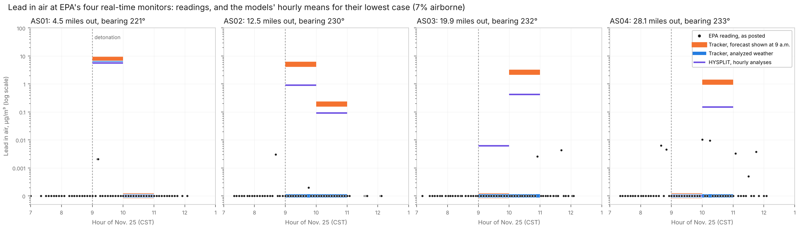

# The Nov. 25, 2026 detonation at the Iowa Army Ammunition Plant: a first comparison

**The Iowa Lead Tracker's forecast against the analyzed weather, NOAA's HYSPLIT, the U.S.
Army's plume map, and EPA's real-time air monitors**

> **Unofficial.** This is a screening model run by a private citizen, not from the Army or
> any government agency. Don't use it to decide if you're safe; follow official
> instructions. HYSPLIT results here are this project's runs of NOAA's public software and
> are not official NOAA products. The model maps below are estimates for assumed releases.
> They are not measurements, and nothing here says how much lead reached any place.

**Status.** Second draft, Nov. 25, 2026, about noon CST, three hours after the detonation.
It replaces a first draft that an independent review found wrong in several places
([what changed](#what-changed-since-the-first-draft)). It covers the first two hours on
analyzed weather; later hours, the Army's results and all lab sampling are still to come.
It was drafted with an AI coding assistant, and the first draft was reviewed by a
separate AI referee ([`reviews/`](reviews/referee-report-1.md)); the maintainer has not
yet checked every number by hand.

Contents: [Summary](#summary) · [1. What this can and can't say](#1-what-this-can-and-cant-say) ·
[2. The event](#2-the-event) · [3. Data and methods](#3-data-and-methods) ·
[4. The weather](#4-the-weather-forecast-against-what-was-analyzed-and-observed) ·
[5. The models](#5-the-models-on-the-same-weather) · [6. EPA's monitors](#6-epas-real-time-monitors) ·
[7. The Army's map](#7-the-armys-map) · [8. What it means for the tracker](#8-what-it-means-for-the-tracker) ·
[9. Next steps](#9-next-steps) · [Reproducing](#reproducing) · [References](#references)

## Summary

The Army says it detonated the lead azide stockpile at the Iowa Army Ammunition Plant at
9 a.m. CST on Wednesday, Nov. 25, 2026 (KCRG 2026b). For a week before, the Iowa Lead
Tracker published forecast maps of where the lead could go under four assumed releases.
Three hours after the detonation, four things can be compared with those maps.

1. **EPA's four real-time lead monitors read almost nothing.** They sit 4.5 to 28 miles
   southwest of the plant. Through 12:05 p.m. they posted 150 readings after the
   detonation; 140 were zero and the highest was 0.010 µg/m³, about the size of readings
   the same instruments posted before the detonation (up to 0.006). At the nearest monitor the
   tracker's lowest case (7% of the lead airborne as fine dust) predicted an hourly mean
   of 5.8 to 7.6 µg/m³, and HYSPLIT 5.6. The highest single reading there was
   0.002 µg/m³, roughly 3,000 times lower. Either far less fine lead became airborne than
   any case assumed, or the cloud passed above or beside these four points, or the
   instruments missed it. The data in hand can't tell these apart. No lab results from
   air filters, soil or surfaces were public.
2. **The wind forecast was right in speed and 9–18° off in direction where it mattered.**
   Matched hour for hour with NOAA's HRRR analysis, the forecast wind in the lowest 250 m
   came from 9–18° too far east at 9, 10 and 11 a.m.; speeds agreed within 0.7 m/s. The
   five surface stations within 16 miles averaged 28° and 31° at 9 and 10 a.m., against
   the forecast's 42° and 44°. Rerun on the analyzed weather, the tracker's own cloud
   heads toward 213–220° instead of 229–231°, and the two footprints barely overlap
   (4–14% by intersection over union).
3. **On the same weather the tracker's near-field zones are larger than HYSPLIT's.** After
   two hours its 100 µg/ft² zone is 1.7 times HYSPLIT's in the 26% case and 2.8 times in
   the 100% case, and its highest hourly air from 1.5 to 12 miles out is 2 to 3.6 times
   HYSPLIT's. The two models' paths differ by about 9° (213° against 222°), and their
   zones overlap by a quarter to a third.
4. **The Army's map, made from a forecast a day earlier, points 241° and puts far more
   lead near the plant.** Its 100 µg/ft² zone covers 27 sq mi and reaches 14 miles; the
   tracker's, for the same 26%, covers 2 sq mi and reaches 4. Coarser particles or
   faster deposition in the tracker reach 9 to 19 sq mi, so they could explain part of
   the gap. The Army hasn't published its model's inputs.

## 1. What this can and can't say

- **Two hours of analyzed weather.** HYSPLIT runs here end at 11 a.m. Anything about later
  hours is the tracker alone.
- **No lead measurements beyond four instruments.** EPA lists 43 sampling sites; only the
  four real-time monitors have public results, and the layer names neither the substance
  nor a detection limit. Filter, soil, wipe and water results will be the test of what
  landed. Nothing here estimates what was released.
- **The "analyzed weather" is a model product.** NOAA's HRRR analysis blends observations
  into HRRR's own one-hour forecast. It is not independent of the HRRR forecast being
  checked, nor of the airport reports and radar winds it takes in, so agreement with it
  is a lower bound on forecast error. There is no wind observation at the plant.
- **HYSPLIT is a reference model, not the truth.** Here it runs on pressure-level data
  every 25 hPa without surface heat fluxes, with fixed deposition speeds.
- **The Army map is read from two JPEG images** of a map dated the morning before the
  detonation. Its position is good to a few miles; its model, particle sizes and source
  are unknown.
- **Zone edges are not boundaries.** A place outside a modeled zone may still get lead,
  and a place inside it may get none you could measure.

## 2. The event

The Army's notice on the morning of Nov. 25 said it would detonate at 9:00 a.m. CST and
update the public by 11 a.m. (McFate 2026b). KCRG and the Associated Press reported that
the Army "intentionally blew up the nation's entire stockpile of lead azide ... at 9 a.m.
on Wednesday," 68 barrels in bunkers, and that video "showed two white plumes rolling over
the detonation site before the clouds quickly dissipated" (KCRG 2026a). Two hours later
the Army said the detonation was complete and that "the EPA has detected zero lead"
(KCRG 2026b). We take 9:00 a.m. as the release time. A start a few minutes off would not
change the hourly comparisons; a start an hour off would.

EPA's Nov. 25 release says it collected 1,216 samples beforehand, that "pre-detonation
sampling is detecting no lead currently in the air," and that during the event "EPA's air
monitoring will be reporting data points every 5 minutes" in a public viewer (EPA 2026a,
2026b). The Army's permit application describes its own air sampling: 24-hour filter
samples at five on-site and five off-site locations, sent to a lab, and five "response"
samples during the event, read in the field by X-ray fluorescence (U.S. Army 2026b). None of those
results were public.

## 3. Data and methods

### 3.1 The forecast the site showed

The site's maps at 9 a.m. came from weather pulled at 8:36 a.m. CST (commit `c9f8e59`; the
commit deployed at 9:00, `fd17b63`, has the same forecast file). We rebuilt the site from
that commit, which replays the saved forecast, and used its 9 a.m. maps for the 7%, 26%
and 100% cases. HRRR was the model shown. Open-Meteo doesn't report which HRRR run a
response came from, so the forecast's lead time is not known; it was at most a few hours.
The tracker reads HRRR at 25 points about 115 miles apart and interpolates between them.

### 3.2 The analyzed weather

NOAA's hourly HRRR analyses for 9, 10 and 11 a.m. (15, 16 and 17 UTC), on pressure levels,
from NOAA's archive on AWS, converted to HYSPLIT's format with HYSPLIT's `api2arl_v4`
([`blast-day/nowcast_hrrr.sh`](../../../validation/hysplit-backtest/blast-day/README.md)).
HRRR assimilates surface stations, radar, aircraft, balloons and satellites each hour
(Benjamin et al. 2016; Dowell et al. 2022).

### 3.3 Observations

All retrieved Nov. 25 and saved in [`data/obs/`](data/obs):

- reports from 18 airports within 85 miles and three Iowa DOT road weather stations (Iowa
  Environmental Mesonet). Airport winds are 2-minute means reported to 10° and 1 kt;
- the Davenport NWS radar's wind profile (VAD) at 9:00 and 9:55 a.m., 65 miles northeast;
- the 6 a.m. balloons at Davenport and Lincoln, Ill., 65 and 111 miles away;
- hourly sunshine at the Iowa State soil moisture station at Crawfordsville, 28 miles
  north-northwest;
- EPA AirNow hourly PM2.5, PM10 and wind for monitors within 160 miles.

### 3.4 The tracker on analyzed weather

To separate forecast error from model differences, we reran the tracker at 11:50 a.m. on
the HRRR that Open-Meteo then served, in which the hours through 11 a.m. come from runs
started at or after those hours and later hours are forecasts from the newest run. The
weather is saved in `data/met_hrrr_asof_20261125_1750Z.json`, so the reruns need no
network. Settings are the site's, with HRRR only. This is HRRR at the tracker's 25 points
with its 10 m, 80 m and eight pressure-level winds; HYSPLIT reads the analyses on the full
3 km grid. The two "analyzed" inputs are close but not identical.

### 3.5 HYSPLIT

HYSPLIT 5.4.2 (Stein et al. 2015), public Linux build, set up as in the
[back-test](../../../validation/hysplit-backtest/README.md): a vertical line source from
10 m to the cloud top (251 m) at the plant, 3,130 kg of lead (100%) in four sizes (0.3, 1,
3 and 10 µm at 9,500 kg/m³) released over 6 minutes from 9:00 a.m.; 200,000 particles;
hourly means in the 0–10 m layer and deposition on a 0.005° grid. The tracker starts from
five layers with a 63 m initial spread, so the two differ in the first cells. Dry
deposition speeds are fixed per size: the tracker's Zhang et al. (2001) values at a 5 m/s
reference wind (0.16, 0.10, 0.32 and 3.66 cm/s), or its Emerson et al. (2020) values. The
tracker itself varies them with the wind each hour. Lower releases are the same run
scaled, which is exact. The 10 µm size holds 10% of the mass and makes about two-thirds
of HYSPLIT's first-hour deposition (the referee's count), so the near field depends on
the coarse end of the assumed sizes.

The runs use the analyses for 9, 10 and 11 a.m. with nothing held fixed, so they end at
11 a.m. The public HYSPLIT build refuses forecast weather without NOAA registration. As a
check on the setup, this build reproduced the back-test's Monday case (597 lb deposited
against 595 published).

### 3.6 What is compared

- **Hourly mean air** is the clock-hour mean at the ground: the tracker's `conc` field and
  HYSPLIT's 0–10 m layer. (The first draft used the tracker's `m60` field, the highest
  running 60-minute mean, which is not an hourly mean after the first hour.) "Hour 1" is
  9 to 10 a.m.
- **Snapshots** are the tracker's field at the end of an hour (`snap`), for comparison with
  the Army's "+1, +4, +8 hr" shapes.
- **Zones** are reported with area, farthest distance and the bearing of the far end, and
  with **overlap**: intersection over union on a common 0.005° grid. Two zones of equal
  area that point 10° apart overlap little.
- **Highest air by distance** compares the models' maxima in rings (1.5–3, 3–6, 6–12 and
  12–25 miles). The single highest cell sits within half a mile of the source and depends
  on cell size and the initial cloud, so it isn't compared.
- Tracker cells are 0.66–0.69 km on a side; HYSPLIT's 0.005° cells are about 0.56 by
  0.42 km. Tracker fields are stored in steps of about 8.5%.

Levels: 5 and 100 µg/ft² on the ground and 0.18 µg/m³ in air are the lines on the Army's
map (it labels them EPA's dust-lead levels for floors and window sills and the "lead air
sampling method detection limit"); 40 µg/ft² and DOE's PAC-1 (32 µg/m³ for one hour) are
the tracker's other lines. Sources are in the scenario README
([Threat-zone levels](../README.md#threat-zone-levels-research-notes)). These are indoor
dust and emergency-planning levels used here as map lines, not outdoor health limits.

### 3.7 The Army's map

Two 1200 × 675 JPEG images of the Army's "Mitigated 0.26" advisory, stamped "Issued Nov.
24, 2026" and "a/o 240630NOV26", supplied by the maintainer ([`data/army/`](data/army)).
The scenario README describes a PDF of the same advisory stamped 240848NOV26; we haven't
compared the two, and the Army said it would update its maps before and after the
detonation. So this is a forecast made about 26 hours ahead.

`scripts/army_map.py` selects the shaded pixels by hue. Distances use the map's scale bar
(2.52 px per mile). The source is taken to be the upwind tip of the plume itself, which
starts inside the magenta box, 2.4 miles west-northwest of the box's center (the first
draft measured from the center). North is assumed up. Checks: the traced zones come to
142 and 26 sq mi against the 148 and 27 printed on the map; a fit through ten labeled
cities gives a scale of 2.58 px per mile and north within 2° of up, but places the plant
8 miles north of the tip with 7 px residuals, so the base map can't be georeferenced from
this image to better than several miles. We give results from the tip and show how they
change from the box center. Areas quoted are the printed ones.

### 3.8 EPA's data

The two public layers behind EPA's "Iowa Army Ammunition Plant Response Data Viewer"
(EPA 2026c), downloaded at 12:07 p.m. CST ([`data/epa/`](data/epa/README.md)): 232
records from four stations labeled "Xact" (the name of a commercial instrument that
measures metals in air in near-real time), with a time, a concentration in µg/m³ and a
station; and 43 sampling sites with the instruments at each (dust monitors, gas monitors,
filter cassettes, canisters). The Xact layer doesn't name the substance or a detection
limit; EPA's release describes it as air monitoring for lead. Timestamps run to within
minutes of the download, so we read them as UTC. These are EPA's preliminary values as
posted.

## 4. The weather: forecast against what was analyzed and observed

*Table 1. Wind at the plant: forecast minus HRRR analysis at the same hour. Positive
direction error means the forecast wind came from farther east (clockwise). Heights above
ground. The cloud starts between the ground and 251 m.*

| Level | 9 a.m.: forecast / analysis | error | 10 a.m.: forecast / analysis | error | 11 a.m.: forecast / analysis | error |
|---|---|---|---|---|---|---|
| 10 m | 3.7 m/s, 42° / 3.7, 24° | +18° | 4.6, 44° / 5.0, 29° | +15° | 5.3, 53° / 5.5, 38° | +15° |
| about 40 m (1000 hPa) | 4.9, 43° / 4.6, 30° | +13° | 5.6, 45° / 6.0, 32° | +13° | 6.2, 53° / 6.6, 41° | +12° |
| about 240 m (975 hPa) | 7.8, 57° / 7.2, 48° | +9° | 7.2, 50° / 7.2, 35° | +15° | 7.1, 54° / 7.6, 43° | +11° |
| about 450 m (950 hPa) | 8.2, 60° / 8.3, 55° | +5° | 8.6, 57° / 8.7, 46° | +11° | 8.3, 54° / 8.2, 47° | +7° |
| about 660 m (925 hPa) | 9.4, 58° / 9.3, 60° | −2° | 10.3, 60° / 9.6, 55° | +5° | 8.9, 65° / 9.2, 55° | +10° |
| about 870 m (900 hPa) | 10.1, 63° / 10.5, 65° | −2° | 10.9, 65° / 10.3, 61° | +4° | 9.9, 72° / 10.2, 63° | +9° |

Speeds agree within 0.7 m/s at every level and hour. Direction does not: through the
layer the cloud starts in, the forecast wind came from 9–18° too far east in all three
hours, and by 11 a.m. the error reached up to 870 m. The forecast also had the tracker's
80 m wind at 5.1 m/s from 44° at 9 a.m.; the analysis has no 80 m level, but its 40 m and
240 m winds (30° and 48°) put it near 33°. A wind from farther north carries the lead
farther south.

*Table 2. Surface wind at the five stations within 16 miles, observed (reports within 20
minutes of the hour, vector-averaged), with the forecast and analysis at the plant.*

| | 9 a.m. | 10 a.m. |
|---|---|---|
| Burlington airport, 8 mi ESE | 050°, 8 kt | 050°, 13 kt |
| Burlington road station, 9 mi E | 022°, 7 kt | 033°, 11 kt |
| Fort Madison airport, 12 mi SSW | 010°, 9 kt | 018°, 12 kt |
| Mount Pleasant airport, 15 mi WNW | 045°, 7 kt | 040°, 8 kt |
| Mount Pleasant road station, 16 mi WNW | 355°, 3 kt | 349°, 5 kt |
| **Vector mean of the five** | **28°** | **31°** |
| Forecast at the plant, 10 m | 42°, 7 kt | 44°, 9 kt |
| HRRR analysis at the plant, 10 m | 24°, 7 kt | 29°, 10 kt |

The stations don't depend on any model, and they side with the analysis: the forecast's
surface wind was about 13° too far east. They also disagree with each other by 30° to
60°, with the two stations nearest the cloud's path at the extremes (Burlington 050°,
Fort Madison 010°–018°). The Mount Pleasant road station reads half the airport's wind
4 miles away; dropping it moves the mean to 32° and 35°.

Across all 21 stations within 85 miles, the analysis minus the observed direction
averages +3° at 9 a.m. and +2° at 10 a.m., with a mean absolute difference of 12° and 8°
and no speed bias ([`data/station_vs_hrrr.json`](data/station_vs_hrrr.json)). Since HRRR
assimilates the airports, that mostly shows the assimilation worked; the three road
stations, which it may not use, differ by +20° and +14° on average. Airport winds are
reported to the nearest 10°, so differences under about 10° at one station mean little.

Aloft, the only measurement is the Davenport radar, 65 miles away, and it is noisy
(Table 3). Directions agree with the analysis within about 20° at seven of eight levels;
speeds differ by up to about 5 m/s, which is the size of the radar's own scatter.

*Table 3. Wind above the Davenport radar at 9:00 a.m. (VAD), with the HRRR analysis at the
radar on its nearest level. RMS is the radar's own fit error.*

| Height above radar | Radar | RMS | HRRR analysis |
|---|---|---|---|
| 197 m | 8.2 m/s from 061° | 3.0 m/s | 7.8 m/s from 062° (247 m) |
| 319 m | 13.4 from 092° | 4.8 | |
| 380 m | 10.3 from 072° | 3.2 | 10.2 from 074° (454 m) |
| 532 m | 13.4 from 061° | 4.7 | |
| 685 m | 12.3 from 073° | 2.6 | 12.0 from 081° (666 m) |
| 746 m | 16.5 from 077° | 2.9 | |
| 989 m | 13.4 from 077° | 2.0 | 12.9 from 082° (881 m), 12.6 from 082° (1,102 m) |
| 1,020 m | 11.8 from 077° | 1.2 | |

Other evidence is mixed. The 6 a.m. balloons had surface inversions and winds turning
from 15°–55° at the ground to 85°–110° near 1 km, three hours before and 65–111 miles
from the plant. The AirNow monitor at Lake Sugema, 40 miles west-southwest, reported
hourly winds from 37° and 43° for the hours beginning 9 and 10 a.m., close to the
forecast's direction, not the analysis's.

Sky and sunshine. The forecast called for 100% cloud. Airports near the plant
(Burlington, Fort Madison, Mount Pleasant, Keokuk) reported no cloud below 12,000 ft from
8:30 to 10 a.m., which doesn't rule out higher cloud; to the west, Fairfield was overcast
at 3,100 ft from 8:55 to 9:55, Oskaloosa broken to overcast at 3,800 ft until about 9:15,
and Ottumwa, Iowa City and Washington had scattered or few clouds near 3,500 ft. The
tracker sets turbulence from the forecast sunshine, not the cloud label: it used
187 W/m² for the first hour, interpolated from the forecast's hourly means (115 W/m² for
8–9 a.m. and 259 for 9–10). Crawfordsville measured 686 kJ/m² in the hour stamped
10 a.m., or 191 W/m²; if that stamp marks the end of the hour, the forecast had about a
third more sun than was measured there. The tracker treated the air as neutral (class D)
with a mixing height of about 440 m in the first hour. The analysis's own profile is
stably stratified between 40 and 240 m at 9 a.m. Whether the cloud mixed to the ground as
fast as either model assumes is an open question that bears directly on section 6.

## 5. The models on the same weather

*Table 4. 26% of the lead airborne (1,794 lb), after 2 hours (11 a.m.). Zones: area /
farthest distance / bearing of the far end. The tracker's zones at 100 and 40 µg/ft² are
complete by then; its 5 µg/ft² zone grows to 90 sq mi (forecast) and 104 sq mi (analyzed)
by 8 hours.*

| | Tracker, forecast | Tracker, analyzed weather | HYSPLIT, analyses | HYSPLIT, Emerson speeds |
|---|---|---|---|---|
| Ground ≥ 100 µg/ft² | 2.2 sq mi / 4.2 mi / 225° | 2.0 / 3.7 / 207° | 1.2 / 2.3 / 220° | 1.6 / 2.7 / 220° |
| Ground ≥ 40 µg/ft² | 9.1 / 9.6 / 228° | 8.7 / 10.5 / 211° | 3.2 / 4.2 / 222° | 4.4 / 5.1 / 221° |
| Ground ≥ 5 µg/ft² | 75 / 29 / 232° | 83 / 27 / 218° | 66 / 24 / 224° | 93 / 28 / 224° |
| Lead on the ground | 115 lb | 125 lb | 93 lb | 120 lb |
| Highest hourly air, hour 1: 1.5–3 mi | 170 µg/m³ | 167 | 82 | 84 |
| 3–6 mi | 88 | 87 | 38 | 37 |
| 6–12 mi | 42 | 53 | 15 | 15 |
| 12–25 mi | 20 | 17 | 7.7 | 7.7 |
| Hourly air ≥ 32 µg/m³ (PAC-1), farthest | 8.7 mi | 9.6 mi | 3.2 mi | 3.2 mi |
| Center of hourly mean air, hour 1 | 5.6 mi at 229° | 5.6 mi at 213° | 6.0 mi at 222° | 6.0 mi at 222° |
| Center, hour 2 | 22 mi at 230° | 20 mi at 215° | 23 mi at 223° | 23 mi at 223° |

*Table 5. Overlap of the zones after 2 hours (intersection over union; 1 = identical,
0 = no overlap).*

| Pair | Case | ≥ 100 | ≥ 40 | ≥ 5 µg/ft² |
|---|---|---|---|---|
| Tracker forecast vs tracker on analyzed weather | 26% | 0.14 | 0.11 | 0.04 |
| | 100% | 0.13 | 0.06 | 0.07 |
| Tracker on analyzed weather vs HYSPLIT | 26% | 0.35 | 0.24 | 0.25 |
| | 100% | 0.30 | 0.21 | 0.42 |
| Tracker forecast vs HYSPLIT | 26% | 0.19 | 0.25 | 0.26 |
| | 100% | 0.23 | 0.24 | 0.42 |


*Figure 1. Modeled lead on the ground for the 26% case: 5 µg/ft² (left) and 100 µg/ft²
(right, enlarged). Tracker zones are after 8 hours; HYSPLIT's after 2. The Army's zones
are traced from its map and placed from the plume's tip. Diamonds are EPA's four real-time
monitors; open squares are EPA's other sampling sites, with no public results.*


*Figure 2. Modeled hourly mean lead in air at the ground, 0.18 µg/m³ or more, 26% case,
for the two hours with analyses. HYSPLIT's outline is smoothed by about 1 km for display;
at this level it rests on a handful of particles per cell.*

The forecast error moved the tracker's own map. On analyzed weather its cloud leaves
along 207°–213° and bends to about 220°, 14° to 18° south of the forecast map's
225°–232°. The zones keep their size and length but not their place: the forecast and
analyzed-weather footprints share 4% to 14% of their combined area. At 15 miles a 15°
shift is 4 miles, wider than the 5 µg/ft² zone.

On the same weather the tracker puts more lead near the plant than HYSPLIT. Its
100 µg/ft² zone is 1.7 times HYSPLIT's in area (2.0 against 1.2 sq mi) and its 40 µg/ft²
zone 2.7 times. With all the lead airborne the 100 µg/ft² zones are 16 and 5.8 sq mi, a
factor of 2.8. Its highest hourly air in each ring from 1.5 to 25 miles is 2.0 to 3.6
times HYSPLIT's, and PAC-1 reaches 9.6 miles against 3.2. This is the direction the
back-tests found in neutral daytime air (tracker distances 0.8 to 1.9 times HYSPLIT's),
and larger than it found ([`TURBULENCE.md`](../../../TURBULENCE.md)). With Emerson
deposition speeds HYSPLIT's zones grow by about 40% and the gap narrows. The 5 µg/ft² zones are closer in size (83 against 66 sq mi).

The models also disagree on direction by about 9°: the tracker's ground-level cloud
follows the 10 m and 80 m winds (213°), HYSPLIT's 0–10 m air sits at 222°. With the wind
turning 24° between 10 m and 240 m, how fast each model mixes the upper part of the cloud
down decides the ground-level path. Their zones overlap by a quarter to a third. The
referee's check with HYSPLIT's `vmixing` tool suggests HYSPLIT diagnosed much stronger
turbulence from this weather file than the tracker assumed; we haven't repeated that.

## 6. EPA's real-time monitors

*Table 6. EPA's four real-time monitors, as posted through 12:07 p.m. CST, and the
models' hourly mean air at each for the lowest case (7% of the lead airborne). Multiply
model values by 3.7 for the 26% case and by 14 for 100%.*

| Monitor | From the plant | Readings after 9 a.m. | Not zero | Highest | Highest before 9 a.m. | Tracker, forecast (h1 / h2) | Tracker, analyzed (h1 / h2) | HYSPLIT (h1 / h2) |
|---|---|---|---|---|---|---|---|---|
| AS01 | 4.5 mi at 221° | 38 | 2 | 0.0021 µg/m³ | 0 | 7.6 / 0 µg/m³ | 5.8 / 0 | 5.6 / 0 |
| AS02 | 12.5 mi at 230° | 37 | 1 | 0.0002 | 0.0030 | 5.0 / 0.19 | 0 / 0 | 0.91 / 0.09 |
| AS03 | 19.9 mi at 232° | 38 | 2 | 0.0043 | 0 | 0 / 2.6 | 0 / 0 | 0.006 / 0.42 |
| AS04 | 28.1 mi at 233° | 37 | 5 | 0.0102 | 0.0063 | 0 / 1.2 | 0 / 0 | 0 / 0.15 |



*Figure 3. EPA's readings (dots; zeros on the bottom line) and the models' hourly means
for the 7% case at each monitor, on a logarithmic scale.*

The readings are flat. Of 150 readings after the detonation, 140 are zero. The ten that
aren't range from 0.0002 to 0.010 µg/m³, and two of the four monitors posted readings of
0.003 to 0.006 µg/m³ before the detonation. Nothing in the series marks a cloud arriving
or leaving.

At AS01 all three model runs agree, and all three are far above the readings. AS01 is
4.5 miles out at 221°, inside the modeled cloud on the forecast and on analyzed weather
in both models. For the lowest case they give hourly means of 5.6 to 7.6 µg/m³ in the
first hour. The highest single 5-minute reading there, at 9:10 a.m., was 0.0021 µg/m³:
about 2,700 to 3,600 times lower, and lower still against the 26% and 100% cases.

At the three farther monitors the models disagree with each other. They lie at 230°–233°,
along the forecast's path. On analyzed weather the tracker's cloud passes south of all
three and predicts nothing there; HYSPLIT, whose path is 9° farther west, still predicts
0.09 to 0.9 µg/m³ for the lowest case, 15 to 4,600 times the highest readings there. So
only AS01 tests all three runs, and it tests them unequally: it sits at 92% of HYSPLIT's
highest value at that distance, but on the flank of the tracker's cloud (44% of the
highest value on the forecast, 32% on analyzed weather).

What could explain AS01:

1. **Much less fine lead became airborne than any case assumed.** The Army said its
   barriers, water and foam were built to do that, and it reported the result as zero
   (KCRG 2026b). If the cloud did cross AS01 at the ground as modeled, the fine airborne
   share was thousands of times smaller than 7%. This is the simplest reading, but the
   monitors alone can't establish it.
2. **The cloud passed over or beside the monitor.** Both models spread the cloud from the
   ground to 251 m at the start and mix it in neutral air. The analysis shows a stable
   layer between 40 and 240 m at 9 a.m.; a buoyant cloud that rose into or above it could
   cross 4.5 miles without reaching the ground. News video showed plumes that "quickly
   dissipated" (KCRG 2026a). The direction is also uncertain by 10° or more (section 4).
   At 4.5 miles the modeled cloud is 1 to 2.5 miles wide (to a tenth of its peak) and
   10° is 0.8 mile, so a path a little farther south than the analyzed one would miss
   AS01 at the ground.
3. **The instruments or the posting missed it.** The layer gives no detection limit,
   sampling interval or status flags. Zeros are posted as exact zeros, which suggests
   values below some limit are set to zero. We don't know what a 5-minute reading
   represents.

What would tell these apart: EPA's filter samples at the 43 sites (which collect over
hours and are analyzed in a lab), dust-monitor records, the Army's on-site samples and
hourly balloons, and soil and wipe sampling between about 205° and 245° within 15 miles,
which spans every model run here and the Army's map. Five of EPA's sampling sites lie
between 190° and 215°, the side the analyzed wind favors; none of the four real-time
monitors do.

Regional particle monitors add nothing yet. AirNow has no PM monitor within 39 miles.
Readings within 160 miles ran 4 to 12 µg/m³ of PM2.5 from 5 to 11 a.m., an ordinary range.
All are upwind or off to the side. The one to the southwest, Lake Sugema (40 miles at
257°), is roughly 20 miles north of the modeled path at that distance and had posted a
single PM2.5 value (10 µg/m³ for 9–10 a.m.). Lead at the Army map's 0.18 µg/m³ line would
be about 2% of that background, so PM2.5 can't show it.

## 7. The Army's map

*Table 7. The Army's "Mitigated 0.26" map (a forecast from the morning of Nov. 24)
against the tracker's 26% case. Army distances are from the plume's tip; values from the
box center are in parentheses where they differ by more than a mile or 3°. Tracker ground
zones are after 8 hours.*

| | Army map | Tracker, forecast | Tracker, analyzed weather |
|---|---|---|---|
| Ground ≥ 100 µg/ft²: area | 27 sq mi (printed) | 2.2 sq mi | 2.0 sq mi |
| farthest, bearing | 14 mi (15), 240° (247°) | 4.2 mi, 225° | 3.7 mi, 207° |
| Ground ≥ 5 µg/ft²: area | 148 sq mi (printed) | 90 sq mi | 104 sq mi |
| farthest, bearing | 36 mi (38), 240° (243°) | 35 mi, 231° | 34 mi, 219° |
| Plume axis | 241° | | |
| Overlap of the 5 µg/ft² zones with the Army's | | 0.14 (0.00) | 0.01 (0.00) |
| Air ≥ 0.18 µg/m³ at +1 h: extent, center | 4–7 mi, 5.7 mi at 243° (258°) | 11–17 mi, 14 mi at 230° | 10–16 mi, 13 mi at 214° |
| at +4 h | 10–67 mi, 41 mi at 238° | 55–78 mi, 66 mi at 230° | 50–72 mi, 61 mi at 221° |
| at +8 h | 89–106 mi, 97 mi at 227° | 128–153 mi, 140 mi at 225° | 124–150 mi, 137 mi at 219° |


*Figure 4. Lead in air at one moment, 0.18 µg/m³ or more: the tracker's snapshots 1, 4
and 8 hours after the detonation and the Army map's three shapes. We read the Army's
smallest shape as +1 h, the long chain as +4 h and the far shape as +8 h; the map's
labels sit beside them but don't mark them.*

The Army's plume points 241°, 10° west of the tracker's forecast and 22° to 34° west of
the tracker on analyzed weather. Its 5 µg/ft² zone is as long as the tracker's (36 against
34–35 miles) and about half again the area, and overlaps the forecast zone by 14% and the
analyzed-weather zone hardly at all. A forecast made a day ahead explains a direction
difference of this size without any difference between the models.

The Army's cloud is slower from the start. Its +1 h shape is 4 to 7 miles out where the
tracker's is 10 to 17; at +4 and +8 h its centers are 41 and 97 miles out against 61–66
and 137–140, about two-thirds of the tracker's speed. At +4 h its cloud still reaches back
to 10 miles from the plant. That pattern suggests a cloud that stays lower, in slower
wind, or a release that lasts longer, though a slower wind forecast would do the same.

The Army's 100 µg/ft² zone is 12 to 13 times the tracker's in area and reaches 14 miles
against 4. Table 8 shows what the tracker gives for the same 26% when its assumptions
change.

*Table 8. Tracker on analyzed weather, 26% airborne, after 8 hours, under other
assumptions.*

| Run | ≥ 100 µg/ft² | ≥ 5 µg/ft² | Lead on the ground within 15 mi |
|---|---|---|---|
| As published: fine sizes (0.3–10 µm), Zhang deposition | 2.0 sq mi, 3.7 mi | 104 sq mi, 34 mi | 89 lb |
| Sizes 1–30 µm (`mixed`) | 11 sq mi, 11 mi | 192 sq mi, 45 mi | 606 lb |
| Sizes 10–100 µm (`soil-bound`) | 19 sq mi, 13 mi | 253 sq mi, 50 mi | 1,028 lb |
| Half fine, half 30 and 100 µm | 14 sq mi, 11 mi | 177 sq mi, 42 mi | 777 lb |
| Fine sizes, deposition speed +1 cm/s | 9.4 sq mi, 11 mi | 328 sq mi, 60 mi | 254 lb |
| Fine sizes, Emerson deposition | 2.9 sq mi, 5.1 mi | 145 sq mi, 41 mi | 113 lb |
| Fine sizes, cloud top 151 m instead of 251 m | 3.7 sq mi, 7.0 mi | 83 sq mi, 33 mi | 103 lb |
| **Army map** | **27 sq mi, 14 mi** | **148 sq mi, 36 mi** | not given |

Coarser particles move the tracker most of the way: an all-coarse release reaches 19 sq mi
and 13 miles. A faster deposition speed does about half as much. Neither reproduces the
Army's shape. Every variant that enlarges the 100 µg/ft² zone more than four-fold also enlarges the
5 µg/ft² zone to 177–328 sq mi, past the Army's 148; the Army's two areas differ by a
factor of 5.5, the tracker's by 13 to 52. Other explanations are open: the Army's lines may
be a conservative percentile or a probability, not a mean; its source may be lower or
last longer, as the slow cloud suggests; its deposition scheme or accumulation period may
differ; water and foam may be modeled as wet removal near the source. The first draft
called particle size the likeliest cause. The runs here support it as one contributor and
nothing more.

## 8. What it means for the tracker

- **Direction.** The published map pointed about 15° too far west of where the analyzed
  wind and the nearby stations put the low-level flow. The site showed a ±5° direction
  spread and three other weather models; whether those covered the analyzed path is not
  yet checked. In the back-test the tracker's path matched HYSPLIT's within about 5° in daytime, but
  both models ran on archived weather there, so it never tested the forecast. A forecast error of this size should be
  expected and shown.
- **Amounts near the plant.** On the same weather the tracker's high zones are about 2 to
  3 times HYSPLIT's. For a screening map that is the cautious side, and larger than the
  back-test found.
- **The release assumptions.** EPA's four monitors read thousands of times below even the
  lowest case at the one monitor all model runs agree on. If lab samples confirm that, the
  cases, built from blasting-cap tests and handbook rules for unmitigated detonations,
  were far too high for this mitigated one. If the cloud instead passed overhead, the
  models' assumption that it starts mixed to the ground is the thing to fix. Either way
  the site's current statement, to wait for official results, stands.
- **Coarse particles.** The published cases put all airborne lead in fine sizes. Table 8
  shows that a coarse share changes the lead on the ground within 15 miles by a factor of
  7 to 12. The tracker should show a coarse case.

## 9. Next steps

- Extend HYSPLIT hour by hour as analyses post, then rerun on NOAA ARL's archived
  native-level HRRR (the 6–11 a.m. file is due about 12:40 p.m., noon–5 p.m. about 6:40).
- Check whether the site's direction spread and other weather models covered the
  analyzed path.
- Add EPA's filter, soil and wipe results, the Army's samples, balloons and its final
  map as they are published; ask EPA for the monitors' detection limit and sampling
  interval.
- Repeat the comparison with HYSPLIT's turbulence diagnostics and with the tracker's
  stability taken from the analysis's profile.
- Get the Army's map as a PDF with a known projection, and its model inputs.

## Reproducing

From the repository root, with HYSPLIT 5.4.2 (`HYSPLIT_DIR`), ecCodes, and the packages in
`requirements.txt` plus `matplotlib`, `scipy`, `Pillow` and (for the radar file) `metpy`:

```bash
HYSPLIT_DIR=/path/to/hysplit scenarios/iowa-aap-lead-azide/postmortem/scripts/reproduce.sh /tmp/postmortem
```

It rebuilds the site's maps from the 9 a.m. forecast (`c9f8e59`), reruns the tracker on
the saved analyzed weather, downloads and converts the HRRR analyses, runs HYSPLIT
(`blast-day/2026-11-25-9am-{zhang,emerson}-analyses.CONTROL`), and writes
`data/compare.json`, `data/army_map.json`, `data/forecast_vs_analysis.json`,
`data/station_vs_hrrr.json` and the figures. Every number in the tables is in those files.

| Script | Does |
|---|---|
| `lib.py` | readers for the tracker's maps and HYSPLIT's output; zones, centers, overlap |
| `compare.py` | Tables 4–6 and 8 |
| `army_map.py` | traces and measures the Army's map; Table 7 |
| `forecast_vs_analysis.py` | Table 1 |
| `station_vs_hrrr.py` | Table 2 and the 21-station comparison |
| `vad_decode.py`, `airnow_extract.py`, `epa_fetch.py` | the radar, AirNow and EPA downloads |
| `run_tracker.sh` | the tracker on analyzed weather and Table 8's runs |
| `figure.py` | Figures 1–4 |

`data/obs/` and `data/epa/` hold the observations as extracted on Nov. 25; EPA's and
AirNow's files change as new data post. `data/draft1/` holds the first draft's numbers.

## What changed since the first draft

The first draft (commit `1fb9452`) was reviewed the same day
([`reviews/referee-report-1.md`](reviews/referee-report-1.md)). Its main errors, all
corrected here:

- It read the tracker's `m60` field as an hourly mean, which made the tracker's cloud
  look slower and wider after the first hour.
- It compared a forecast for 9:30 a.m. with analyses for 9:00 and 10:00 and concluded the
  forecast "held up." Matched in time the forecast was 9–18° off in the lowest 250 m.
- Its 8-hour HYSPLIT run held the 9 a.m. weather fixed, and its near-field agreement
  ("2.2 vs 2.3 sq mi") came from that run. On real hourly analyses HYSPLIT's zone is half
  that size.
- It compared areas without overlap, measured the Army's map from the wrong point with
  too small an error bar, and called particle size the likeliest reason for the Army's
  larger zone without testing it.
- It said nearby stations reported no low cloud; Fairfield and Oskaloosa did.
- It had no EPA data.

## References

- Benjamin, S. G., and Coauthors, 2016: A North American hourly assimilation and model
  forecast cycle: The Rapid Refresh. *Mon. Wea. Rev.*, **144**, 1669–1694,
  doi:10.1175/MWR-D-15-0242.1.
- Dowell, D. C., and Coauthors, 2022: The High-Resolution Rapid Refresh (HRRR): An hourly
  updating convection-allowing forecast model. Part I: Motivation and system description.
  *Wea. Forecasting*, **37**, 1371–1395, doi:10.1175/WAF-D-21-0151.1.
- Emerson, E. W., and Coauthors, 2020: Revisiting particle dry deposition and its role in
  radiative effect estimates. *Proc. Natl. Acad. Sci. USA*, **117**, 26076–26082,
  doi:10.1073/pnas.2014761117.
- EPA, 2026a: EPA, Army and other federal partners provide public update on Iowa Army
  Ammunition Plant. News release, Nov. 24,
  https://www.epa.gov/newsreleases/epa-army-and-other-federal-partners-provide-public-update-iowa-army-ammunition-plant.
- EPA, 2026b: EPA collects over 1,200 air, land, and water samples ahead of Iowa Army
  Ammunition Plant controlled detonation. News release, Nov. 25,
  https://www.epa.gov/newsreleases/epa-collects-over-1200-air-land-and-water-samples-ahead-iowa-army-ammunition-plant.
- EPA, 2026c: Iowa Army Ammunition Plant Response Data Viewer (public layers
  `IAAAP_Xact_Data_Public_Viewer` and `Air_Sampling_and_Monitoring_Location`),
  https://experience.arcgis.com/experience/1ddcf8b9d8314971b00dac8893ae9cd6 (retrieved
  Nov. 25, 2026, 18:07 UTC; preliminary data).
- EPA AirNow, 2026: Hourly data files, Nov. 25, 2026,
  https://files.airnowtech.org/airnow/2026/20261125/ (retrieved Nov. 25, 2026;
  preliminary, unvalidated data).
- Iowa Environmental Mesonet, 2026: ASOS/AWOS, RWIS and ISU Soil Moisture Network data,
  and upper-air soundings. Iowa State University, https://mesonet.agron.iastate.edu/
  (retrieved Nov. 25, 2026).
- KCRG, 2026a: Army detonates lead azide stockpile at Iowa ammunition plant (with
  Associated Press reporting). Nov. 25, updated 9:58 a.m. CST,
  https://www.kcrg.com/2026/11/25/happening-today-army-detonate-lead-azide-iowa-ammunition-plant/.
- KCRG, 2026b: Army says Iowa ammunition plant detonation exceeded expectations for lead
  containment. Nov. 25, updated 11:38 a.m. CST,
  https://www.kcrg.com/2026/11/25/watch-army-gives-update-after-lead-azide-detonation/.
- McFate, L., 2026a: Public safety advisory (Iowa Army Ammunition Plant). U.S. Army
  Sustainment Command, Nov. 24, https://www.army.mil/article/297039 (as described in the
  scenario README; army.mil refuses scripted downloads).
- McFate, L., 2026b: Today's controlled detonation at Iowa Army Ammunition Plant. U.S.
  Army Sustainment Command, Nov. 25, https://www.army.mil/article/297089 (text from the
  maintainer's screenshot, as recorded in `forecast_summary.py`).
- NOAA, 2026: High-Resolution Rapid Refresh (HRRR) model, bucket `noaa-hrrr-bdp-pds`, and
  NEXRAD Level III products, bucket `unidata-nexrad-level3`. NOAA Open Data Dissemination
  on AWS (retrieved Nov. 25, 2026).
- Stein, A. F., and Coauthors, 2015: NOAA's HYSPLIT atmospheric transport and dispersion
  modeling system. *Bull. Amer. Meteor. Soc.*, **96**, 2059–2077,
  doi:10.1175/BAMS-D-14-00110.1.
- U.S. Army, 2026a: Public advisory maps, "Mitigated 0.26" dispersion and deposition,
  detonation 25 Nov 2026 0900 CST. Issued Nov. 24, 2026, a/o 240630NOV26 (two 1200 × 675
  JPEG images supplied by the maintainer; in `data/army/`).
- U.S. Army, 2026b: Emergency permit application for treatment of lead azide, Quality
  Assurance Project Plan (redacted). Posted by EPA at
  https://response.epa.gov/site/site_profile.aspx?site_id=17211 (retrieved Nov. 25, 2026).
- Zhang, L., S. Gong, J. Padro, and L. Barrie, 2001: A size-segregated particle dry
  deposition scheme for an atmospheric aerosol module. *Atmos. Environ.*, **35**, 549–560,
  doi:10.1016/S1352-2310(00)00326-5.
