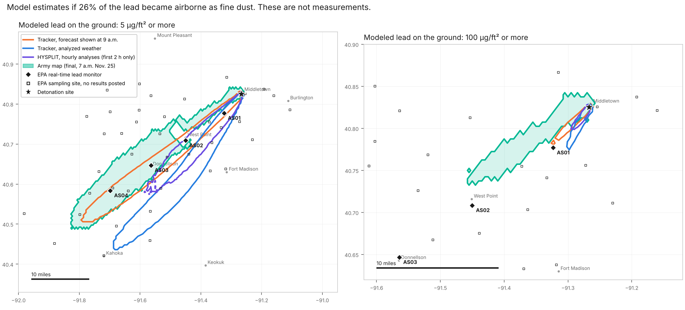
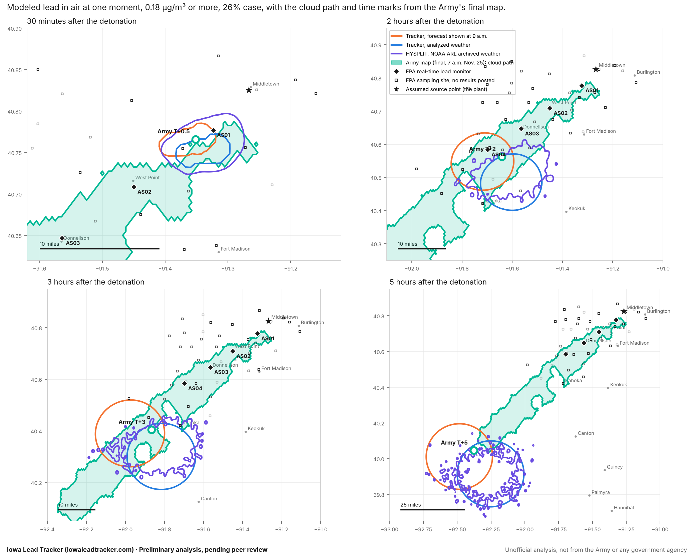

# The Nov. 25, 2026 detonation at the Iowa Army Ammunition Plant: a first comparison

**Were EPA's lead monitors placed to catch a cloud? The Iowa Lead Tracker's forecast, the
analyzed weather, NOAA's HYSPLIT and the U.S. Army's map against EPA's real-time readings**

> **Unofficial.** This is a screening model run by a private citizen, not from the Army or
> any government agency. Don't use it to decide if you're safe; follow official
> instructions. HYSPLIT results here are this project's runs of NOAA's public software and
> are not official NOAA products. The model maps below are estimates for assumed releases.
> They are not measurements, and nothing here says how much lead reached any place.

**Status.** Preliminary analysis, pending peer review. Third draft, updated Nov. 26, 2026, about 1:30 a.m. CST, sixteen hours after the
detonation. The first draft was rewritten after an independent review, and this one was
corrected after a second review of its summary
([what changed](#what-changed-since-the-first-draft)). The model comparison
now covers all eight modeled hours (9 a.m. to 5 p.m.) on NOAA's archived weather; the
Army's results and all lab sampling are still to come. It was drafted with an AI coding assistant, and the
first draft was reviewed by a separate AI referee; the maintainer has not yet checked every
number by hand.

Contents: [Summary](#summary) · [1. What this can and can't say](#1-what-this-can-and-cant-say) ·
[2. The event](#2-the-event) · [3. Data and methods](#3-data-and-methods) ·
[4. The weather](#4-the-weather-forecast-against-what-was-analyzed-and-observed) ·
[5. The models](#5-the-models-on-the-same-weather) ·
[6. EPA's monitors](#6-were-epas-monitors-placed-to-catch-a-cloud) ·
[7. The Army's map](#7-the-armys-map) · [8. What it means for the tracker](#8-what-it-means-for-the-tracker) ·
[9. Next steps](#9-next-steps) · [Reproducing](#reproducing) · [References](#references)

## Summary

The Army says it detonated the lead azide stockpile at the Iowa Army Ammunition Plant at
9 a.m. CST on Wednesday, Nov. 25, 2026, and that EPA "detected zero lead" afterward
(KCRG 2026b). For a week before, the Iowa Lead Tracker published forecast maps of where
the lead could go under four assumed releases. The first question after the detonation is
whether EPA's zero means little lead got out, or that its monitors were in the wrong
place. The rest of this comparison (the weather, the models, the Army's map) serves that
question.

1. **EPA's four real-time lead monitors read almost nothing.** They sit 4.5 to 28 miles
   southwest of the plant. Through 8:40 p.m. they posted 253 readings from the
   detonation on; 236 were zero and the highest was 0.010 µg/m³, about the size of readings
   the same instruments posted before the detonation (up to 0.006). EPA calls them "Xact
   stations monitoring for lead" (EPA 2026e). It hasn't published their model, inlet or
   detection limit.
2. **Whether they were placed to catch a cloud depends on where the detonation was, and
   that is not public.** Every distance here is measured from one point taken for the
   whole plant. From that point the nearest monitor, AS01, is inside the modeled cloud in
   every run, and 1% of the lead as fine dust would have read hundreds of times above what
   it posted. But if the source was 2 km east or south of that point, the cloud on
   analyzed weather passes every real-time monitor unseen, even in the lowest published
   case (7%). If it was 2 km north or west, they still catch it (Table 13).
3. **From the assumed point the coverage is thin.** The three farther monitors lie along
   the forecast path. On analyzed weather the cloud passes south of them, so the answer
   rests on AS01 alone, 7° off the analyzed path. A cloud that stayed in the lowest 150 m
   and followed the wind there, toward 204° to 207°, would have missed all four in the
   tracker's runs even at 7%.
4. **Several explanations fit the near-zero readings, and the data can't rank them**
   (section 6.6). Little fine lead got out. The lead was on coarse particles, which fall
   out or don't pass a PM10 inlet. The cloud went over or to the south of AS01. The
   source was somewhere else. Or the public feed doesn't show what the instruments
   measured. We calculated three. Coarse particles fall out before AS01 only at about
   100 µm. A cloud released twice as high as modeled still reaches AS01 in HYSPLIT. A
   source 2 km away can move the cloud off every monitor. EPA's filter samples at sites
   AS06, AS12, AS13, AS14 and AS18, and soil and surface samples, are what can settle it.
   None were public by midnight on Nov. 25.

The supporting results:

- **The wind forecast was right in speed and 9–18° off in direction where it mattered.**
  Matched hour for hour with NOAA's HRRR analysis, the forecast wind in the lowest 250 m
  came from 9–18° too far east at 9, 10 and 11 a.m. and noon; speeds agreed within
  0.7 m/s. By 1 p.m. the error was 5° or less, and at 2 and 3 p.m. 4° or less; at
  4 and 5 p.m. it was up to 12° again, with no steady sign. The five surface stations within 16 miles averaged 28° and 31° at 9 and
  10 a.m., against the forecast's 42° and 44°. Rerun on the analyzed weather, the
  tracker's own cloud heads toward 215–220° instead of 226–231°, and the two footprints
  barely overlap (2–14% by intersection over union).
- **On the same weather the tracker and HYSPLIT agree, for all eight hours.** With
  HYSPLIT run on NOAA's archived HRRR, both put the cloud along 215–216° in the first two
  hours and 217–221° from then to 5 p.m. In the 26% case their 100 µg/ft² zones are 2.2
  and 2.0 sq mi, their 5 µg/ft² zones 107 and 100 sq mi, and the zones overlap by
  45–66%. The tracker runs higher at some distances: its 40 µg/ft² zone is 1.5 times
  HYSPLIT's, its 100 µg/ft² zone 1.8 times with all the lead airborne, and its hourly
  air beyond 6 miles 1.8 times. HYSPLIT itself is sensitive to its weather input: on coarser
  pressure-level data its path shifts 7° and its near-field zones halve.
- **The Army's final map agrees with the tracker's forecast on direction and speed, and
  puts far more lead near the plant.** Stamped 7 a.m. on Nov. 25, it points 230° (the
  tracker's forecast: 229–231°) and has the cloud 6, 27, 43 and 79 miles out at half an
  hour, 2, 3 and 5 hours (the tracker: 6, 31, 48 and 85). HYSPLIT on analyzed weather
  has it 5, 28, 44 and 83 miles out, so the runs differ from the Army's marks
  in direction, not speed. Both rest on forecasts, and both point 7° to 14°
  west of the runs on analyzed weather. The Army's 100 µg/ft² zone covers 29 sq mi and reaches 12
  miles; the tracker's, for the same 26%, covers 2 sq mi and reaches 4. A coarse share
  of particles in the tracker gives 11 to 18 sq mi, so it could explain much of the
  gap. The Army hasn't published its model's inputs.

## 1. What this can and can't say

- **The source point is assumed.** Every distance and bearing is from one point,
  40.8255° N, 91.2665° W, taken for the whole plant. It is not the magazines; their
  location is not public (the [scenario README](../README.md) explains). A shift of 2 km
  moves AS01's bearing by about 15°. Section 6.8 tests what that does.
- **One event.** The HYSPLIT reference runs cover the eight modeled hours, 9 a.m. to
  5 p.m., on NOAA's archived weather. Agreement between the models on this day says
  nothing about other weather, and it is agreement between two models, not with
  measurements.
- **No lead measurements beyond four instruments.** EPA lists 43 sampling sites; only the
  four real-time monitors have public results. EPA says they are "Xact stations monitoring
  for lead" (EPA 2026e); the data layer itself names neither the substance nor a detection
  limit. What is published for this kind of instrument is in section 3.8;
  whether it applies to these four is an assumption. Filter, soil, wipe and water results will be the test of what
  landed. Nothing here estimates what was released.
- **The "analyzed weather" is a model product.** NOAA's HRRR analysis blends observations
  into HRRR's own one-hour forecast. It is not independent of the HRRR forecast being
  checked, nor of the airport reports and radar winds it takes in, so agreement with it
  is a lower bound on forecast error. There is no wind observation at the plant.
- **HYSPLIT is a reference model, not the truth.** It uses fixed deposition speeds here,
  and its answer moves by a factor of two with the weather file it is given (section 5).
- **The Army map is read from two JPEG images** of its final maps before the detonation,
  at 1.66 pixels per mile. Positions are good to about 3 miles; its model, particle sizes
  and source are unknown.
- **Zone edges are not boundaries.** A place outside a modeled zone may still get lead,
  and a place inside it may get none you could measure.

## 2. The event

The Army's notice on the morning of Nov. 25 said it would detonate at 9:00 a.m. CST and
update the public by 11 a.m. (McFate 2026b). KCRG and the Associated Press reported that
the Army "intentionally blew up the nation's entire stockpile of lead azide ... at 9 a.m.
on Wednesday," 68 barrels in bunkers, and that video "showed two white plumes rolling over
the detonation site before the clouds quickly dissipated" (KCRG 2026a). Two hours later
the Army said the detonation was complete and that "the EPA has detected zero lead"
(KCRG 2026b). An emergency alert that evening said "Army, CDC, EPA and FEMA concur that
it is safe to resume normal activities. Continuous monitoring will be conducted to
ensure safety" (KCRG 2026b). We take 9:00 a.m. as the release time. A start a few minutes off would not
change the hourly comparisons; a start an hour off would.

EPA's Nov. 25 release says it collected 1,216 samples beforehand, that "pre-detonation
sampling is detecting no lead currently in the air," and that during the event "EPA's air
monitoring will be reporting data points every 5 minutes" in a public viewer (EPA 2026a,
2026b). The Army's permit application describes its own air sampling: 24-hour filter
samples at five on-site and five off-site locations, sent to a lab, and five "response"
samples during the event, read in the field by X-ray fluorescence (U.S. Army 2026b). None of those
results were public by 7 p.m. EPA's response site listed no documents newer than Nov. 23
and, for Nov. 25, only the link to its data viewer (EPA 2026d).

## 3. Data and methods

### 3.1 The forecast the site showed

The site's maps at 9 a.m. came from weather pulled at 8:36 a.m. CST (commit `c9f8e59`; the
commit deployed at 9:00, `fd17b63`, has the same forecast file). We rebuilt the site from
that commit, which replays the saved forecast, and used its 9 a.m. maps for the 7%, 26%
and 100% cases. HRRR was the model shown. Open-Meteo doesn't report which HRRR run a
response came from, so the forecast's lead time is not known; it was at most a few hours.
The tracker reads HRRR at 25 points about 115 miles apart and interpolates between them.

### 3.2 The analyzed weather

Two forms of NOAA's HRRR for the day:

- **NOAA ARL's archive** (`20261125_12-17_hrrr` and `20261125_18-23_hrrr`, 6 a.m. to
  5 p.m., posted about 12:40 and 6:43 p.m.): hourly HRRR on its native levels with surface fluxes, in HYSPLIT's format. This is the
  weather the HYSPLIT reference runs use, as in the back-test.
- **The hourly analyses** for 9 a.m. to 5 p.m. (15 to 23 UTC) on pressure levels every
  25 hPa, from NOAA's archive on AWS, converted with HYSPLIT's `api2arl_v4`
  ([`blast-day/nowcast_hrrr.sh`](../../../validation/hysplit-backtest/blast-day/README.md)).
  Each is available an hour after its time. They are used for the wind comparison in
  section 4 and for a second HYSPLIT run.

HRRR assimilates surface stations, radar, aircraft, balloons and satellites each hour
(Benjamin et al. 2016; Dowell et al. 2022).

### 3.3 Observations

All retrieved Nov. 25 and saved in [`data/obs/`](data/obs):

- reports from 18 airports within 85 miles and three Iowa DOT road weather stations (Iowa
  Environmental Mesonet). Airport winds are 2-minute means reported to 10° and 1 kt;
- the Davenport NWS radar's wind profile (VAD) at 9:00 and 9:55 a.m., 65 miles northeast;
- the 6 a.m. balloons at Davenport and Lincoln, Ill., 65 and 111 miles away;
- hourly sunshine at the Iowa State soil moisture station at Crawfordsville, 28 miles
  north-northwest;
- EPA AirNow hourly PM2.5, PM10 and wind for monitors within 160 miles.

### 3.4 The tracker on analyzed weather

To separate forecast error from model differences, we reran the tracker at 6:51 p.m. on
the HRRR that Open-Meteo then served, after all eight modeled hours (9 a.m. to 5 p.m.)
had passed. The weather is saved in `data/met_hrrr_asof_20261126_0051Z.json`, so the
reruns need no network. Settings are the site's, with HRRR only. This is HRRR at the
tracker's 25 points with its 10 m, 80 m and eight pressure-level winds. It is close to
NOAA's analyses but not identical: at the plant its 10 m wind is within 2° of the
analysis at every hour from 9 a.m. to 5 p.m., and within 0.1 m/s except at 5 p.m.
(0.6 m/s). Open-Meteo revised some hours
between earlier pulls; a pull at 4:15 p.m. was 5° off at 2 p.m.

### 3.5 HYSPLIT

HYSPLIT 5.4.2 (Stein et al. 2015), public Linux build, set up as in the
[back-test](../../../validation/hysplit-backtest/README.md): a vertical line source from
10 m to the cloud top (251 m) at the plant, 3,130 kg of lead (100%) in four sizes (0.3, 1,
3 and 10 µm at 9,500 kg/m³) released over 6 minutes from 9:00 a.m.; 200,000 particles;
hourly means in the 0–10 m layer, deposition, and a snapshot of the 0–10 m layer every
30 minutes. The tracker starts from five layers with
a 63 m initial spread, so the two differ in the first cells. Dry deposition speeds are
fixed per size: the tracker's Zhang et al. (2001) values at a 5 m/s reference wind (0.16,
0.10, 0.32 and 3.66 cm/s), or its Emerson et al. (2020) values. The tracker itself varies
them with the wind each hour. Lower releases are the same run scaled, which is exact. The
10 µm size holds 10% of the mass and makes about two-thirds of HYSPLIT's first-hour
deposition (counted in the review of the first draft), so the near field depends on the coarse end of the
assumed sizes.

Two sets of runs:

- **Reference:** NOAA ARL's archived HRRR, 9 a.m. to 5 p.m., on a 0.003° grid, with
  Zhang and with Emerson speeds. Earlier versions of this draft had only the first
  archive file and stopped at 11 a.m.; the 8-hour runs reproduce those two hours (every
  zone within 0.1 sq mi).
- **Sensitivity:** the pressure-level analyses, 9 a.m. to 5 p.m., on a 0.005° grid, Zhang
  speeds. Without surface fluxes HYSPLIT estimates mixing from the profiles.

Nothing is held fixed in either. The public HYSPLIT build refuses forecast weather without
NOAA registration. As a check on the setup, this build reproduced the back-test's Monday
case (597 lb deposited against 595 published).

### 3.6 What is compared

- **Hourly mean air** is the clock-hour mean at the ground: the tracker's `conc` field and
  HYSPLIT's 0–10 m layer. (The first draft used the tracker's `m60` field, the highest
  running 60-minute mean, which is not an hourly mean after the first hour.) "Hour 1" is
  9 to 10 a.m.
- **Snapshots** are the tracker's field at the end of an hour (`snap`), for comparison with
  the Army's "+1, +4, +8 hr" shapes.
- **Zones** are reported with area, farthest distance and the bearing of the far end, and
  with **overlap**: intersection over union on a common 0.005° grid. Two zones of equal
  area that point 10° apart overlap little.
- **Highest air by distance** compares the models' maxima in rings (1.5–3, 3–6, 6–12 and
  12–25 miles). The single highest cell sits within half a mile of the source and depends
  on cell size and the initial cloud, so it isn't compared.
- Tracker cells are 0.66–0.69 km on a side; HYSPLIT's 0.003° cells are about 0.33 by
  0.25 km. Tracker fields are stored in steps of about 8.5%.

Levels: 5 and 100 µg/ft² on the ground and 0.18 µg/m³ in air are the lines on the Army's
map (it labels them EPA's dust-lead levels for floors and window sills and the "lead air
sampling method detection limit"); 40 µg/ft² and DOE's PAC-1 (32 µg/m³ for one hour) are
the tracker's other lines. Sources are in the scenario README
([Threat-zone levels](../README.md#threat-zone-levels-research-notes)). These are indoor
dust and emergency-planning levels used here as map lines, not outdoor health limits.

### 3.7 The Army's map

Two 1200 × 675 JPEG images of the Army's "Mitigated 0.26" advisory maps, stamped "Issued
Nov. 25, 2026" and "a/o 250700NOV26" (7:00 a.m. on the day of the detonation), supplied
by the maintainer as the Army's final maps before it ([`data/army/`](data/army); U.S. Army
2026a). An earlier issue stamped a/o 240630NOV26 is there too (U.S. Army 2026c). The
final maps print areas of 29 and 186 sq mi for 100 and 5 µg/ft² (the earlier issue: 27
and 148) and mark the cloud's path in air at T+0.5, T+2, T+3 and T+5 hours.

`scripts/army_map.py` selects the shaded pixels by hue. Distances use the map's scale bar
(1.66 px per mile, so one pixel is 0.6 mile). The source is taken to be the upwind tip of
the ground plume, at the southwest edge of the magenta marker that the legend labels
"Iowa Army Ammunition Plant"; the marker's center is 3 miles away, and results from it
are given as the alternative. North is assumed up. The traced zones come to 165 and
26 sq mi against the printed 186 and 29, so the tracing runs about 10% small; areas quoted
are the printed ones. On the air map the cloud's path is one band, crossed by four lines
labeled with times. We read each line's end points from an enlarged crop (good to about
1 px) and take the cloud's position at that time as the point where the line crosses the
band's long axis. The map doesn't say whether a line marks the cloud's center or its
leading edge.

### 3.8 EPA's data

The two public layers behind EPA's "Iowa Army Ammunition Plant Response Data Viewer"
(EPA 2026c), downloaded at 1:00 a.m. CST on Nov. 26 ([`data/epa/`](data/epa/README.md)): 335
records from four stations labeled "Xact" (the name of a commercial instrument that
measures metals in air in near-real time), with a time, a concentration in µg/m³ and a
station; and 43 sampling sites with the instruments at each (dust monitors, gas monitors,
filter cassettes, canisters). The Xact layer doesn't name the substance or a detection
limit; EPA's release describes it as air monitoring for lead. Timestamps run to within
minutes of the download, so we read them as UTC. These are EPA's preliminary values as
posted.

EPA's Heartland Region wrote on the evening of Nov. 25 that its equipment included "Xact
stations monitoring for lead, DustTrak aerosol equipment monitoring for particulate
matter, AreaRAEs providing real-time air monitoring, and Summa cans sampling for Volatile
Organic Compounds" (EPA 2026e). The viewer's own text gives a screening level "for lead."
So the real-time readings are lead from Xact monitors. EPA hasn't given the model, the
inlet or a detection limit, and its list of instruments at AS01 to AS04 (dust monitor, gas
monitor, air cassette, canister) leaves the Xact out. A photo with the post shows a
rack-mounted instrument with a filter tape and a sample line through a trailer roof,
which looks like the maker's current ambient model, the Xact 625i (Petterson 2022). That
monitor collects particles on a filter tape and measures metals in the deposit by X-ray
fluorescence, so it reads lead as an element whatever compound it is in. What is
published for it:

- **Inlet.** It draws 16.7 L/min through a size-selective inlet; the options are PM10,
  PM2.5, PM1 and low-volume total particulate (CARB 2018). EPA's own verification test
  used a PM10 inlet (EPA 2012). A PM10 inlet passes about half of the particles of 10 µm
  aerodynamic diameter and few larger ones.
- **Sampling time.** 15 minutes to 4 hours (CARB 2018). The maker said in 2022 that
  5-minute sampling and analysis was "now available" (Petterson 2022). EPA's layer has a
  reading about every five minutes.
- **Detection limit for lead**, at 68% confidence (one standard deviation): 1.8 ng/m³
  for 15-minute samples, 0.63 for 30 minutes, 0.22 for an hour and 0.027 for four hours
  (CARB 2018, Appendix 2). These are the maker's figures for counting noise on a clean
  deposit, not a field detection limit. The table's formula makes the limit fall as the sampling time
  to the power 1.5, and its values follow that. Carried down to 5 minutes it gives about
  9 ng/m³, or 0.009 µg/m³. That figure is our extrapolation below the table's shortest
  time, for a 5-minute mode the procedure doesn't describe. It is not a published value,
  and the posted readings are quieter than it implies (section 6.4).
- **Accuracy.** In EPA's 80-day test of the earlier Xact 625 in Ohio, hourly lead averaged
  over a day tracked lab filters with a slope of 1.1, r² of 0.94 and an offset of
  +1.6 ng/m³; a blank stretch of filter tape alone read about 1 ng/m³ of lead (EPA 2012).

## 4. The weather: forecast against what was analyzed and observed

*Table 1. Wind at the plant: forecast / HRRR analysis at the same hour (speed in m/s,
direction the wind comes from), with the forecast's direction error in parentheses.
Positive means the forecast wind came from farther east (clockwise). Heights above ground.
The cloud starts between the ground and 251 m.*

<!-- table:wind -->
| Level | 9 a.m. | 10 a.m. | 11 a.m. | Noon |
|---|---|---|---|---|
| 10 m | 3.7, 42° / 3.7, 24° (+18°) | 4.6, 44° / 5.0, 29° (+15°) | 5.3, 53° / 5.5, 38° (+15°) | 5.8, 54° / 6.2, 40° (+14°) |
| about 40 m (1000 hPa) | 4.9, 43° / 4.6, 30° (+13°) | 5.6, 45° / 6.0, 32° (+13°) | 6.2, 53° / 6.6, 41° (+12°) | 7.0, 54° / 7.2, 39° (+15°) |
| about 240 m (975 hPa) | 7.8, 57° / 7.2, 48° (+9°) | 7.2, 50° / 7.2, 35° (+15°) | 7.1, 54° / 7.6, 43° (+11°) | 7.9, 55° / 8.2, 42° (+13°) |
| about 450 m (950 hPa) | 8.2, 60° / 8.3, 55° (+5°) | 8.6, 57° / 8.7, 46° (+11°) | 8.3, 54° / 8.2, 47° (+7°) | 8.9, 53° / 8.6, 45° (+8°) |
| about 660 m (925 hPa) | 9.4, 58° / 9.3, 60° (−2°) | 10.3, 60° / 9.6, 55° (+5°) | 8.9, 65° / 9.2, 55° (+10°) | 8.7, 61° / 8.8, 51° (+10°) |
| about 870 m (900 hPa) | 10.1, 63° / 10.5, 65° (−2°) | 10.9, 65° / 10.3, 61° (+4°) | 9.9, 72° / 10.2, 63° (+9°) | 9.4, 70° / 9.3, 63° (+7°) |
<!-- /table:wind -->

*Table 1b. The same for the afternoon. The morning's direction error is gone by 2 p.m.
At 4 and 5 p.m. the forecast is off again, by up to 12°.*

<!-- table:wind_pm -->
| Level | 1 p.m. | 2 p.m. | 3 p.m. | 4 p.m. | 5 p.m. |
|---|---|---|---|---|---|
| 10 m | 6.3, 52° / 6.3, 47° (+5°) | 5.7, 45° / 6.0, 45° (0°) | 5.8, 54° / 5.6, 54° (0°) | 5.2, 43° / 4.9, 48° (−5°) | 4.1, 35° / 5.2, 44° (−9°) |
| about 40 m (1000 hPa) | 7.4, 51° / 7.3, 47° (+4°) | 6.7, 45° / 6.8, 47° (−2°) | 7.1, 52° / 7.0, 56° (−4°) | 6.6, 46° / 6.1, 54° (−8°) | 6.0, 36° / 6.7, 42° (−6°) |
| about 240 m (975 hPa) | 8.7, 52° / 8.8, 51° (+1°) | 8.1, 46° / 8.4, 49° (−3°) | 9.0, 54° / 9.4, 58° (−4°) | 9.8, 52° / 9.3, 64° (−12°) | 10.0, 50° / 10.3, 48° (+2°) |
| about 450 m (950 hPa) | 9.4, 51° / 9.4, 53° (−2°) | 9.1, 52° / 8.9, 51° (+1°) | 9.2, 55° / 10.2, 59° (−4°) | 9.7, 60° / 10.6, 68° (−8°) | 10.0, 59° / 12.0, 52° (+7°) |
| about 660 m (925 hPa) | 9.5, 58° / 9.6, 56° (+2°) | 9.2, 51° / 9.3, 53° (−2°) | 10.2, 59° / 10.7, 61° (−2°) | 11.6, 64° / 11.4, 71° (−7°) | 10.8, 67° / 12.9, 57° (+10°) |
| about 870 m (900 hPa) | 10.6, 68° / 10.0, 60° (+8°) | 9.8, 61° / 9.5, 57° (+4°) | 10.7, 63° / 11.0, 65° (−2°) | 12.2, 69° / 12.0, 74° (−5°) | 10.9, 72° / 13.2, 63° (+9°) |
<!-- /table:wind_pm -->

Speeds agree within 0.7 m/s at every level from 9 a.m. to 2 p.m.; later they differ by
up to 1.1 m/s at 3 p.m. and 2.3 m/s at 5 p.m. Direction does not: through the
layer the cloud starts in, the forecast wind came from 9–18° too far east in all four
morning hours, and from 11 a.m. the error reached up to 870 m. It did not last: at
1 p.m. the forecast was within 5° below 700 m, and at 2 and 3 p.m. within 4° (Table 1b).
At 4 p.m. the forecast wind came from 5–12° too far north instead, and at 5 p.m. it was
6–9° too far north below 100 m and 7–10° too far east above 400 m. By then the modeled
cloud is more than 100 miles from the plant, so the wind over the plant no longer steers
it.
The forecast had turned the low-level wind toward the east about three hours before the
analyzed wind got there. The forecast also had the tracker's
80 m wind at 5.1 m/s from 44° at 9 a.m.; the analysis has no 80 m level, but its 40 m and
240 m winds (30° and 48°) put it near 33°. A wind from farther north carries the lead
farther south.

*Table 2. Surface wind at the five stations within 16 miles, observed (reports within 20
minutes of the hour, vector-averaged), with the forecast and analysis at the plant.*

| | 9 a.m. | 10 a.m. |
|---|---|---|
| Burlington airport, 8 mi ESE | 050°, 8 kt | 050°, 13 kt |
| Burlington road station, 9 mi E | 022°, 7 kt | 033°, 11 kt |
| Fort Madison airport, 12 mi SSW | 010°, 9 kt | 018°, 12 kt |
| Mount Pleasant airport, 15 mi WNW | 045°, 7 kt | 040°, 8 kt |
| Mount Pleasant road station, 16 mi WNW | 355°, 3 kt | 349°, 5 kt |
| **Vector mean of the five** | **28°** | **31°** |
| Forecast at the plant, 10 m | 42°, 7 kt | 44°, 9 kt |
| HRRR analysis at the plant, 10 m | 24°, 7 kt | 29°, 10 kt |

The stations don't depend on any model, and they side with the analysis: the forecast's
surface wind was about 13° too far east. They also disagree with each other by 30° to
60°, with the two stations nearest the cloud's path at the extremes (Burlington 050°,
Fort Madison 010°–018°). The Mount Pleasant road station reads half the airport's wind
4 miles away; dropping it moves the mean to 32° and 35°.

Across all 21 stations within 85 miles, the analysis minus the observed direction
averages +3° at 9 a.m. and +2° at 10 a.m., with a mean absolute difference of 12° and 8°
and no speed bias ([`data/station_vs_hrrr.json`](data/station_vs_hrrr.json)). Since HRRR
assimilates the airports, that mostly shows the assimilation worked; the three road
stations, which it may not use, differ by +20° and +14° on average. Airport winds are
reported to the nearest 10°, so differences under about 10° at one station mean little.

Aloft, the only measurement is the Davenport radar, 65 miles away, and it is noisy
(Table 3). Directions agree with the analysis within about 20° at seven of eight levels;
speeds differ by up to about 5 m/s, which is the size of the radar's own scatter.

*Table 3. Wind above the Davenport radar at 9:00 a.m. (VAD), with the HRRR analysis at the
radar on its nearest level. RMS is the radar's own fit error.*

| Height above radar | Radar | RMS | HRRR analysis |
|---|---|---|---|
| 197 m | 8.2 m/s from 061° | 3.0 m/s | 7.8 m/s from 062° (247 m) |
| 319 m | 13.4 from 092° | 4.8 | |
| 380 m | 10.3 from 072° | 3.2 | 10.2 from 074° (454 m) |
| 532 m | 13.4 from 061° | 4.7 | |
| 685 m | 12.3 from 073° | 2.6 | 12.0 from 081° (666 m) |
| 746 m | 16.5 from 077° | 2.9 | |
| 989 m | 13.4 from 077° | 2.0 | 12.9 from 082° (881 m), 12.6 from 082° (1,102 m) |
| 1,020 m | 11.8 from 077° | 1.2 | |

Other evidence is mixed. The 6 a.m. balloons had surface inversions and winds turning
from 15°–55° at the ground to 85°–110° near 1 km, three hours before and 65–111 miles
from the plant. The AirNow monitor at Lake Sugema, 40 miles west-southwest, reported
hourly winds from 37° and 43° for the hours beginning 9 and 10 a.m., close to the
forecast's direction, not the analysis's.

Sky and sunshine. The forecast called for 100% cloud. Airports near the plant
(Burlington, Fort Madison, Mount Pleasant, Keokuk) reported no cloud below 12,000 ft from
8:30 to 10 a.m., which doesn't rule out higher cloud; to the west, Fairfield was overcast
at 3,100 ft from 8:55 to 9:55, Oskaloosa broken to overcast at 3,800 ft until about 9:15,
and Ottumwa, Iowa City and Washington had scattered or few clouds near 3,500 ft. The
tracker sets turbulence from the forecast sunshine, not the cloud label: it used
187 W/m² for the first hour, interpolated from the forecast's hourly means (115 W/m² for
8–9 a.m. and 259 for 9–10). Crawfordsville measured 686 kJ/m² in the hour stamped
10 a.m., or 191 W/m²; if that stamp marks the end of the hour, the forecast had about a
third more sun than was measured there. The tracker treated the air as neutral (class D)
with a mixing height of about 440 m in the first hour. The analysis's own profile is
stably stratified between 40 and 240 m at 9 a.m. Whether the cloud mixed to the ground as
fast as either model assumes is an open question that bears directly on section 6.

## 5. The models on the same weather

*Table 4. 26% of the lead airborne (1,794 lb), after 8 hours (5 p.m.). Zones: area /
farthest distance / bearing of the far end. Air in µg/m³.*

<!-- table:models -->
|  | Tracker, forecast | Tracker, analyzed weather | HYSPLIT, ARL archive | HYSPLIT, ARL archive, Emerson speeds | HYSPLIT, pressure-level analyses |
|---|---|---|---|---|---|
| Ground ≥ 100 µg/ft² | 2.2 sq mi / 4.2 mi / 225° | 2.2 sq mi / 4.2 mi / 208° | 2.0 sq mi / 3.9 mi / 211° | 2.6 sq mi / 4.4 mi / 212° | 1.2 sq mi / 2.3 mi / 220° |
| Ground ≥ 40 µg/ft² | 9.1 sq mi / 9.6 mi / 228° | 8.1 sq mi / 9.7 mi / 213° | 5.4 sq mi / 6.0 mi / 211° | 7.4 sq mi / 7.1 mi / 213° | 3.2 sq mi / 4.2 mi / 222° |
| Ground ≥ 5 µg/ft² | 90 sq mi / 35 mi / 231° | 107 sq mi / 36 mi / 218° | 100 sq mi / 34 mi / 220° | 132 sq mi / 38 mi / 219° | 67 sq mi / 25 mi / 223° |
| Lead on the ground | 243 lb | 257 lb | 231 lb | 306 lb | 203 lb |
| Highest hourly air, hour 1: 1.5–3 mi | 170 | 138 | 209 | 214 | 82 |
| Highest hourly air, hour 1: 3–6 mi | 88 | 100 | 84 | 85 | 38 |
| Highest hourly air, hour 1: 6–12 mi | 42 | 48 | 26 | 25 | 15 |
| Highest hourly air, hour 1: 12–25 mi | 20 | 20 | 11 | 11 | 7.7 |
| Hourly air ≥ 32 µg/m³ (PAC-1), farthest | 8.7 mi | 8.3 mi | 5.3 mi | 5.3 mi | 3.2 mi |
| Center of hourly mean air, hour 1 | 5.6 mi at 229° | 5.6 mi at 215° | 5.3 mi at 215° | 5.2 mi at 215° | 6.0 mi at 222° |
| Center of hourly mean air, hour 2 | 22 mi at 230° | 21 mi at 216° | 19 mi at 216° | 19 mi at 216° | 23 mi at 223° |
<!-- /table:models -->

*Table 5. Overlap of the zones after 8 hours (intersection over union; 1 = identical,
0 = no overlap).*

<!-- table:overlap -->
| Pair | Case | ≥ 100 | ≥ 40 | ≥ 5 µg/ft² |
|---|---|---|---|---|
| Tracker forecast vs tracker on analyzed weather | 26% | 0.11 | 0.14 | 0.04 |
|  | 100% | 0.12 | 0.06 | 0.02 |
| Tracker on analyzed weather vs HYSPLIT (ARL archive) | 26% | 0.45 | 0.52 | 0.66 |
|  | 100% | 0.49 | 0.68 | 0.66 |
| Tracker forecast vs HYSPLIT (ARL archive) | 26% | 0.07 | 0.13 | 0.07 |
|  | 100% | 0.09 | 0.07 | 0.06 |
<!-- /table:overlap -->



*Figure 1. Modeled lead on the ground for the 26% case: 5 µg/ft² (left) and 100 µg/ft²
(right, enlarged), after 8 hours. HYSPLIT is the run on NOAA ARL's archived weather.
The Army's zones are traced from its final map and placed from the
plume's tip. Diamonds are EPA's four real-time monitors; open squares are EPA's other
sampling sites, with no public results.*


*Figure 2. Modeled hourly mean lead in air at the ground, 0.18 µg/m³ or more, 26% case,
for the first two hours, while the cloud is among EPA's sites. HYSPLIT's outline is smoothed by about 1 km for
display; at this level it rests on a handful of particles per cell.*

The forecast error moved the tracker's own map. On analyzed weather its cloud leaves
along 208°–215° and bends to about 218°–220°, 13° to 17° south of the forecast map's
225°–231°. The zones keep their size and length but not their place: the forecast and
analyzed-weather footprints share 2% to 14% of their combined area. At 15 miles a 15°
shift is 4 miles, wider than the 5 µg/ft² zone.

On the same weather the tracker and HYSPLIT agree. With HYSPLIT on NOAA ARL's archived
HRRR, both models' clouds are centered at 215° in the first hour, 216° in the second and
217°–221° from then to 5 p.m., when both have the center 123 to 125 miles out. In the
26% case the 100 µg/ft² zones are 2.2 and 2.0 sq mi and reach 4.2 and 3.9 miles; the
5 µg/ft² zones are 107 and 100 sq mi and reach 36 and 34 miles; the lead on the ground
after eight hours is 257 and 231 lb. The zones overlap by 45% to 66% of their combined
area (49% to 68% with all the lead airborne), against 2% to 14% between the forecast and
analyzed-weather maps. For this event the weather forecast mattered far more than the
choice of model.

Where they differ, the tracker is the higher one. Its 40 µg/ft² zone is 1.5 times
HYSPLIT's (8.1 against 5.4 sq mi). With all the lead airborne its 100 µg/ft² zone is 1.8
times HYSPLIT's (17 against 9.3 sq mi), though HYSPLIT with Emerson deposition speeds
gives 15. Its highest hourly air is 0.7 to 1.2 times HYSPLIT's within 6 miles and 1.8
times from 6 to 25 miles, and PAC-1 reaches 8.3 miles against 5.3. This is the
moderate high bias the back-tests found in neutral daytime air (tracker distances 0.8 to
1.9 times HYSPLIT's; [`TURBULENCE.md`](../../../TURBULENCE.md)).

HYSPLIT's own answer depends on its weather file. On the pressure-level analyses, which
have levels near 40 and 240 m with nothing between and no surface fluxes, its cloud runs along
222°–223° for the first five hours, 7° west of the run on archived weather at first and
2° by the fifth hour; its 100 µg/ft² zone is 1.2 sq mi instead of 2.0, its 5 µg/ft² zone
67 sq mi instead of 100, and its highest hourly air within 6 miles is about 40% as
high. An earlier
version of this draft compared the tracker with that run and found a 1.7- to 3.6-fold
difference that the archived weather removes.

## 6. Were EPA's monitors placed to catch a cloud?

### 6.1 What they read

*Table 6. EPA's four real-time monitors, as posted through 1:00 a.m. CST on Nov. 26, and the models'
hourly mean air (µg/m³) at each for the lowest case (7% of the lead airborne) in hours 1
and 2. Multiply model values by 3.7 for the 26% case and by 14 for 100%.*

<!-- table:monitors -->
| Monitor | From the plant | Readings after 9 a.m. | Not zero | Highest (µg/m³) | Highest before 9 a.m. | Tracker, forecast (h1 / h2) | Tracker, analyzed (h1 / h2) | HYSPLIT, ARL archive (h1 / h2) |
|---|---|---|---|---|---|---|---|---|
| AS01 | 4.5 mi at 221° | 63 | 2 | 0.0021 | 0 | 7.6 / 0 | 6.7 / 0 | 5.5 / 0 |
| AS02 | 12.5 mi at 230° | 66 | 2 | 0.0043 | 0.0030 | 5.0 / 0.19 | 0 / 0 | 0.17 / 0 |
| AS03 | 19.9 mi at 232° | 64 | 4 | 0.0043 | 0 | 0 / 2.6 | 0 / 0 | 0 / 0 |
| AS04 | 28.1 mi at 233° | 60 | 9 | 0.0102 | 0.0063 | 0 / 1.2 | 0 / 0 | 0 / 0 |
<!-- /table:monitors -->


*Figure 3. EPA's readings (dots; zeros on the bottom line) and the models' hourly means
for the 7% case at each monitor, on a logarithmic scale.*

The readings are flat. Of 253 readings from the detonation on, 236 are zero. The seventeen
that aren't range from 0.00001 to 0.010 µg/m³, and two of the four monitors posted readings
of 0.003 to 0.006 µg/m³ before the detonation. Nothing in the series marks a cloud
arriving or leaving. AS01, the nearest, posted a reading every five minutes through the
first hour; its only non-zero values, 0.0021 µg/m³, came at 9:10 and 9:11 a.m.

All four posted about every five minutes until 1:55 p.m. After that the public layer
holds fourteen more readings, between 4:00 and 8:40 p.m.: thirteen zeros and one of
0.00001 µg/m³ (AS04 at 4:28 p.m.). A few time stamps appear twice. EPA hasn't said why the postings
thinned. By then the modeled cloud is well past the monitors in every run: at 2 p.m. its
trailing edge is 48 to 72 miles out, and the farthest monitor is at 28.

### 6.2 Where they sit

*Table 9. Modeled highest hourly mean air (µg/m³) for the lowest case (7% airborne) at
EPA's real-time monitors and at its other sampling sites that fall inside the cloud on
analyzed weather, over all eight hours.*

<!-- table:sites -->
| Site | From the plant | Instruments | Tracker, forecast | Tracker, analyzed | HYSPLIT, ARL archive |
|---|---|---|---|---|---|
| AS01 | 4.5 mi at 222° | **real-time lead** | 7.6 | 6.7 | 5.5 |
| AS02 | 12.5 mi at 230° | **real-time lead** | 5.0 | 0 | 0.17 |
| AS03 | 19.9 mi at 232° | **real-time lead** | 2.6 | 0 | 0 |
| AS04 | 28.1 mi at 233° | **real-time lead** | 1.2 | 0.0002 | 0 |
| AS06 | 6.8 mi at 211° | filter, dust monitor | 0 | 11 | 5.3 |
| AS11 | 7.4 mi at 229° | filter | 7.6 | 0.0136 | 0.63 |
| AS12 | 9.8 mi at 211° | filter | 0 | 6.7 | 2.8 |
| AS13 | 13.8 mi at 221° | filter | 0.0853 | 2.5 | 0.99 |
| AS35 | 14.3 mi at 202° | filter, dust monitor | 0 | 0.0047 | 0.36 |
| AS14 | 21.4 mi at 220° | filter | 0.0786 | 1.4 | 1.1 |
| AS18 | 25.6 mi at 218° | filter | 0.0053 | 1.8 | 1.1 |
| AS36 | 29.8 mi at 212° | filter | 0 | 0.36 | 0.38 |
| AS37 | 31.4 mi at 223° | filter | 0.16 | 0.36 | 0.44 |
| AS05 | 36.6 mi at 220° | filter, dust monitor | 0.0377 | 0.87 | 0.78 |
<!-- /table:sites -->

On the forecast, all four real-time monitors are in the cloud: they lie at 222° to 233°,
along the tracker's forecast path and the axis of the Army's final map (230°). EPA placed
them where the forecasts said the lead would go.

On analyzed weather only AS01 is. Both models put the cloud's first-hour center at 215°,
and AS01, at 222°, gets about 40% of the highest value at its distance, still 5.5 to
6.7 µg/m³ for the lowest case. The three farther monitors are outside. The tracker gives
them nothing. HYSPLIT, which now runs long enough for the cloud to pass all four, gives
AS02 the cloud's edge (0.17 µg/m³) and AS03 and AS04 nothing. The sites best placed
for the analyzed path are filter samplers, not real-time monitors: AS06 and AS12 at 211°,
7 and 10 miles out, then AS13, AS14 and AS18, where the two models give 1.0 to
2.5 µg/m³ for the lowest case.

### 6.3 How much they cover

The cloud's true direction isn't known to better than about 10° (section 4), so the
useful question is how the monitors fare over a range of directions. We turned each
modeled cloud about the plant in 1° steps and read off the highest hourly mean at any
real-time monitor (Figure 5, Table 10). Turning the cloud rigidly ignores how a different
wind would reshape it, so this is a sensitivity test.


*Figure 5. The highest hourly mean any real-time monitor would read if the modeled cloud
traveled in another direction, for the lowest case (7% airborne). Dots mark each run's own
direction. The gray band is where the cloud would go if it followed the surface wind
(from 24°–31° at the plant and the nearby stations).*

*Table 10. Directions of travel (first-hour center of the cloud) over which at least one
real-time monitor would read an hourly mean at or above two levels: 0.18 µg/m³, the Army
map's air line, and 0.01 µg/m³, the highest reading any of the monitors posted.*

<!-- table:windows -->
| Share of the lead airborne | Hourly mean at a monitor of at least | Tracker, forecast | Tracker, analyzed | HYSPLIT, ARL archive |
|---|---|---|---|---|
| 7% | 0.18 µg/m³ | 208°–238° | 208°–240° | 203°–244° |
| 7% | 0.01 µg/m³ | 208°–244° | 204°–243° | 200°–245° |
| 1% | 0.18 µg/m³ | 213°–234° | 208°–235° | 210°–238° |
| 1% | 0.01 µg/m³ | 208°–241° | 208°–240° | 203°–245° |
| 0.1% | 0.18 µg/m³ | 219°–226° | 227°–227° | 225°–227° |
| 0.1% | 0.01 µg/m³ | 213°–236° | 208°–239° | 206°–241° |
<!-- /table:windows -->

For the lowest published case the monitors respond over 30° to 40° of arc, from 203°–208°
to 238°–244°, and over the middle of it, about 213° to 233°, they would read 5 to
18 µg/m³. For 1% of the lead airborne the window is still 213° to 234° in every run. Every direction estimated here
falls inside: 215° (both models on analyzed weather), 222° (HYSPLIT on pressure-level
data), 229°–230° (the tracker's forecast and the Army's map). The analyzed path, 215°, is
inside by 2° to 7°, depending on the run, and section 4 puts the direction's uncertainty
near 10°. A cloud that followed the surface wind, toward 204°–211°, is at or past the
edge: from 204° to 207° the tracker's cloud gives 0 to 0.02 µg/m³ at every real-time
monitor in the 7% case, and only HYSPLIT's wider cloud is caught (0.19 to 0.83). All of
this is from the assumed source point (section 6.8).

Sensitivity at AS01 is high. With the cloud as modeled, an hourly mean of 0.18 µg/m³ there
needs 0.17% to 0.23% of the lead airborne as fine dust, about 11 to 16 lb of the 6,900;
0.01 µg/m³ needs about 0.01%, under a pound. A 5-minute reading during the cloud's passage
would run above the hourly mean, so these are conservative.

So for a cloud of fine dust at the ground, starting from the assumed source point, the
monitors were placed to catch it. Section 6.8 tests the source point. The coverage is
thinner than four monitors suggests: south of about 225° it is AS01 alone, because the
other three sit within 3° of each other on the forecast axis.

### 6.4 What they could not see

- **A cloud above the ground.** Both models start the cloud mixed from the ground to
  251 m. That height is half of what the cloud-rise formula gives for an open-air charge,
  a screening assumption for earth cover that has not been validated
  ([`MODEL.md`](../../../MODEL.md)). NOAA ARL's archived weather has the air well mixed to
  about 150 m at 9 a.m. (the same potential temperature, 272.0 K, at its lowest levels),
  warmer air above (273.4 K at about 270 m), and a boundary layer 261 m deep that grew to
  424 m by 10 a.m. and 673 m by 11. An earlier version of this section put a stable layer
  "between 40 and 240 m"; that came from the pressure-level file, which has only those
  two levels there and can't show where the stable air starts. Section 6.6 tests a
  higher cloud. News video showed plumes that "quickly dissipated" (KCRG 2026a), which
  says nothing about height.
- **Anything the feed doesn't show.** The layer gives no detection limit, sampling
  interval or status flags. Zeros are posted as exact zeros and no value is negative, yet
  values as small as 0.00001 µg/m³ are posted. If the noise were the 0.009 µg/m³ that the
  maker's table implies at 5 minutes (section 3.8) and negative values were posted as
  zero, about half the readings would be above zero. Seventeen of about 250 are. So
  either the noise is far smaller than that or the feed is processed in a way EPA hasn't
  described. Until EPA states the limit and how small values are treated, a posted zero
  can't be turned into an upper bound.
- **Particles too coarse for the inlet.** A monitor with a PM10 inlet measures little
  that is larger than 10 µm in aerodynamic diameter, however much of it passes
  (section 6.6).
- **Lead on the ground.** These are air monitors. Very coarse particles, about 100 µm or
  larger, fall out before a monitor 4.5 miles away (section 6.6).

### 6.5 What the readings mean

If the cloud crossed AS01 at the ground as modeled, the fine airborne share was thousands
of times smaller than the lowest case: a few thousandths of a percent of the lead, taking
the highest reading at face value. That is the simplest reading, it matches what the Army said its barriers, water and foam were built to do, and
the placement analysis above supports it for a ground-level cloud of fine dust. It is not
established, because it rests on one instrument, an assumed mixing depth, a detection
limit EPA hasn't stated and an inlet that may not pass coarse particles.

What would settle it: EPA's filter samples at AS06, AS12, AS13, AS14 and AS18, which
collect over hours and are analyzed in a lab; the dust-monitor record at AS06; the Army's
on-site samples and hourly balloons, which would show how high the cloud went; and soil
and wipe sampling between about 205° and 245° within 15 miles, which spans every model run
here and the Army's map.

Regional particle monitors add nothing yet. AirNow has no PM monitor within 39 miles.
Readings within 160 miles ran 3 to 13 µg/m³ of PM2.5 from 5 a.m. to 5 p.m., an ordinary
range. All are upwind or off to the side. The one to the southwest, Lake Sugema (40 miles
at 257°), is roughly 20 miles north of the modeled path at that distance and posted 3 to
10 µg/m³ in the hours from 8 a.m. to 5 p.m. Lead at the Army map's 0.18 µg/m³
line would be a few percent of that background, so PM2.5 can't show it.

### 6.6 Why AS01 read almost nothing

AS01 was inside the modeled cloud in every run. It posted every five minutes through the
first hour and read 0.002 µg/m³ at most. On the models' timing (Table 7b, taking the
speed as steady over the first half hour) the cloud's front reaches AS01's distance
roughly 15 minutes after the detonation and its center at 22 to 27, so the two readings
at 9:10 and 9:11 a.m. come a little before the modeled cloud. Two other monitors posted values that size before the detonation.

Several explanations fit a near-zero reading there. They can overlap, there may be
others, and the data so far can't rank them. The first two agree that almost no fine lead
reached AS01 at the ground; they differ on whether much coarse lead left the site. The
next three would mean a cloud of fine lead missed the monitors, which matters more for
exposure.

1. **Little fine lead became airborne.** If the barriers, water and foam worked as the
   Army says, the fine airborne share was far below any case the tracker published. From
   the assumed source point, the highest value AS01 posted corresponds to about 0.002% of
   the lead as fine dust at the ground (Table 11). In field tests of buried and
   metal-cased detonations, most of the data put the share of a munition's metal reaching
   the air near 1% or less, with a range of 0.3% to 22% (Aurell et al. 2015). Those were
   tests of military munitions, not of a stockpile under barriers, water and foam.
2. **The lead was on coarse particles.** They either fell before reaching AS01 or
   reached it and were too large for its inlet. Both are calculated below. In the same
   field tests, soil-covered detonations put about 30 times as much particle mass in
   PM10 as in PM2.5, against about 1 to 1 for open detonations, because of the soil
   thrown up (Aurell et al. 2015).
3. **The cloud passed over AS01.** Whether the cloud topped out inside or above the
   morning's mixed layer turns on the untested factor of two in its height (section 6.4).
   This is calculated below: in HYSPLIT, a cloud released twice as high still reaches
   AS01 at the ground.
4. **A shallow cloud passed south of AS01.** The archived weather has the wind below
   about 150 m from 24° to 31° at 9 a.m., and from 51° at about 270 m. A cloud that
   stayed in the lowest layer would head toward 204° to 211°. AS01 is at 222°. From about
   208° on, every run still puts the 7% case above 0.18 µg/m³ at a monitor, and a 1%
   release is caught from 208° to 213° on, depending on the run (Table 10). From 204° to
   207° the tracker's cloud misses every real-time monitor even at 7%; only HYSPLIT's
   wider cloud is caught. A shallow cloud would also be narrower than the modeled one.
5. **The detonation was not at the assumed point.** Tested in section 6.8.
6. **The public feed doesn't show what the instruments measured.** EPA says the stations
   monitor for lead, but it hasn't said how the feed treats small values, and the posted
   values don't behave like raw readings (section 6.4).

**The cloud-overhead explanation, calculated.** We ran HYSPLIT on NOAA ARL's archived
weather with the cloud released between 251 and 502 m, from the modeled cloud top up to
the open-air value of the cloud-rise formula, for four hours.

*Table 14. HYSPLIT, lowest case (7% airborne): the highest hourly mean air at the ground
(µg/m³) with the cloud released as modeled and released above the modeled top.*

<!-- table:lofted -->
| Site | From the plant | Instrument | Released at 10–251 m (as modeled) | Released at 251–502 m |
|---|---|---|---|---|
| AS01 | 4.5 mi at 222° | real-time lead | 5.5 | 6.5 |
| AS02 | 12.5 mi at 230° | real-time lead | 0.17 | 1.6 |
| AS03 | 19.9 mi at 232° | real-time lead | 0 | 0 |
| AS04 | 28.1 mi at 233° | real-time lead | 0 | 0 |
| AS06 | 6.8 mi at 211° | filter | 5.3 | 1.2 |
| AS12 | 9.8 mi at 211° | filter | 2.8 | 0.94 |
| AS13 | 13.8 mi at 221° | filter | 0.99 | 2.2 |
| AS14 | 21.4 mi at 220° | filter | 1.1 | 2.3 |
| AS18 | 25.6 mi at 218° | filter | 1.1 | 1.1 |
<!-- /table:lofted -->

The higher cloud does not pass over AS01. It reads 6.5 µg/m³ there against 5.5 for the
standard run, and 1.6 against 0.17 at AS02. Two things do it. The boundary layer grows
past the cloud's height within the first hour and mixes it down. And the wind at that
height carries it along 223°, straight at AS01, where the standard run's cloud is
centered at 215°. So in HYSPLIT's weather a cloud twice as high as modeled is easier for
the monitors to catch, not harder. This doesn't close the question. A cloud that rose
well above 500 m, or air that mixed more slowly than HYSPLIT has it, could still carry
lead over AS01, and nothing public says how high the cloud went. It is one run of one
model.

**The coarse-particle explanation, calculated.** We reran the tracker on analyzed weather
with all of the lead airborne in one particle size at a time: the four fine sizes of the
published cases, then 10, 30 and 100 µm at the density of soil (lead carried on soil and
debris, the tracker's coarse sizes) and 30 µm at the density of the lead compound. As a
check, HYSPLIT was run for two hours on NOAA ARL's archived weather with the three
soil-density sizes, using the tracker's deposition speeds.

*Table 11. One particle size at a time: its aerodynamic diameter (the size an inlet
sorts by), the highest hourly mean air at AS01 for each 1% of the lead airborne in that
size, the share of the lead that would bring that air to 0.01 µg/m³ (the highest reading
any monitor posted), and the share of what is released that lands within AS01's distance
and within 15 miles. Air is what reaches AS01, whether or not an inlet would pass it.
Where two values are given they are tracker / HYSPLIT. Tracker shares on the ground are
after 8 hours, HYSPLIT's after 2.*

<!-- table:coarse -->
| Particle size | Aerodynamic diameter | Settling speed | Air at AS01 per 1% of the lead (µg/m³) | Share of the lead for AS01 to read 0.01 µg/m³ | On the ground within 4.5 mi | On the ground within 15 mi |
|---|---|---|---|---|---|---|
| 0.3 µm, lead density | 0.92 µm | 0.0041 cm/s | 0.83 | 0.012% | 1% | 1% |
| 1 µm, lead density | 3.1 µm | 0.0335 cm/s | 0.87 | 0.012% | 0% | 1% |
| 3 µm, lead density | 9.2 µm | 0.27 cm/s | 0.92 | 0.011% | 1% | 3% |
| 10 µm, lead density | 31 µm | 2.9 cm/s | 0.89 | 0.011% | 15% | 33% |
| 10 µm, soil density | 16 µm | 0.81 cm/s | 0.89 / 1.00 | 0.011% / 0.010% | 4% / 4% | 10% / 10% |
| 30 µm, soil density | 49 µm | 6.9 cm/s | 0.48 / 0.88 | 0.021% / 0.011% | 35% / 35% | 62% / 63% |
| 100 µm, soil density | 163 µm | 58 cm/s | under 0.0001 / 0.0345 | all of it or more / 0.29% | 99% / 99% | 100% / 100% |
| 30 µm, lead density | 92 µm | 24 cm/s | 0.0135 | 0.74% | 82% | 97% |
<!-- /table:coarse -->

Two things can keep coarse lead out of a reading at AS01: it falls to the ground before
it gets there, or it gets there and the inlet doesn't pass it.

**Falling out first** needs very coarse particles. Particles of 10 µm reach
AS01 as readily as fine dust. At 30 µm and soil density the reading falls by half in the
tracker and hardly at all in HYSPLIT, so 26% of the lead in that size would still put 12
to 23 µg/m³ at AS01. Only at about 100 µm, the size of fine sand, or at 30 µm for
particles as dense as the lead compound itself, does most of the lead fall first: 82% to
99% of it lands within AS01's distance.

The two models agree on where the lead lands, within one percentage point at every size
both ran. They disagree on how much of the rest is still in the air at AS01. For 100 µm
the tracker leaves almost none, and HYSPLIT leaves 0.035 µg/m³ for each 1% of the lead.
By HYSPLIT, even a release made up entirely of 100 µm particles would have to be under
0.3% of the lead, about 20 lb, for AS01 to stay at 0.01 µg/m³.

So if the monitor measured every size, this explanation would need nearly all of the
airborne lead in sand-size particles or dense fragments, with no more than about 0.01%
to 0.02% of the lead in anything of 30 µm or finer at soil density.

**Not passing the inlet** needs much less. If the monitors have a PM10 inlet (section
3.8), they measure little that is larger than 10 µm in aerodynamic diameter. That is
about 3 µm for particles as dense as the lead compound and about 6 µm at soil density.
Every coarse size in Table 11 is above it. Lead on 30 µm soil particles would pass AS01
at half or more of the fine-dust concentration and not be measured. This explanation
then needs only that nearly all of the lead was on particles coarser than the inlet's
cut, with no more than about 0.01% to 0.03% of it finer. A PM2.5 inlet would cut lower
still. For the published fine cases the inlet changes little: a PM10 inlet would pass
about 80% of their lead by mass and a PM2.5 inlet about 30%, against readings thousands
of times below them.

Lead caught on wet soil, foam and debris could be that coarse. The published cases
assumed the opposite, a condensed metal fume.

Either way the lead ends up on the ground, which can be checked. With 26% of the lead in
100 µm particles, both models put 100 µg/ft² or more over about 4 sq mi out to 5 miles,
and 5 µg/ft² or more over 12 to 14 sq mi out to 10 miles. At 30 µm it spreads farther:
100 µg/ft² or more over 36 to 43 sq mi out to 19 miles. The Army's own map, 29 sq mi out
to 12 miles, is nearer the 30 µm result than the 100 µm one. Lead on particles of a few
tens of micrometers, with monitors behind a PM10 inlet, would fit both the Army's map
and the readings. That is a possibility, not a finding: the inlet, the Army's particle
sizes and the amount released are all unknown. Soil and wipe samples along 205° to 245°,
and the filter cassettes if they collect every particle size, would show it.

**Prior work.** The closest published measurements are field tests of open and buried
detonations of military munitions, sampled by flying instruments through the plumes
(Aurell et al. 2015). Its findings are quoted under explanations 1 and 2 above. EPA's national air
standard for lead is measured as lead in total suspended particles, not in PM10. PM10
monitors are allowed only where levels are low and sources aren't expected to emit
particles too coarse for them. When it kept
that method in 2008 it wrote that "ingestion pathways are important to air-related Pb
exposures and that Pb particles contributing to these pathways include ultra-coarse
particles," its term for particles larger than 10 µm, and that measuring all sizes "is
necessary to provide sufficient public health protection from the range of particle
sizes of ambient air Pb, including ultra-coarse particles" (EPA 2008).

Two events show how air sampling and the ground can differ. In the dust that settled
east of the World Trade Center in 2001, particles finer than 2.5 µm were 0.9% to 2% of
the mass, the largest share was coarser than 53 µm, and the dust held 101 to 625 µg/g of
lead (Lioy et al. 2002). A fine-particle monitor counts little of a dust like that. In
the 2019 fire at Notre-Dame cathedral in Paris, the roof and spire were covered with
460 t of lead. The regional health agency reported that no air sample taken around the
cathedral exceeded the limit for lead in airborne particles, without saying when the
samples were taken. Soil collected eight to ten months later within 1 km held about
200 mg/kg more lead downwind than in other directions, an excess of about 1 t, some six
times what was estimated to have traveled beyond 1 km. The authors write that the
exposure is hard to confirm "because too few soil, dust, and blood samples were
collected immediately after the fire" (van Geen et al. 2020). They do not attribute the
difference to particle size.

Neither event was a detonation, and neither shows what happened in Iowa. They show that
lead from a single event can end up on the ground near its source while air sampling
finds little, and EPA's own lead standard is built around the coarse-particle part of
that.

Limits of this calculation: single sizes of spherical particles; a cloud that starts
mixed to the ground, as everywhere here; the tracker's map values are stored in steps
with a floor, so its smallest values are rough; the HYSPLIT check runs two hours with
fixed deposition speeds; and the inlet is taken as a clean cut at 10 µm when a real one
passes a falling share of particles on either side of it.

### 6.7 A 1% release

The lowest case the tracker published has 7% of the lead airborne. Table 12 scales the
same runs to 1% (69 lb as fine dust), a release small enough that the three farther
monitors matter less and the nearest one carries the answer.

*Table 12. If 1% of the lead became airborne as fine dust: the highest hourly mean air
(µg/m³) at EPA's four real-time monitors and at the five filter sites on the analyzed
path, with the highest reading each monitor posted, and the ground zones (area /
farthest distance / bearing of the far end) and lead on the ground after 8 hours.*

<!-- table:one_percent -->
|  | Tracker, forecast | Tracker, analyzed weather | HYSPLIT, ARL archive | Highest EPA reading after the detonation |
|---|---|---|---|---|
| Air at AS01, 4.5 mi at 222° | 1.1 | 0.96 | 0.78 | 0.0021 |
| Air at AS02, 12.5 mi at 230° | 0.72 | 0 | 0.0237 | 0.0043 |
| Air at AS03, 19.9 mi at 232° | 0.38 | 0 | 0 | 0.0043 |
| Air at AS04, 28.1 mi at 233° | 0.17 | 0 | 0 | 0.0102 |
| Air at AS06, 6.8 mi at 211° | 0 | 1.6 | 0.76 | filter, no result posted |
| Air at AS12, 9.8 mi at 211° | 0 | 0.96 | 0.40 | filter, no result posted |
| Air at AS13, 13.8 mi at 221° | 0.0122 | 0.36 | 0.14 | filter, no result posted |
| Air at AS14, 21.4 mi at 220° | 0.0112 | 0.20 | 0.15 | filter, no result posted |
| Air at AS18, 25.6 mi at 218° | 0.0008 | 0.26 | 0.16 | filter, no result posted |
| Ground ≥ 100 µg/ft² | none | none | none |  |
| Ground ≥ 40 µg/ft² | none | none | 0.065 sq mi / 0.49 mi / 212° |  |
| Ground ≥ 5 µg/ft² | 1.3 sq mi / 3.6 mi / 224° | 1.7 sq mi / 3.3 mi / 209° | 1.4 sq mi / 3.2 mi / 212° |  |
| Lead on the ground | 9.3 lb | 9.9 lb | 8.9 lb |  |
| Hourly air ≥ 0.18 µg/m³, area / farthest | 67 sq mi / 29 mi | 76 sq mi / 28 mi | 68 sq mi / 34 mi |  |
<!-- /table:one_percent -->

At 1% the nearest monitor would still read 0.8 to 1.1 µg/m³ as an hourly mean. That is
roughly 400 to 500 times its highest reading and about 80 to 100 times the highest
reading at any monitor. On the forecast path the other three read 0.17 to 0.72 µg/m³. On
analyzed weather they read nothing, or 0.02 µg/m³ at AS02 in HYSPLIT, so at 1% the answer
rests on AS01 alone, with the limits in sections 6.4 and 6.6: fine dust, a cloud at the
ground, and an inlet that passes it.

The five filter sites on the analyzed path would have 0.14 to 1.6 µg/m³ for an hour.
Their lab results are the direct test of a release this size.

On the ground a 1% release leaves no 100 µg/ft² zone. The 5 µg/ft² zone covers 1.3 to
1.7 sq mi and ends within 4 miles of the plant, and 9 to 10 lb of lead lands in eight
hours. Hourly air of 0.18 µg/m³ or more reaches 28 to 34 miles. No hourly value reaches
PAC-1 (32 µg/m³) in any run.

### 6.8 If the detonation was somewhere else

Every distance and bearing in this paper is from one point for the whole plant. The
magazines' location is not public. To see how much that matters, we moved the modeled
cloud, without turning it, so that it starts 1, 2 and 3 km from the assumed point in each
of 24 directions, and read the four real-time monitors again. This ignores how the wind
differs a few kilometers away, so it is a sensitivity test.

*Table 13. In how many of 24 directions of source shift at least one real-time monitor
would read an hourly mean of 0.18 µg/m³ or more, and the directions (from the assumed
point toward the moved source) in which none would.*

<!-- table:source_shift -->
| Source moved by | Share of the lead airborne | Tracker, forecast | Tracker, analyzed weather | HYSPLIT, ARL archive |
|---|---|---|---|---|
| 1 km | 7% | 24 of 24 | 22 of 24; missed toward 120°–135° | 24 of 24 |
| 1 km | 1% | 24 of 24 | 20 of 24; missed toward 90°–135° | 22 of 24; missed toward 135°–150° |
| 2 km | 7% | 24 of 24 | 16 of 24; missed toward 90°–195° | 18 of 24; missed toward 105°–180° |
| 2 km | 1% | 23 of 24; missed toward 150°–150° | 15 of 24; missed toward 75°–195° | 16 of 24; missed toward 90°–195° |
| 3 km | 7% | 24 of 24 | 15 of 24; missed toward 75°–195° | 16 of 24; missed toward 90°–195° |
| 3 km | 1% | 19 of 24; missed toward 120°–180° | 13 of 24; missed toward 60°–210° | 14 of 24; missed toward 75°–210° |
<!-- /table:source_shift -->

On the forecast path the monitors catch the 7% case wherever the source is put within
3 km. On analyzed weather they don't. With the source 2 km to the east, southeast or
south, the tracker's cloud misses every real-time monitor in a third of the directions
tried, and HYSPLIT's in a quarter, even for the 7% case. With the source to the north or
west they still catch it. At 1 km the monitors catch nearly everything.

So the statement that the monitors were placed to catch a cloud holds for the assumed
point and for a source north or west of it. It does not hold for a source 2 km or more to
the east or south. The plant covers many square miles, so shifts larger than 3 km are
possible, and they could put the source closer to AS01 as well as farther from it. The
Army knows where the magazines are. EPA's permit redacts it.

## 7. The Army's map

*Table 7. The Army's final "Mitigated 0.26" maps (a/o 7 a.m. Nov. 25) against the
tracker's 26% case. Army distances are from the plume's tip; values from the marker's
center are in parentheses. Tracker ground zones are after 8 hours.*

<!-- table:army -->
|  | Army, final map | Tracker, forecast | Tracker, analyzed weather |
|---|---|---|---|
| Ground ≥ 100 µg/ft²: area | 29 sq mi (printed) | 2.2 sq mi | 2.2 sq mi |
| farthest, bearing | 12 mi (15), 238° (241°) | 4.2 mi, 225° | 4.2 mi, 208° |
| Ground ≥ 5 µg/ft²: area | 186 sq mi (printed) | 90 sq mi | 107 sq mi |
| farthest, bearing | 37 mi (40), 232° (233°) | 35 mi, 231° | 36 mi, 218° |
| Plume axis | 230° on the ground, 227° in air |  |  |
| Overlap of the 5 µg/ft² zones with the Army's |  | 0.37 (0.16) | 0.00 (0.00) |
<!-- /table:army -->

*Table 7b. The cloud at the Army map's four time marks. Army: distance along its path
to each mark. Models: where a snapshot of ground-level air is 0.18 µg/m³ or more
(nearest to farthest distance) and its air-weighted center, 26% case. HYSPLIT on the
pressure-level analyses is the weaker of its two weather inputs (section 5).*

<!-- table:marks -->
| Time | Army mark (path 227°) | Tracker, forecast | Tracker, analyzed weather | HYSPLIT, ARL archive | HYSPLIT, pressure-level analyses |
|---|---|---|---|---|---|
| T+0.5 h | 6 mi | 5–9 mi, center 6 mi at 228° | 5–8 mi, center 6 mi at 215° | 3–9 mi, center 5 mi at 215° | 3–10 mi, center 6 mi at 222° |
| T+2 h | 27 mi | 24–37 mi, center 31 mi at 231° | 23–35 mi, center 30 mi at 217° | 19–38 mi, center 28 mi at 219° | 21–45 mi, center 32 mi at 224° |
| T+3 h | 43 mi | 39–57 mi, center 48 mi at 231° | 37–55 mi, center 46 mi at 218° | 32–60 mi, center 44 mi at 220° | 30–74 mi, center 50 mi at 223° |
| T+5 h | 79 mi | 72–98 mi, center 85 mi at 229° | 69–94 mi, center 81 mi at 219° | 63–99 mi, center 83 mi at 220° | 48–120 mi, center 87 mi at 222° |
<!-- /table:marks -->



*Figure 4. Lead in air at one moment, 0.18 µg/m³ or more, 26% case: snapshots half an
hour, 2, 3 and 5 hours after the detonation from the tracker on the forecast and on
analyzed weather and from HYSPLIT on NOAA ARL's archived weather. The
cloud path from the Army's final air map is shaded and the Army's mark for each time is
the ring. HYSPLIT's outline turns ragged at 3 and 5 hours because few of its particles
are left in each cell at this level.*


*Figure 6. Table 7b as a chart. Top: how far from the plant each source has the cloud at
each of the Army's time marks. Bars span ground-level air of 0.18 µg/m³ or more, dots are
the cloud's center, and the green line is the Army's mark. Bottom: the direction from the
plant to the cloud's center at the same times, with the bearings of EPA's four real-time
monitors shaded. Hollow markers are HYSPLIT on the pressure-level analyses, the weaker of
its two weather inputs.*

On direction and speed the Army's final map and the tracker's forecast agree. The Army's
plume lies along 230° on the ground and 227° in air; the tracker's forecast map along
229°–231°. The 5 µg/ft² zones are the same length (37 and 35 miles) and overlap by 37%
of their combined area. That is less than the tracker and HYSPLIT overlap on the same
weather (66%), in part because the Army's zone is twice the area, and far more than the
tracker's forecast and analyzed-weather maps overlap (4%).
All four of the Army's marks fall inside the tracker's forecast cloud at that time
(Table 7b, Figures 4 and 6). At half an hour the mark and the center of the tracker's cloud are
both 6 miles out; at 2, 3 and 5 hours the mark is 4 to 6 miles behind the center.

Speed is not where the models and the Army differ. Half an hour after the detonation
every run has the cloud's center 5 to 6 miles out, at 2 hours 28 to 32 miles out
against the Army's 27, and at 5 hours 81 to 87 against the Army's 79. That holds for the tracker on either weather and for HYSPLIT on
either weather file. The marks differ from the analyzed-weather runs in direction only:
the Army's path lies along 227°, and those runs put the center at 215°–222° at half an
hour, 217°–224° at 2 hours and 219°–222° at 5 hours. HYSPLIT's cloud is longer than the
tracker's at each time (19–38 against 23–35 miles at 2 hours, 63–99 against 69–94 at
5 hours). I haven't tested why. Wind that changes with height stretching HYSPLIT's
particles along the path is the likely reason. On NOAA ARL's archived weather HYSPLIT
has the center 44 and 83 miles out at 3 and 5 hours, against the Army's 43 and 79 and
the tracker's 46 and 81 on analyzed weather. On the pressure-level analyses, the weaker
of its two weather inputs, it has 50 and 87.

Figure 6 puts the two halves side by side. In distance the sources sit on top of each
other at every mark. In direction they split into two groups that stay apart at every
mark: the two forecasts (the Army's path at 227° and the tracker's forecast at
228°–231°), and the tracker and HYSPLIT on analyzed weather (215°–220°). HYSPLIT on the
pressure-level analyses runs between them at 222°–224°. EPA's real-time monitors lie at
221° to 233°, so the forecast group runs through their bearings and the analyzed-weather
group passes just south of them. This is direction only. Section 6 tests what the
monitors would have read with the cloud's width counted, and finds AS01 inside the
modeled cloud in every run.

Both are forecasts, and both miss the analyzed wind the same way. On analyzed weather the
tracker's cloud runs along 215°–220°, as HYSPLIT's does, and its 5 µg/ft² zone shares
almost nothing with the Army's. If the analysis is closer to the truth than the two forecasts (section 4), the
Army's map pointed 7° to 14° too far west, as the tracker's did. EPA's three farther
real-time monitors sit on that forecast axis.

The earlier issue of the Army's map, stamped 6:30 a.m. Nov. 24, pointed 241° and moved
the cloud more slowly (about 41 miles at 4 hours). The final issue turned 11° toward the
south and moves the cloud a third to a half faster, consistent with a newer forecast.

The amounts differ. The Army's 100 µg/ft² zone is 13 times the tracker's in area
(29 sq mi against 2.2) and reaches 12 miles against 4; its 5 µg/ft² zone is about
twice the tracker's (186 sq mi against 90–107). Table 8 shows what the tracker gives for
the same 26% when its assumptions change.

*Table 8. Tracker on analyzed weather, 26% airborne, after 8 hours, under other
assumptions.*

<!-- table:sensitivity -->
| Run | ≥ 100 µg/ft² | ≥ 5 µg/ft² | Lead on the ground within 15 mi |
|---|---|---|---|
| As published: fine sizes (0.3–10 µm), Zhang deposition | 2.2 sq mi, 4.2 mi | 107 sq mi, 36 mi | 86 lb |
| Sizes 1–30 µm (`mixed`) | 11 sq mi, 11 mi | 198 sq mi, 46 mi | 601 lb |
| Sizes 10–100 µm (`soil-bound`) | 18 sq mi, 13 mi | 246 sq mi, 50 mi | 1,019 lb |
| Half fine, half 30 and 100 µm | 13 sq mi, 11 mi | 188 sq mi, 44 mi | 767 lb |
| Fine sizes, deposition speed +1 cm/s | 10 sq mi, 11 mi | 355 sq mi, 65 mi | 240 lb |
| Fine sizes, Emerson deposition | 3.2 sq mi, 5.7 mi | 152 sq mi, 43 mi | 110 lb |
| Fine sizes, cloud top 151 m instead of 251 m | 3.9 sq mi, 6.6 mi | 82 sq mi, 33 mi | 100 lb |
| **Army, final map** | **29 sq mi, 12 mi** | **186 sq mi, 37 mi** | not given |
<!-- /table:sensitivity -->

A coarse share of particles moves the tracker most of the way. With half the airborne
lead in 30 and 100 µm particles, or with sizes spread over 1–30 µm, its 5 µg/ft² zone
comes to 188–198 sq mi, close to the Army's 186, and its 100 µg/ft² zone to 11–13 sq mi
and 11 miles, against the Army's 29 sq mi and 12 miles. An all-coarse release reaches
18 sq mi. A faster deposition speed for fine particles does less for the high zone and
overshoots the low one. So the Army's map looks like a model with a substantial coarse
fraction, though no variant here reaches 29 sq mi. Other explanations stay open: the
Army's lines may be a conservative percentile, not a mean; its source may be lower or its
deposition scheme different; water and foam may be modeled as removal near the source.
The Army hasn't published its model's inputs, and these runs don't identify them.

## 8. What it means for the tracker

- **Direction.** The published map pointed 8° to 14° west of the path the runs on
  analyzed weather give. The Army's final map pointed the same way as the tracker's, so
  the difference lies in the weather forecasts, not in one model. The analyzed weather is
  itself a model product, and HYSPLIT's path differs by up to 7° between its two forms. The site showed a ±5° direction spread and three other weather models; whether
  those covered the analyzed path is not yet checked. In the back-test the tracker's path
  matched HYSPLIT's within about 5° in daytime, but both models ran on archived weather
  there, so it never tested the forecast. A forecast error of this size should be expected
  and shown.
- **Amounts near the plant.** On the same weather the tracker and HYSPLIT agree on the
  highest ground zone and on the lead deposited, and the tracker runs up to about twice
  as high in air beyond 6 miles. For a screening map that is the cautious side, and in
  line with the back-test.
- **The release assumptions.** EPA's nearest monitor read thousands of times below even
  the lowest case, and it was placed where it would have caught a ground-level cloud
  (section 6). If lab samples confirm that, the
  cases, built from blasting-cap tests and handbook rules for unmitigated detonations,
  were far too high for this mitigated one. If the cloud instead passed overhead, the
  models' assumption that it starts mixed to the ground is the thing to fix. Either way
  the site's current statement, to wait for official results, stands.
- **Coarse particles.** The published cases put all airborne lead in fine sizes. Table 8
  shows that a coarse share changes the lead on the ground within 15 miles by a factor of
  7 to 12 and brings the tracker's zones close to the Army's. The tracker should show a
  coarse case. Particles of 30 µm still reach AS01, and only sand-size particles fall out
  first (Table 11). But a monitor with a PM10 inlet would not measure either, so the site
  should say that real-time monitors may not see coarse lead.

## 9. Next steps

- Ask the Army or EPA where the detonation was, or bound it from the permit and imagery,
  and rerun section 6 from that point.
- Check whether the site's direction spread and other weather models covered the
  analyzed path.
- Add EPA's filter, soil and wipe results, the Army's samples, balloons and its final
  map as they are published; ask EPA for the monitors' model, inlet, detection limit
  and sampling interval, and what its filter cassettes collect.
- Compare HYSPLIT's turbulence diagnostics on the archived weather with the tracker's,
  and test the tracker with stability taken from the analysis's profile.
- Get the Army's maps as PDFs with a known projection, its post-detonation map, and its
  model inputs.

## Reproducing

From the repository root, with HYSPLIT 5.4.2 (`HYSPLIT_DIR`), ecCodes, and the packages in
`requirements.txt` plus `matplotlib`, `scipy`, `Pillow` and (for the radar file) `metpy`:

```bash
HYSPLIT_DIR=/path/to/hysplit scenarios/iowa-aap-lead-azide/postmortem/scripts/reproduce.sh /tmp/postmortem
```

It rebuilds the site's maps from the 9 a.m. forecast (`c9f8e59`), reruns the tracker on
the saved analyzed weather, downloads NOAA ARL's archived HRRR and the hourly analyses,
runs HYSPLIT for 8 hours (`blast-day/2026-11-25-9am-{zhang,emerson}.CONTROL` on the archive,
`2026-11-25-9am-zhang-analyses.CONTROL` on the analyses, and
`2026-11-25-9am-coarse-early2h.CONTROL` for the coarse sizes), and writes
`data/compare.json`, `data/army_map.json`, `data/forecast_vs_analysis.json`,
`data/station_vs_hrrr.json` and the figures. `scripts/tables.py` then rewrites Tables 1 and
4–14 in this file from those data, so every number in them is in those files.

| Script | Does |
|---|---|
| `lib.py` | readers for the tracker's maps and HYSPLIT's output; zones, centers, overlap |
| `compare.py` | the numbers for Tables 4–6 and 8 |
| `snapshots.py` | the cloud at the Army's time marks from the tracker's time steps and HYSPLIT's 30-minute snapshots; Table 7b |
| `tables.py` | writes Tables 1 and 4–14 into this file from the data |
| `army_map.py` | traces and measures both issues of the Army's maps; Table 7 |
| `forecast_vs_analysis.py` | Table 1 |
| `station_vs_hrrr.py` | Table 2 and the 21-station comparison |
| `vad_decode.py`, `airnow_extract.py`, `epa_fetch.py` | the radar, AirNow and EPA downloads |
| `run_tracker.sh` | the tracker on analyzed weather and Table 8's runs |
| `monitor_coverage.py` | EPA sites in the modeled cloud, the direction sweep, the 1% case, the source-shift test and the higher-cloud run; Tables 9, 10 and 12–14 |
| `coarse.py` | one particle size at a time in the tracker and HYSPLIT: air at AS01 and lead on the ground; Table 11 |
| `figure.py` | Figures 1–6 |

`data/obs/` and `data/epa/` hold the observations as extracted on Nov. 25; EPA's and
AirNow's files change as new data post. [`data/sources/`](data/sources/README.md) holds
copies of the documents quoted for the monitors' specifications and the precedents in
section 6.6. `data/draft1/` holds the first draft's numbers.

## What changed since the first draft

The first draft (commit `1fb9452`) was reviewed the same day by a separate AI referee.
That report was a working document for the rewrite and is no longer kept here; it is in
the git history (last present at commit `0206b75`). The first draft's main errors, all
corrected here:

- It read the tracker's `m60` field as an hourly mean, which made the tracker's cloud
  look slower and wider after the first hour.
- It compared a forecast for 9:30 a.m. with analyses for 9:00 and 10:00 and concluded the
  forecast "held up." Matched in time the forecast was 9–18° off in the lowest 250 m.
- Its 8-hour HYSPLIT run held the 9 a.m. weather fixed, so its results after the first
  hour or two described weather that didn't happen.
- It compared areas without overlap, measured the Army's map from the wrong point with
  too small an error bar, and called particle size the likeliest reason for the Army's
  larger zone without testing it.
- It said nearby stations reported no low cloud; Fairfield and Oskaloosa did.
- It had no EPA data.
- Its HYSPLIT runs used pressure-level analyses. On NOAA ARL's archived weather, posted
  at about 12:40 p.m., HYSPLIT's path and near-field zones match the tracker's on analyzed
  weather; the 2- to 3-fold gap an earlier version of this draft reported came from the
  weather file.
- It used an earlier issue of the Army's map (stamped Nov. 24). The Army's final maps
  point 11° farther south and move the cloud faster, and agree with the tracker's
  forecast on both.

### After the second review

A separate AI referee reviewed the summary of this paper on Nov. 26
([`reviews/initial-findings-review-1.md`](reviews/initial-findings-review-1.md)). It found
the numbers right and several conclusions too strong. Changed here:

- Every distance and bearing is from one point taken for the whole plant, and the
  detonation site is not public. The paper now says so and tests it (section 6.8). The
  statement that the monitors were placed to catch a cloud is limited to that point.
- A cloud heading 204° to 207° misses every real-time monitor in the tracker's runs even
  for the 7% case. Earlier text said such a cloud could only hide a small release.
- The explanations for the near-zero readings are no longer ranked, and two were added:
  a source somewhere else, and a public feed that doesn't show what was measured.
- The "stable layer between 40 and 240 m" came from a weather file with only two levels
  there. The archived weather has the air mixed to about 150 m at 9 a.m. A higher-cloud
  run was added (Table 14).
- The 0.009 µg/m³ detection limit is an extrapolation the posted readings don't fit. The
  paper no longer says what a posted zero means.
- "10° to 15°" for the difference in path was the top of the range. It is 7° to 14°.
- The field study of detonation emissions (Aurell et al. 2015) was read in full and its
  findings are used.

## References

- Aurell, J., B. K. Gullett, D. Tabor, R. K. Williams, W. Mitchell, and M. R. Kemme, 2015:
  Aerostat-based sampling of emissions from open burning and open detonation of military
  ordnance. *J. Hazard. Mater.*, **284**, 108–120, doi:10.1016/j.jhazmat.2014.10.029
  (read at https://www.epa.gov/sites/default/files/2015-03/documents/9546011.pdf).
- Benjamin, S. G., and Coauthors, 2016: A North American hourly assimilation and model
  forecast cycle: The Rapid Refresh. *Mon. Wea. Rev.*, **144**, 1669–1694,
  doi:10.1175/MWR-D-15-0242.1.
- CARB, 2018: Standard operating procedure for continuous determination of metals in
  ambient air using an Xact 625i ambient metals monitor. CAMB SOP 450, first edition,
  California Air Resources Board, November 2018,
  https://ww2.arb.ca.gov/sites/default/files/2019-04/SOP450%20for%20XACT625I%20XRF.pdf.
- Dowell, D. C., and Coauthors, 2022: The High-Resolution Rapid Refresh (HRRR): An hourly
  updating convection-allowing forecast model. Part I: Motivation and system description.
  *Wea. Forecasting*, **37**, 1371–1395, doi:10.1175/WAF-D-21-0151.1.
- Emerson, E. W., and Coauthors, 2020: Revisiting particle dry deposition and its role in
  radiative effect estimates. *Proc. Natl. Acad. Sci. USA*, **117**, 26076–26082,
  doi:10.1073/pnas.2014761117.
- EPA, 2008: National Ambient Air Quality Standards for Lead; final rule. 73 Fed. Reg.
  66964, Nov. 12, 2008 (read in the version signed Oct. 15, 2008,
  https://webarchive.library.unt.edu/eot2008/20081106175556/http://www.epa.gov/air/lead/pdfs/20081015_pb_naaqs_final.pdf).
- EPA, 2012: Environmental Technology Verification report: Cooper Environmental Services
  LLC Xact 625 particulate metals monitor. EPA/600/R-12/680, September 2012,
  https://archive.epa.gov/nrmrl/archive-etv/web/pdf/p100fk6b.pdf.
- EPA, 2026a: EPA, Army and other federal partners provide public update on Iowa Army
  Ammunition Plant. News release, Nov. 24,
  https://www.epa.gov/newsreleases/epa-army-and-other-federal-partners-provide-public-update-iowa-army-ammunition-plant.
- EPA, 2026b: EPA collects over 1,200 air, land, and water samples ahead of Iowa Army
  Ammunition Plant controlled detonation. News release, Nov. 25,
  https://www.epa.gov/newsreleases/epa-collects-over-1200-air-land-and-water-samples-ahead-iowa-army-ammunition-plant.
- EPA, 2026c: Iowa Army Ammunition Plant Response Data Viewer (public layers
  `IAAAP_Xact_Data_Public_Viewer` and `Air_Sampling_and_Monitoring_Location`),
  https://experience.arcgis.com/experience/1ddcf8b9d8314971b00dac8893ae9cd6 (retrieved
  Nov. 26, 2026, 07:00 UTC; preliminary data).
- EPA, 2026d: IAAAP Lead Azide, site profile and documents. EPA On-Scene Coordinator
  response site, https://response.epa.gov/site/site_profile.aspx?site_id=17211 (retrieved
  Nov. 26, 2026, about 01:00 UTC).
- EPA, 2026e: U.S. EPA Heartland Region, Facebook post on the equipment used for the
  detonation, Nov. 25, 2026, about 8 p.m. CST (text and photos from the maintainer's
  screenshot; a copy of the post is in
  [`data/sources/`](data/sources/epa_region7_facebook_post_20261125.jpg)).
- EPA AirNow, 2026: Hourly data files, Nov. 25, 2026,
  https://files.airnowtech.org/airnow/2026/20261125/ (retrieved Nov. 25, 2026;
  preliminary, unvalidated data).
- Iowa Environmental Mesonet, 2026: ASOS/AWOS, RWIS and ISU Soil Moisture Network data,
  and upper-air soundings. Iowa State University, https://mesonet.agron.iastate.edu/
  (retrieved Nov. 25, 2026).
- KCRG, 2026a: Army detonates lead azide stockpile at Iowa ammunition plant (with
  Associated Press reporting). Nov. 25, updated 9:58 a.m. CST,
  https://www.kcrg.com/2026/11/25/happening-today-army-detonate-lead-azide-iowa-ammunition-plant/.
- KCRG, 2026b: Army says Iowa ammunition plant detonation exceeded expectations for lead
  containment. Nov. 25, updated 6:28 p.m. CST,
  https://www.kcrg.com/2026/11/25/watch-army-gives-update-after-lead-azide-detonation/.
- Lioy, P. J., and Coauthors, 2002: Characterization of the dust/smoke aerosol that
  settled east of the World Trade Center (WTC) in lower Manhattan after the collapse of
  the WTC 11 September 2001. *Environ. Health Perspect.*, **110**, 703–714.
- McFate, L., 2026a: Public safety advisory (Iowa Army Ammunition Plant). U.S. Army
  Sustainment Command, Nov. 24, https://www.army.mil/article/297039 (as described in the
  scenario README; army.mil refuses scripted downloads).
- McFate, L., 2026b: Today's controlled detonation at Iowa Army Ammunition Plant. U.S.
  Army Sustainment Command, Nov. 25, https://www.army.mil/article/297089 (text from the
  maintainer's screenshot, as recorded in `forecast_summary.py`).
- NOAA, 2026: High-Resolution Rapid Refresh (HRRR) model, bucket `noaa-hrrr-bdp-pds`, and
  NEXRAD Level III products, bucket `unidata-nexrad-level3`. NOAA Open Data Dissemination
  on AWS (retrieved Nov. 25, 2026).
- Petterson, K., 2022: Continuous multi-metal monitoring. Cooper Environmental,
  presentation at EPA's National Ambient Air Monitoring Conference, Aug. 24, 2022,
  https://www.epa.gov/system/files/documents/2022-10/Krag_Petterson_NAAMC_2022_08_24.pdf.
- Stein, A. F., and Coauthors, 2015: NOAA's HYSPLIT atmospheric transport and dispersion
  modeling system. *Bull. Amer. Meteor. Soc.*, **96**, 2059–2077,
  doi:10.1175/BAMS-D-14-00110.1.
- U.S. Army, 2026a: Public advisory maps, "Mitigated 0.26" dispersion and deposition,
  detonation 25 Nov 2026 0900 CST. Issued Nov. 25, 2026, a/o 250700NOV26 (two 1200 × 675
  JPEG images supplied by the maintainer as the Army's final maps before the detonation;
  in `data/army/`).
- U.S. Army, 2026b: Emergency permit application for treatment of lead azide, Quality
  Assurance Project Plan (redacted). Posted by EPA at
  https://response.epa.gov/site/site_profile.aspx?site_id=17211 (retrieved Nov. 25, 2026).
- U.S. Army, 2026c: Public advisory maps, "Mitigated 0.26", earlier issue. Issued Nov.
  24, 2026, a/o 240630NOV26 (two JPEG images supplied by the maintainer; in `data/army/`).
- van Geen, A., Y. Yao, T. Ellis, and A. Gelman, 2020: Fallout of lead over Paris from
  the 2019 Notre-Dame cathedral fire. *GeoHealth*, **4**, e2020GH000279,
  doi:10.1029/2020GH000279.
- Zhang, L., S. Gong, J. Padro, and L. Barrie, 2001: A size-segregated particle dry
  deposition scheme for an atmospheric aerosol module. *Atmos. Environ.*, **35**, 549–560,
  doi:10.1016/S1352-2310(00)00326-5.
