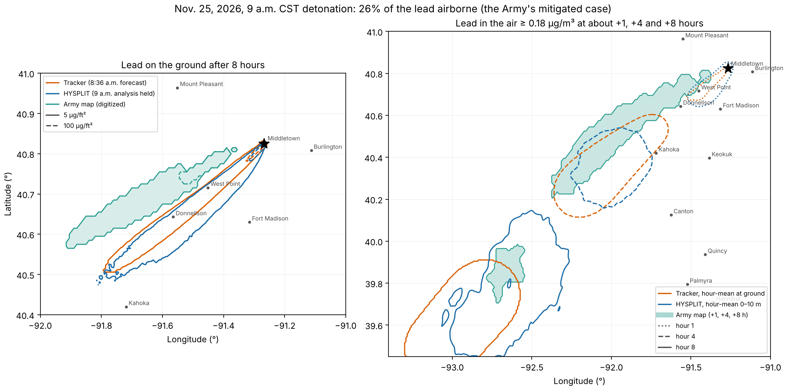
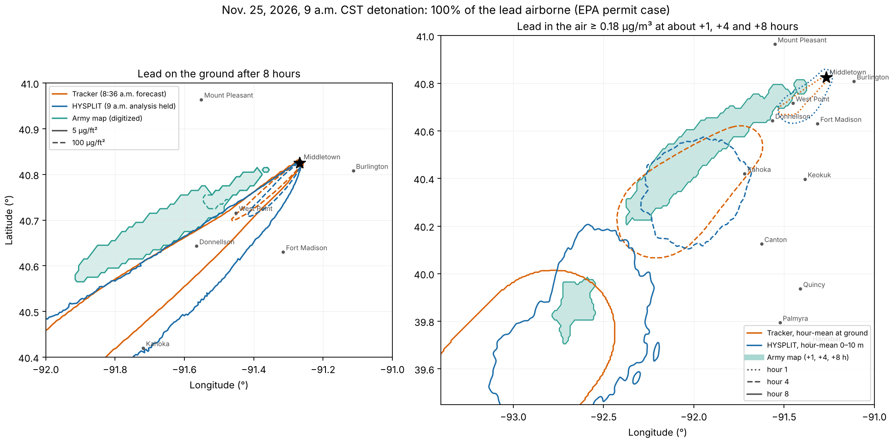

# Postmortem: the Nov. 25, 2026 detonation at the Iowa Army Ammunition Plant

**How the Iowa Lead Tracker's forecast compares with HYSPLIT run on the weather that
happened, and with the U.S. Army's own plume map**

> **Unofficial.** This is a screening model run by a private citizen, not from the Army or
> any government agency. Don't use it to decide if you're safe; follow official
> instructions. HYSPLIT results here are this project's runs of NOAA's public software and
> are not official NOAA products. Nothing below says what lead was actually measured
> anywhere; no measurements were public when this was written.

**Status.** First draft, written Nov. 25, 2026, late morning CST, about two hours after the
detonation. It uses the one hour of analyzed weather available then (9 a.m.). Sections
marked *pending* will be filled in as the later hours are archived (see
[Next steps](#7-next-steps)). Numbers may change.

Contents: [Abstract](#abstract) · [1. Background](#1-background) ·
[2. Data and methods](#2-data-and-methods) · [3. Was the weather forecast right?](#3-was-the-weather-forecast-right) ·
[4. Tracker against HYSPLIT](#4-the-tracker-against-hysplit) ·
[5. Against the Army's map](#5-against-the-armys-map) · [6. Discussion](#6-discussion) ·
[7. Next steps](#7-next-steps) · [8. Limits](#8-limits) · [Reproducing](#reproducing) ·
[References](#references)

## Abstract

News reports say the Army detonated about 9,700 lb of lead azide at the Iowa Army
Ammunition Plant near Middletown, Iowa, on the morning of Wednesday, Nov. 25, 2026; its
map gives 9 a.m. CST. When this was written, the Army hadn't published the actual time or
any results. For
a week before, the Iowa Lead Tracker published forecast maps of where the lead could go.
This postmortem asks three questions. Was the weather forecast behind the published map
right? Given the weather that happened, does the tracker's dispersion agree with NOAA's
HYSPLIT? And how do both compare with the Army's "Mitigated 0.26" map?

The forecast held up. Above about 200 m, the tracker's first-hour winds were within
1 m/s and 6° of NOAA's 9 a.m. HRRR analysis, and the analysis agreed with the Davenport
radar's measured winds within about 10° and, at most levels, 1 m/s. Near the ground the analysis was about
15° more northerly than the forecast; surface stations around the plant disagreed with each
other by more than that. By 10 a.m., though, the analyzed wind in the lowest 450 m had
turned 12–19° more northerly than the forecast. Run on the 9 a.m. analysis, HYSPLIT put the lead where the tracker
did: both send it southwest (about 230°), and the ground zones agree closely (100 µg/ft²:
2.2 vs 2.3 sq mi; 40 µg/ft²: 9.1 vs 8.0 sq mi) except the faintest one (5 µg/ft²: 90 vs
139 sq mi). The tracker's cloud travels about 20% faster than HYSPLIT's after the first few
hours.

The Army's map agrees with both on direction (within about 15°) and with HYSPLIT on the
cloud's speed and the 5 µg/ft² area (148 vs 139 sq mi). It differs sharply near the plant:
its 100 µg/ft² zone covers 27 sq mi, about 12 times the tracker's and HYSPLIT's for the same
26% of the lead airborne, and more than either gives with all of the lead airborne. The
likeliest reason is the particle sizes. The tracker assumes all the airborne lead is fine,
breathable dust; the Army's model must put a share of it in heavier particles that fall out
within about 15 miles. The Army hasn't published its particle sizes.

## 1. Background

The Iowa Lead Tracker (iowaleadtracker.com) is an open puff model of where lead from the
detonation could travel ([`MODEL.md`](../../../MODEL.md)). It shows four release cases:
7%, 26%, 55% and 100% of the lead airborne as fine dust (0.3 to 10 µm). The 26% case copies
the emission factor of 0.26 in the Army's "Mitigated 0.26" maps; 100% is the factor EPA's
emergency permit requires for the Army's official maps
([scenario README](../README.md#release-cases-research-notes)). The cloud's growth comes
from the forecast's turbulence ([`TURBULENCE.md`](../../../TURBULENCE.md)), and the weather
from four forecast models, with HRRR shown within 18 hours of the blast.

Before the event, a back-test against HYSPLIT on four past days found that the tracker and
HYSPLIT put the cloud on the same path in daytime, and that with the turbulence-based
spread the zone distances came within 0.8–1.9× of HYSPLIT's
([back-test](../../../validation/hysplit-backtest/README.md)). This is the same comparison
for the real event, plus the Army's map.

The Army's public advisory maps ("Mitigated 0.26") show lead on the ground (100 and
5 µg/ft², with areas of 27 and 148 sq mi) and lead in the air at 0.18 µg/m³, the lead air
sampling method's detection limit, at +1, +4 and +8 hours after a 9 a.m. CST detonation.
The maps were made with a model the Army hasn't named in them; its advisory refers to
"state-of-the-art atmospheric dispersion modeling" (McFate 2026).

## 2. Data and methods

### 2.1 What the tracker predicted

We use the forecast the site showed at 9 a.m.: the weather pulled at 8:36 a.m. CST (merged
to `main` at 8:55 a.m. as commit `c9f8e59`). The 9:05 a.m. pull was merged at 9:19 a.m.,
after the detonation, so it isn't the forecast people saw at 9 a.m. We rebuilt the site from that
commit (`make_map_picker.py --build`, which replays the saved forecasts) and read the
9 a.m. maps for the 26% ("U.S. Army mitigated") and 100% ("EPA permit") cases. HRRR was the
model shown; the other three (RRFS, GFS, ECMWF) make up the spread.

### 2.2 What the weather did

**NOAA's HRRR analysis.** HRRR is NOAA's 3 km hourly model. Each hour it blends new
observations (surface stations, radar, aircraft, balloons, satellites) into its last short
forecast; the result, the analysis, is the best gridded estimate of the atmosphere at that
hour (Benjamin et al. 2016; Dowell et al. 2022). It isn't an observation: between stations
and near the ground it is still partly model. We took the 9 a.m. (15 UTC) analysis on
pressure levels from NOAA's archive on AWS (`noaa-hrrr-bdp-pds`, `hrrr.t15z.wrfprsf00`,
posted 9:54 a.m. CST) and converted it to HYSPLIT's format with HYSPLIT's `api2arl_v4`.

**Observations.** To check the analysis we used:

- hourly and 20-minute reports from the airport stations at Burlington (KBRL), Fort
  Madison (KFSW), Mount Pleasant (KMPZ) and Ottumwa (KOTM), from the Iowa Environmental
  Mesonet;
- the Davenport NWS radar's wind profile (KDVN, VAD Wind Profile product, 9:00 and
  9:55 a.m.), from NOAA's Level III archive on AWS;
- the 6 a.m. CST weather balloons at Davenport (DVN) and Lincoln, Ill. (ILX);
- hourly sunshine at the Iowa State University soil moisture station at Crawfordsville
  (CRFI4), about 30 miles north.

The Army said it would launch weather balloons hourly at the site; we haven't seen those
data published.

### 2.3 HYSPLIT

HYSPLIT 5.4.2 (Stein et al. 2015), the public Linux build, with the same release as the
back-test: two vertical lines from 10 m to the cloud top (251 m) at the plant, 3,130 kg of
lead (100%) in four sizes (0.3, 1, 3 and 10 µm, 9,500 kg/m³), released over 6 minutes from
9:00 a.m.; 200,000 3D particles; air reported as hourly means in the 0–10 m and 0–100 m
layers and deposition on a 0.005° grid. Dry deposition speeds are fixed per size, the
Zhang et al. (2001) values from the back-test's Monday case. The 26% case is the same run
scaled by 0.26, which is exact: HYSPLIT's transport and deposition don't depend on the
amount released.

Only one hour of analysis existed when this was written, so the 8-hour run holds the
9 a.m. analysis fixed for all 8 hours (a *persistence* run). It answers "where would the
lead go if the 9 a.m. weather lasted," not "where did it go." The first hour or two are a
fair test; later hours are not, and are replaced as the hourly analyses are archived. The
public HYSPLIT build refuses forecast weather without NOAA registration, so we couldn't
drive it with the HRRR forecast started at 9 a.m.

As a check on the setup, we reran the back-test's Monday overcast case with this build and
NOAA ARL's archived HRRR. It reproduced the published HYSPLIT numbers: 597 lb deposited
(595 published), and peak hourly air of 24, 14 and 9 µg/m³ at hours 2, 3 and 5 (21, 13
and 9 published, which were sampled on the coarser map grid).

### 2.4 The Army's map

We digitized the two map images in [`data/army/`](data/army), stamped "Issued Nov. 24,
2026" and "a/o 240630NOV26". (The PDF described in the scenario README is stamped
240848NOV26; we haven't checked whether the maps differ.) Distances come from the map's
scale bar (2.5 pixels per mile) measured from the center of the magenta source box, and
directions assume north is up. The areas quoted are the ones printed on the map. A fit
through ten labeled cities places the plant about 8 miles north of the box's center, so the
box probably outlines the plant's grounds or a buffer rather than the detonation point.
Positions taken from the map are good to about ±5 miles and ±5°.

### 2.5 Comparing like with like

The three sources don't report the same thing. The tracker and HYSPLIT give one-hour mean
air at the ground (HYSPLIT: the 0–10 m layer); the Army's air map shows the cloud "at"
+1, +4 and +8 hours, probably snapshots. Ground lead is after 8 hours in our runs; the
Army's map doesn't say what period it covers. Where we give a cloud "center", it is the
air-weighted center of the hour's mean ground-level air for both models; the tracker's own
`centroid` field (the whole cloud at the end of the hour) runs farther ahead.

## 3. Was the weather forecast right?

**Winds aloft: yes.** Table 1 compares the tracker's first-hour wind profile at the plant
(from the HRRR forecast pulled at 8:36 a.m.) with the 9 a.m. analysis. Above about 200 m,
where the cloud starts (its top is about 250 m), they agree within about 1 m/s and 6°.

*Table 1. Wind at the plant: tracker's forecast for the first hour against the 9 a.m.
HRRR analysis.*

| Height | Tracker forecast | HRRR analysis, 9 a.m. |
|---|---|---|
| 10 m | 4.2 m/s from 43° | 3.7 m/s from 24° |
| about 240 m | 7.5 m/s from 54° | 7.2 m/s from 48° |
| about 450 m | 8.4 m/s from 58° | 8.3 m/s from 55° |
| about 660 m | 9.9 m/s from 59° | 9.3 m/s from 60° |
| about 870 m | 10.5 m/s from 64° | 10.5 m/s from 65° |

**The analysis aloft matches the radar.** The nearest measured winds aloft are the
Davenport radar's, about 70 miles northeast. Sampled at the radar, the 9 a.m. analysis
agrees with the radar's 9:00 a.m. profile within about 10°, and within about 1 m/s except
at 380–530 m, where the radar's two estimates (10.3 and 13.4 m/s) bracket the analysis's
10.2 (Table 2). The radar's clear-air returns were noisy (RMS 5–9 kt), and at about 320 m
it reported a 26-kt wind from 092° that doesn't fit the levels around it.

*Table 2. Wind at the Davenport radar, 9 a.m.: measured (VAD) against the HRRR analysis
at the same place.*

| Height above the radar | Radar | HRRR analysis |
|---|---|---|
| about 200–250 m | 8.2 m/s from 061° | 7.8 m/s from 062° |
| about 380–530 m | 10.3–13.4 m/s from 061–072° | 10.2 m/s from 074° |
| about 680 m | 12.3 m/s from 073° | 12.0 m/s from 081° |
| about 990 m | 13.4 m/s from 077° | 12.9 m/s from 082° |

The 6 a.m. balloons at Davenport and Lincoln, Ill., had winds from 65–95° in the lowest
kilometer, more easterly than the analysis at the plant three hours later. They are 70–130
miles away and three hours earlier, so they don't contradict it.

**By 10 a.m. the low-level wind had turned.** The tracker's "hour 1" winds are valid at
10 a.m., so the 10 a.m. analysis (posted 10:53 a.m.) is the cleaner test (Table 1b). Above
about 600 m the forecast still holds. Below it, where the cloud starts, the analyzed wind
came 12–19° more from the north than forecast. That would carry the near-field lead
more to the south-southwest than the tracker's 230°.

*Table 1b. Wind at the plant at 10 a.m.: tracker forecast against the 10 a.m. HRRR
analysis.*

| Height | Tracker forecast | HRRR analysis, 10 a.m. |
|---|---|---|
| 10 m | 4.2 m/s from 43° | 5.0 m/s from 29° |
| about 240 m | 7.5 m/s from 54° | 7.2 m/s from 35° |
| about 450 m | 8.4 m/s from 58° | 8.7 m/s from 46° |
| about 660 m | 9.9 m/s from 59° | 9.6 m/s from 55° |
| about 870 m | 10.5 m/s from 64° | 10.3 m/s from 61° |

**Near the ground: within the stations' own spread.** Around 9 a.m. the stations reported
north-northeast to northeast winds of 7–13 kt (Table 3). The analysis at the plant
(7 kt from 24°) sits inside that range; the tracker's forecast (8 kt from 43°) does too.
At single stations the analysis was off by up to 33° (Burlington) and 24° (Fort Madison),
in opposite directions; averaged over the three, analysis and observations agree within a
few degrees.

*Table 3. Surface wind around 9 a.m. CST. Observed (METAR) against the HRRR analysis at
each station.*

| Station | Distance from plant | Observed | HRRR analysis |
|---|---|---|---|
| Burlington (KBRL), 8:53 and 9:53 a.m. | 8 mi ESE | 8 and 13 kt from 050° | 7 kt from 017° |
| Fort Madison (KFSW), 9:15 a.m. | 12 mi S | 10 kt from 010° | 8 kt from 034° |
| Mount Pleasant (KMPZ), 9:15 a.m. | 17 mi NW | 7 kt from 050° | 8 kt from 044° |
| Ottumwa (KOTM), 8:53 a.m. | 64 mi W | 6 kt from 030° | not sampled |

**Sky: sunnier than the "overcast" label, as sunny as the forecast's sunshine.** Every
station reported no clouds below 12,000 ft except a few at 3,700 ft at Ottumwa. The
tracker's forecast said 100% cloud all day, but its sunshine for 9–10 a.m. was 187 W/m²,
and Crawfordsville measured about 190 W/m² over the same hour (686 kJ/m²). The model
estimates turbulence from the sunshine, not the cloud label, so the stability it used
(neutral, class D, with a mixing height of about 440 m rising to about 950 m) is plausible.
High cloud likely explains the gap between "100%" and the measured sunshine; we didn't
check satellite images.

## 4. The tracker against HYSPLIT

*Table 4. 26% of the lead airborne (about 1,800 lb), 9 a.m. detonation, 8 hours. Tracker:
published forecast. HYSPLIT: the 9 a.m. analysis held for 8 hours.*

| | Tracker | HYSPLIT | Tracker ÷ HYSPLIT |
|---|---|---|---|
| Ground ≥ 100 µg/ft²: area / farthest | 2.2 sq mi / 4.2 mi | 2.3 sq mi / 3.8 mi | 0.96 / 1.1 |
| Ground ≥ 40 µg/ft²: area / farthest | 9.1 sq mi / 9.6 mi | 8.0 sq mi / 7.8 mi | 1.1 / 1.2 |
| Ground ≥ 5 µg/ft²: area / farthest | 90 sq mi / 35 mi | 139 sq mi / 37 mi | 0.65 / 0.94 |
| Direction of the 5 µg/ft² zone's far end | 231° | 230° | |
| Lead on the ground after 8 h | 243 lb | 312 lb | 0.78 |
| Highest hourly air (hour 1) | 277 µg/m³ | 345 µg/m³ | 0.80 |
| Hourly air ≥ 32 µg/m³ (DOE PAC-1): farthest | 8.7 mi | 6.1 mi | 1.4 |
| Air ≥ 0.18 µg/m³, hour 1: farthest | 17 mi | 17 mi | 1.0 |
| Cloud center, hour 4 / hour 8 | 48 / 122 mi | 50 / 101 mi | 0.96 / 1.2 |

*Table 5. The same with 100% of the lead airborne (about 6,900 lb), the EPA permit case.*

| | Tracker | HYSPLIT | Tracker ÷ HYSPLIT |
|---|---|---|---|
| Ground ≥ 100 µg/ft²: area / farthest | 15 sq mi / 13 mi | 15 sq mi / 11 mi | 1.0 / 1.2 |
| Ground ≥ 40 µg/ft²: area / farthest | 39 sq mi / 23 mi | 59 sq mi / 24 mi | 0.66 / 0.97 |
| Ground ≥ 5 µg/ft²: area / farthest | 479 sq mi / 75 mi | 907 sq mi / 99 mi | 0.53 / 0.76 |
| Lead on the ground after 8 h | 936 lb | 1,200 lb | 0.78 |
| Highest hourly air (hour 1) | 1,064 µg/m³ | 1,328 µg/m³ | 0.80 |
| Hourly air ≥ 32 µg/m³ (DOE PAC-1): farthest | 23 mi | 22 mi | 1.0 |

**Direction and the near field agree.** Both models send the lead southwest along about
230°, past West Point and Donnellson (Figure 1, left). Within about 10 miles, where the
highest ground levels are, the two agree within 20% in area and distance in both cases.
HYSPLIT's first-hour peak is 25% higher; PAC-1 reaches about as far.

**The first hour on two real analyses.** Once the 10 a.m. analysis posted, we ran HYSPLIT
for the first hour on the 9 and 10 a.m. analyses together, with nothing held. Its cloud
center at hour 1 is 6.0 miles out at 222°, the same as the held run (5.7 miles, 222°); the
tracker's is 5.6 miles at 229°. Air at 0.18 µg/m³ reaches 19 miles in the 26% case,
against 17 in both other runs. (Its peaks are higher, 589 µg/m³ for 26%, because that run
used the finer 0.003° grid, so they aren't comparable with Table 4.) The turn in the wind
shows up after the first hour, which the hourly runs in [Next steps](#7-next-steps) will
cover.

**The tracker's far zones are narrower.** The 5 µg/ft² zone ends at about the same
distance in the 26% case, but HYSPLIT's covers about 1.5 times the area: its cloud is wider.
This is the direction the back-test pointed to. The tracker's crosswind growth is scaled
to a 10-minute basis on purpose, which keeps the cloud about 0.7 times as wide as the
1-hour value ([`TURBULENCE.md`](../../../TURBULENCE.md)). A narrower cloud is more
concentrated along its center line and thinner at the edges, so the faintest zone comes out
smaller. HYSPLIT also deposits about 30% more lead in 8 hours.

**The tracker's cloud runs faster later.** After hour 4 the tracker's cloud pulls ahead:
122 miles by hour 8 against HYSPLIT's 101. Some of that is the forecast (winds after 9 a.m.)
against persistence (9 a.m. winds held), so it isn't yet a fair test of the models. The
first rerun with the hourly analyses will settle it.

## 5. Against the Army's map

*Table 6. The Army's "Mitigated 0.26" map against both models for the 26% case. Army
areas are as printed; Army distances and directions are measured from the image (±5 mi,
±5°).*

| | Army map | Tracker | HYSPLIT |
|---|---|---|---|
| Ground ≥ 100 µg/ft²: area | 27 sq mi | 2.2 sq mi | 2.3 sq mi |
| Ground ≥ 100 µg/ft²: farthest | about 15 mi | 4.2 mi | 3.8 mi |
| Ground ≥ 5 µg/ft²: area | 148 sq mi | 90 sq mi | 139 sq mi |
| Ground ≥ 5 µg/ft²: farthest | about 38 mi | 35 mi | 37 mi |
| Direction of the ground zone | about 243–250° | 231° | 230° |
| Air ≥ 0.18 µg/m³ near +1 h | 6–9 mi out, about 250° | out to 17 mi | out to 17 mi |
| Air ≥ 0.18 µg/m³ near +4 h | 11–69 mi, center 42 mi, about 240° | center 48 mi | 35–66 mi, center 50 mi |
| Air ≥ 0.18 µg/m³ near +8 h | 89–108 mi, center 98 mi, about 228° | center 122 mi | 76–137 mi, center 101 mi |



*Figure 1. 26% of the lead airborne. Left: lead on the ground after 8 hours, 5 µg/ft²
(solid) and 100 µg/ft² (dashed). Right: air at or above 0.18 µg/m³ in hours 1, 4 and 8.
Orange: the tracker's published forecast (HRRR, pulled 8:36 a.m.). Blue: HYSPLIT on the
9 a.m. HRRR analysis held for 8 hours. Green: the Army's map, traced from the image and
placed from the source box with the scale bar. HYSPLIT's air outlines are smoothed by about
1 km for display only.*



*Figure 2. The same with 100% of the lead airborne (EPA permit case).*

**The Army's cloud moves like HYSPLIT's.** By +4 and +8 hours the Army's cloud is 42 and
98 miles out, close to HYSPLIT's 50 and 101 and slower than the tracker's 48 and 122.
Its +1-hour cloud is small and close in (6–9 miles), which fits a snapshot at one instant
rather than an hour's mean.

**The direction differs by about 10–15° near the plant.** The Army's ground zone points
about 243–250°, both models about 230°. Far out the three agree (Army +8 h about 228°).
That near-field difference is about the size of our uncertainty in placing the Army map, and
it was made from a forecast issued Nov. 24, a day earlier. It is also the direction the
surface stations disagreed in: Burlington reported 050°, which carries lead toward 230°,
while Fort Madison reported 010°, toward 190°. We can't say from these data which is right
for the first few miles.

**The 5 µg/ft² zone agrees; the 100 µg/ft² zone doesn't.** The Army's faintest ground zone
is about the same size and length as HYSPLIT's (148 vs 139 sq mi; about 38 vs 37 miles).
Its 100 µg/ft² zone is about 12 times larger than either model's and reaches about
15 miles, against about 4. Even with all of the lead airborne, both models give 15 sq mi,
about half the Army's 27 for a quarter of the lead.

## 6. Discussion

**What the tracker got right.** The forecast it was built on was good at 9 a.m.: the winds
that carry the cloud were within about 1 m/s and 6° of the analysis, and the analysis within
about 10° of the radar. Given the weather, its near-field numbers, where people
are closest and levels highest, are within about 20% of HYSPLIT's, and its direction matches
HYSPLIT's and, farther out, the Army's.

**Where the forecast slipped.** By 10 a.m. the lowest 450 m had turned 12–19° more
northerly than forecast. If that lasted, the lead near the plant went more to the
south-southwest than the published map showed, and farther from the Army's map, which
pointed more westerly. The hourly reruns will show how long it lasted.

**Where it differs from HYSPLIT.** Its faint far zones are narrower and its cloud runs
farther by the end of the day. The first is a known choice (the 10-minute spread basis),
which the back-test found gives a moderate high bias in the high zones and a low bias in
the lowest. The second needs the hourly analyses before we can blame either model.

**Why the Army's near field is so much heavier.** Three things could put 12 times more
ground above 100 µg/ft² within 15 miles: bigger particles, faster deposition, or a cloud
that starts lower. Of these, particle size is the likeliest and the largest. The tracker
puts all the airborne lead in breathable sizes (0.3 to 10 µm), which settle slowly; HYSPLIT
here does the same. A blast in earth-covered magazines behind barriers, water walls and
foam would make a lot of larger, wet, soil-bound particles that fall out within miles.
That fits the Army's map: a heavy near field (the "100" zone), then a faint far field the
same size as ours (the "5" zone, made by the fine fraction). The scenario README already
notes that the Army's case "keeps the site's all-respirable fume sizes, so it is not a
reproduction of the Army's HPAC/SHARC/NARAC run." This event is the first evidence of how
much that matters: for lead on the ground within about 15 miles, a lot.

For the public the practical point is narrow. The tracker's red (100 µg/ft²) zone was too
small next to the Army's. Its yellow (5 µg/ft²) zone was about the right size and in about
the right place. Neither says what was actually deposited; only sampling can.

## 7. Next steps

- *Pending:* rerun HYSPLIT on the hourly HRRR analyses as they post (9 a.m. to 5 p.m.;
  [`blast-day/nowcast_hrrr.sh`](../../../validation/hysplit-backtest/blast-day/README.md))
  to replace the persistence run, then on NOAA ARL's archived native-level HRRR (posted
  about 12:40 p.m. and 6:40 p.m. CST).
- *Pending:* run the tracker itself on the analyzed weather, to separate forecast error
  from model differences.
- *Pending:* compare with EPA's and the Army's air and surface sampling when it is
  published, the only test against lead that was really there.
- Try a size distribution with a coarse, soil-bound fraction (the model's `--size-preset
  mixed` or `soil-bound`) against the Army's 100 µg/ft² zone.
- Ask the Army for its model, particle sizes and source height, and its hourly balloon data.

## 8. Limits

- One hour of analyzed weather, held for 8 hours. After the first hour or two, the HYSPLIT
  numbers say where the lead would go if 9 a.m. lasted, not where it went.
- The HRRR analysis is a model estimate constrained by observations, not an observation. We
  used it on pressure levels every 25 hPa (about 200–250 m apart near the ground) and
  without surface heat fluxes, so HYSPLIT estimated mixing from the profiles.
- HYSPLIT is a reference model, not the truth. Its dry deposition speeds are fixed values
  taken from a different day.
- The Army map was measured from a JPEG: ±5 miles and ±5°, and drawn areas don't add up to
  the printed ones. We used the printed areas.
- The Army's map was made from a forecast issued Nov. 24; ours from one pulled 24 minutes
  before the detonation. They answer different questions.
- No measurements of lead were public when this was written. Nothing here says how much
  lead was actually released, where it landed, or whether any place is safe.

## Reproducing

From the repository root, with HYSPLIT 5.4.2 (`HYSPLIT_DIR`), ecCodes and the packages in
`requirements.txt` plus `matplotlib` and `metpy`:

```bash
# 1. The tracker's 9 a.m. forecast as published (8:36 a.m. pull)
git worktree add /tmp/wt0836 c9f8e59
(cd /tmp/wt0836 && python3 scenarios/iowa-aap-lead-azide/make_map_picker.py --build)
M=/tmp/wt0836/scenarios/iowa-aap-lead-azide/outputs/site/maps
python3 scenarios/iowa-aap-lead-azide/postmortem/scripts/tracker_stats.py $M/mid-0900.html $M/permit-0900.html

# 2. The 9 a.m. HRRR analysis, converted to ARL (validation/hysplit-backtest/blast-day)
WORK=/tmp/blast validation/hysplit-backtest/blast-day/nowcast_hrrr.sh 15 15
#    then repeat that hour as 16-23 UTC (persistence) and run
#    blast-day/2026-11-25-9am-zhang-persist.CONTROL with hycs_std

# 3. Numbers and figures
python3 scenarios/iowa-aap-lead-azide/postmortem/scripts/hysplit_stats.py RUN_DIR 15 0.26 1.0
python3 scenarios/iowa-aap-lead-azide/postmortem/scripts/figure.py mid 0.26 fig1.png \
    $M/mid-0900.html RUN_DIR scenarios/iowa-aap-lead-azide/postmortem/data/army/*air*.jpg \
    scenarios/iowa-aap-lead-azide/postmortem/data/army/*ground*.jpg
```

The repeat step rewrites the hour (characters 7–8) of each 50-byte record header of the
15 UTC frame; the forecast-hour field stays 0, because the data are the analysis.
`data/` holds the numbers these produce and the observations as downloaded.

## References

- Benjamin, S. G., and Coauthors, 2016: A North American hourly assimilation and model
  forecast cycle: The Rapid Refresh. *Mon. Wea. Rev.*, **144**, 1669–1694,
  doi:10.1175/MWR-D-15-0242.1.
- Dowell, D. C., and Coauthors, 2022: The High-Resolution Rapid Refresh (HRRR): An hourly
  updating convection-allowing forecast model. Part I: Motivation and system description.
  *Wea. Forecasting*, **37**, 1371–1395, doi:10.1175/WAF-D-21-0151.1.
- Iowa Environmental Mesonet, 2026: ASOS/AWOS and ISU Soil Moisture Network data, and
  upper-air soundings. Iowa State University, https://mesonet.agron.iastate.edu/ (retrieved
  Nov. 25, 2026).
- McFate, L., 2026: Public safety advisory (Iowa Army Ammunition Plant). U.S. Army
  Sustainment Command, Nov. 24, https://www.army.mil/article/297039.
- NOAA, 2026: NOAA High-Resolution Rapid Refresh (HRRR) model, and NEXRAD Level III
  products. NOAA Open Data Dissemination on AWS, `noaa-hrrr-bdp-pds` and
  `unidata-nexrad-level3` (retrieved Nov. 25, 2026).
- Stein, A. F., and Coauthors, 2015: NOAA's HYSPLIT atmospheric transport and dispersion
  modeling system. *Bull. Amer. Meteor. Soc.*, **96**, 2059–2077.
- U.S. Army, 2026: Public advisory maps, "Mitigated 0.26" dispersion and deposition,
  detonation 25 Nov 2026 0900 CST. Issued Nov. 24, 2026, a/o 240630NOV26 (images supplied
  by the maintainer).
- Zhang, L., S. Gong, J. Padro, and L. Barrie, 2001: A size-segregated particle dry
  deposition scheme for an atmospheric aerosol module. *Atmos. Environ.*, **35**, 549–560,
  doi:10.1016/S1352-2310(00)00326-5.
