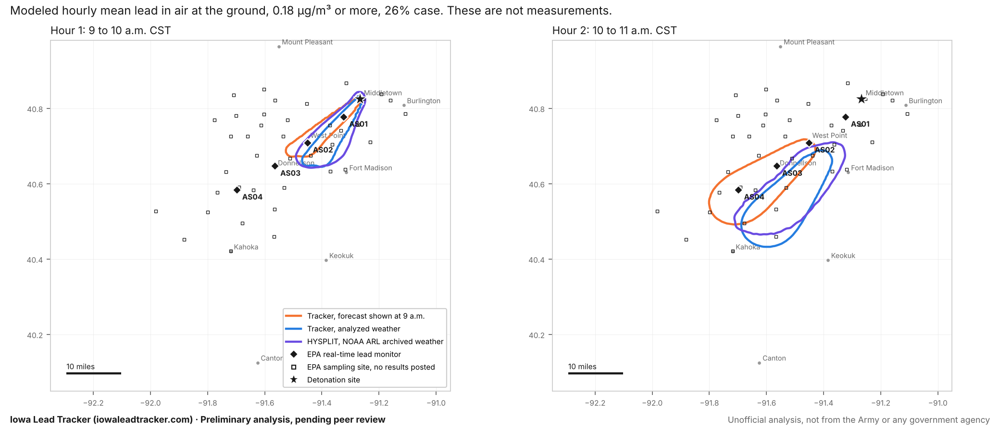

# The Nov. 25, 2026 detonation at the Iowa Army Ammunition Plant: a first comparison

**Were EPA's lead monitors placed to catch a cloud? The Iowa Lead Tracker's forecast, the
analyzed weather, NOAA's HYSPLIT and the U.S. Army's map against EPA's real-time readings**

> **Unofficial.** This is a screening model run by a private citizen, not from the Army or
> any government agency. Don't use it to decide if you're safe; follow official
> instructions. HYSPLIT results here are this project's runs of NOAA's public software and
> are not official NOAA products. The model maps below are estimates for assumed releases.
> They are not measurements, and nothing here says how much lead reached any place.

**Status.** Second draft, updated Nov. 25, 2026, about 1:15 p.m. CST, four hours after
the detonation. It replaces a first draft that an independent review found wrong in
several places ([what changed](#what-changed-since-the-first-draft)). The model comparison
covers the first two hours on NOAA's archived weather; later hours, the Army's results and
all lab sampling are still to come. It was drafted with an AI coding assistant, and the
first draft was reviewed by a separate AI referee
([`reviews/`](reviews/referee-report-1.md)); the maintainer has not yet checked every
number by hand.

Contents: [Summary](#summary) · [1. What this can and can't say](#1-what-this-can-and-cant-say) ·
[2. The event](#2-the-event) · [3. Data and methods](#3-data-and-methods) ·
[4. The weather](#4-the-weather-forecast-against-what-was-analyzed-and-observed) ·
[5. The models](#5-the-models-on-the-same-weather) ·
[6. EPA's monitors](#6-were-epas-monitors-placed-to-catch-a-cloud) ·
[7. The Army's map](#7-the-armys-map) · [8. What it means for the tracker](#8-what-it-means-for-the-tracker) ·
[9. Next steps](#9-next-steps) · [Reproducing](#reproducing) · [References](#references)

## Summary

The Army says it detonated the lead azide stockpile at the Iowa Army Ammunition Plant at
9 a.m. CST on Wednesday, Nov. 25, 2026, and that EPA "detected zero lead" afterward
(KCRG 2026b). For a week before, the Iowa Lead Tracker published forecast maps of where
the lead could go under four assumed releases. The first question after the detonation is
whether EPA's zero means little lead got out, or that its monitors were in the wrong
place. The rest of this comparison (the weather, the models, the Army's map) serves that
question.

1. **EPA's four real-time lead monitors read almost nothing.** They sit 4.5 to 28 miles
   southwest of the plant. Through 1:05 p.m. they posted 200 readings after the
   detonation; 187 were zero and the highest was 0.010 µg/m³, about the size of readings
   the same instruments posted before the detonation (up to 0.006).
2. **They were placed to catch a cloud at the ground.** Turning the modeled cloud through
   every direction it could plausibly have taken, the monitors would have read an hourly
   mean above the Army's 0.18 µg/m³ line for a release as small as 1% of the lead on any
   heading from about 211° to 236°. Every estimate of the cloud's direction here falls
   inside that: 215° for both models on analyzed weather, 229–230° for the tracker's
   forecast and the Army's map. At the nearest monitor, 4.5 miles out, about 0.2% of the
   lead (some 14 lb) would have been enough, and the lowest case the tracker published
   (7%) gives 5.5 to 7.6 µg/m³ there, roughly 3,000 times the highest reading.
3. **That coverage is thinner than four monitors suggests, and it is two-dimensional.**
   The three farther monitors lie along the forecast path. On analyzed weather the cloud
   passes south of them, so south of about 225° the coverage rests on the nearest monitor
   alone. And all of this assumes the cloud was at the ground. A cloud that rose above
   the shallow morning mixed layer and came down miles later would have missed the nearest
   monitor and, on the analyzed path, the other three. EPA's filter samplers at 211° to
   221° (sites AS06, AS12, AS13, AS14 and AS18) are on that path; their lab results, with
   soil and surface samples, are what can settle it. None were public.

The supporting results:

- **The wind forecast was right in speed and 9–18° off in direction where it mattered.**
  Matched hour for hour with NOAA's HRRR analysis, the forecast wind in the lowest 250 m
  came from 9–18° too far east at 9, 10 and 11 a.m. and noon; speeds agreed within
  0.7 m/s. The five surface stations within 16 miles averaged 28° and 31° at 9 and
  10 a.m., against the forecast's 42° and 44°. Rerun on the analyzed weather, the
  tracker's own cloud heads toward 215–219° instead of 229–231°, and the two footprints
  barely overlap (5–12% by intersection over union).
- **On the same weather the tracker and HYSPLIT agree.** With HYSPLIT run on NOAA's
  archived HRRR, both put the cloud along 215–216°, their 100 µg/ft² zones are the same
  size in the 26% case (2.1 and 2.0 sq mi), and their zones overlap by 59–71%. The
  tracker runs higher at some distances: its 40 µg/ft² zone is 1.5 times HYSPLIT's, its
  100 µg/ft² zone 1.7 times with all the lead airborne, and its hourly air beyond 6 miles
  1.7 to 1.9 times. HYSPLIT itself is sensitive to its weather input: on coarser
  pressure-level data its path shifts 7° and its near-field zones halve.
- **The Army's final map agrees with the tracker's forecast on direction and speed, and
  puts far more lead near the plant.** Stamped 7 a.m. on Nov. 25, it points 230° (the
  tracker's forecast: 229–231°) and has the cloud 27, 43 and 79 miles out at 2, 3 and 5
  hours (the tracker: 31, 48 and 85). Both rest on forecasts, and both point 10° to 15°
  west of the analyzed wind. The Army's 100 µg/ft² zone covers 29 sq mi and reaches 12
  miles; the tracker's, for the same 26%, covers 2 sq mi and reaches 4. A coarse share
  of particles in the tracker gives 12 to 17 sq mi, so it could explain much of the
  gap. The Army hasn't published its model's inputs.

## 1. What this can and can't say

- **Two hours of archived weather.** The HYSPLIT reference runs end at 11 a.m., when NOAA's
  first archive file ends. Anything about later hours is the tracker alone.
- **No lead measurements beyond four instruments.** EPA lists 43 sampling sites; only the
  four real-time monitors have public results, and the layer names neither the substance
  nor a detection limit. Filter, soil, wipe and water results will be the test of what
  landed. Nothing here estimates what was released.
- **The "analyzed weather" is a model product.** NOAA's HRRR analysis blends observations
  into HRRR's own one-hour forecast. It is not independent of the HRRR forecast being
  checked, nor of the airport reports and radar winds it takes in, so agreement with it
  is a lower bound on forecast error. There is no wind observation at the plant.
- **HYSPLIT is a reference model, not the truth.** It uses fixed deposition speeds here,
  and its answer moves by a factor of two with the weather file it is given (section 5).
- **The Army map is read from two JPEG images** of its final maps before the detonation,
  at 1.66 pixels per mile. Positions are good to about 3 miles; its model, particle sizes
  and source are unknown.
- **Zone edges are not boundaries.** A place outside a modeled zone may still get lead,
  and a place inside it may get none you could measure.

## 2. The event

The Army's notice on the morning of Nov. 25 said it would detonate at 9:00 a.m. CST and
update the public by 11 a.m. (McFate 2026b). KCRG and the Associated Press reported that
the Army "intentionally blew up the nation's entire stockpile of lead azide ... at 9 a.m.
on Wednesday," 68 barrels in bunkers, and that video "showed two white plumes rolling over
the detonation site before the clouds quickly dissipated" (KCRG 2026a). Two hours later
the Army said the detonation was complete and that "the EPA has detected zero lead"
(KCRG 2026b). We take 9:00 a.m. as the release time. A start a few minutes off would not
change the hourly comparisons; a start an hour off would.

EPA's Nov. 25 release says it collected 1,216 samples beforehand, that "pre-detonation
sampling is detecting no lead currently in the air," and that during the event "EPA's air
monitoring will be reporting data points every 5 minutes" in a public viewer (EPA 2026a,
2026b). The Army's permit application describes its own air sampling: 24-hour filter
samples at five on-site and five off-site locations, sent to a lab, and five "response"
samples during the event, read in the field by X-ray fluorescence (U.S. Army 2026b). None of those
results were public.

## 3. Data and methods

### 3.1 The forecast the site showed

The site's maps at 9 a.m. came from weather pulled at 8:36 a.m. CST (commit `c9f8e59`; the
commit deployed at 9:00, `fd17b63`, has the same forecast file). We rebuilt the site from
that commit, which replays the saved forecast, and used its 9 a.m. maps for the 7%, 26%
and 100% cases. HRRR was the model shown. Open-Meteo doesn't report which HRRR run a
response came from, so the forecast's lead time is not known; it was at most a few hours.
The tracker reads HRRR at 25 points about 115 miles apart and interpolates between them.

### 3.2 The analyzed weather

Two forms of NOAA's HRRR for the morning:

- **NOAA ARL's archive** (`20261125_12-17_hrrr`, 6 to 11 a.m., posted about 12:40 p.m.):
  hourly HRRR on its native levels with surface fluxes, in HYSPLIT's format. This is the
  weather the HYSPLIT reference runs use, as in the back-test.
- **The hourly analyses** for 9 a.m. to noon (15 to 18 UTC) on pressure levels every
  25 hPa, from NOAA's archive on AWS, converted with HYSPLIT's `api2arl_v4`
  ([`blast-day/nowcast_hrrr.sh`](../../../validation/hysplit-backtest/blast-day/README.md)).
  Each is available an hour after its time. They are used for the wind comparison in
  section 4 and for a second HYSPLIT run.

HRRR assimilates surface stations, radar, aircraft, balloons and satellites each hour
(Benjamin et al. 2016; Dowell et al. 2022).

### 3.3 Observations

All retrieved Nov. 25 and saved in [`data/obs/`](data/obs):

- reports from 18 airports within 85 miles and three Iowa DOT road weather stations (Iowa
  Environmental Mesonet). Airport winds are 2-minute means reported to 10° and 1 kt;
- the Davenport NWS radar's wind profile (VAD) at 9:00 and 9:55 a.m., 65 miles northeast;
- the 6 a.m. balloons at Davenport and Lincoln, Ill., 65 and 111 miles away;
- hourly sunshine at the Iowa State soil moisture station at Crawfordsville, 28 miles
  north-northwest;
- EPA AirNow hourly PM2.5, PM10 and wind for monitors within 160 miles.

### 3.4 The tracker on analyzed weather

To separate forecast error from model differences, we reran the tracker at 12:56 p.m. on
the HRRR that Open-Meteo then served, in which the hours through noon come from runs
started at or after those hours and later hours are forecasts from the newest run. The
weather is saved in `data/met_hrrr_asof_20261125_1856Z.json`, so the reruns need no
network. Settings are the site's, with HRRR only. This is HRRR at the tracker's 25 points
with its 10 m, 80 m and eight pressure-level winds. It is close to NOAA's analyses but not
identical: at the plant its 10 m wind direction is within 2° of the analysis at 9, 10 a.m.
and noon and 8° off at 11 a.m., and Open-Meteo revised some hours between two pulls an
hour apart.

### 3.5 HYSPLIT

HYSPLIT 5.4.2 (Stein et al. 2015), public Linux build, set up as in the
[back-test](../../../validation/hysplit-backtest/README.md): a vertical line source from
10 m to the cloud top (251 m) at the plant, 3,130 kg of lead (100%) in four sizes (0.3, 1,
3 and 10 µm at 9,500 kg/m³) released over 6 minutes from 9:00 a.m.; 200,000 particles;
hourly means in the 0–10 m layer and deposition. The tracker starts from five layers with
a 63 m initial spread, so the two differ in the first cells. Dry deposition speeds are
fixed per size: the tracker's Zhang et al. (2001) values at a 5 m/s reference wind (0.16,
0.10, 0.32 and 3.66 cm/s), or its Emerson et al. (2020) values. The tracker itself varies
them with the wind each hour. Lower releases are the same run scaled, which is exact. The
10 µm size holds 10% of the mass and makes about two-thirds of HYSPLIT's first-hour
deposition (the referee's count), so the near field depends on the coarse end of the
assumed sizes.

Two sets of runs:

- **Reference:** NOAA ARL's archived HRRR, 9 to 11 a.m., on a 0.003° grid, with Zhang and
  with Emerson speeds.
- **Sensitivity:** the pressure-level analyses, 9 a.m. to noon, on a 0.005° grid, Zhang
  speeds. Without surface fluxes HYSPLIT estimates mixing from the profiles.

Nothing is held fixed in either. The public HYSPLIT build refuses forecast weather without
NOAA registration. As a check on the setup, this build reproduced the back-test's Monday
case (597 lb deposited against 595 published).

### 3.6 What is compared

- **Hourly mean air** is the clock-hour mean at the ground: the tracker's `conc` field and
  HYSPLIT's 0–10 m layer. (The first draft used the tracker's `m60` field, the highest
  running 60-minute mean, which is not an hourly mean after the first hour.) "Hour 1" is
  9 to 10 a.m.
- **Snapshots** are the tracker's field at the end of an hour (`snap`), for comparison with
  the Army's "+1, +4, +8 hr" shapes.
- **Zones** are reported with area, farthest distance and the bearing of the far end, and
  with **overlap**: intersection over union on a common 0.005° grid. Two zones of equal
  area that point 10° apart overlap little.
- **Highest air by distance** compares the models' maxima in rings (1.5–3, 3–6, 6–12 and
  12–25 miles). The single highest cell sits within half a mile of the source and depends
  on cell size and the initial cloud, so it isn't compared.
- Tracker cells are 0.66–0.69 km on a side; HYSPLIT's 0.003° cells are about 0.33 by
  0.25 km. Tracker fields are stored in steps of about 8.5%.

Levels: 5 and 100 µg/ft² on the ground and 0.18 µg/m³ in air are the lines on the Army's
map (it labels them EPA's dust-lead levels for floors and window sills and the "lead air
sampling method detection limit"); 40 µg/ft² and DOE's PAC-1 (32 µg/m³ for one hour) are
the tracker's other lines. Sources are in the scenario README
([Threat-zone levels](../README.md#threat-zone-levels-research-notes)). These are indoor
dust and emergency-planning levels used here as map lines, not outdoor health limits.

### 3.7 The Army's map

Two 1200 × 675 JPEG images of the Army's "Mitigated 0.26" advisory maps, stamped "Issued
Nov. 25, 2026" and "a/o 250700NOV26" (7:00 a.m. on the day of the detonation), supplied
by the maintainer as the Army's final maps before it ([`data/army/`](data/army); U.S. Army
2026a). An earlier issue stamped a/o 240630NOV26 is there too (U.S. Army 2026c). The
final maps print areas of 29 and 186 sq mi for 100 and 5 µg/ft² (the earlier issue: 27
and 148) and mark the cloud's path in air at T+0.5, T+2, T+3 and T+5 hours.

`scripts/army_map.py` selects the shaded pixels by hue. Distances use the map's scale bar
(1.66 px per mile, so one pixel is 0.6 mile). The source is taken to be the upwind tip of
the ground plume, at the southwest edge of the magenta marker that the legend labels
"Iowa Army Ammunition Plant"; the marker's center is 3 miles away, and results from it
are given as the alternative. North is assumed up. The traced zones come to 165 and
26 sq mi against the printed 186 and 29, so the tracing runs about 10% small; areas quoted
are the printed ones. On the air map the cloud's path is one band, crossed by four lines
labeled with times. We read each line's end points from an enlarged crop (good to about
1 px) and take the cloud's position at that time as the point where the line crosses the
band's long axis. The map doesn't say whether a line marks the cloud's center or its
leading edge.

### 3.8 EPA's data

The two public layers behind EPA's "Iowa Army Ammunition Plant Response Data Viewer"
(EPA 2026c), downloaded at 1:07 p.m. CST ([`data/epa/`](data/epa/README.md)): 282
records from four stations labeled "Xact" (the name of a commercial instrument that
measures metals in air in near-real time), with a time, a concentration in µg/m³ and a
station; and 43 sampling sites with the instruments at each (dust monitors, gas monitors,
filter cassettes, canisters). The Xact layer doesn't name the substance or a detection
limit; EPA's release describes it as air monitoring for lead. Timestamps run to within
minutes of the download, so we read them as UTC. These are EPA's preliminary values as
posted.

## 4. The weather: forecast against what was analyzed and observed

*Table 1. Wind at the plant: forecast / HRRR analysis at the same hour (speed in m/s,
direction the wind comes from), with the forecast's direction error in parentheses.
Positive means the forecast wind came from farther east (clockwise). Heights above ground.
The cloud starts between the ground and 251 m.*

<!-- table:wind -->
| Level | 9 a.m. | 10 a.m. | 11 a.m. | Noon |
|---|---|---|---|---|
| 10 m | 3.7, 42° / 3.7, 24° (+18°) | 4.6, 44° / 5.0, 29° (+15°) | 5.3, 53° / 5.5, 38° (+15°) | 5.8, 54° / 6.2, 40° (+14°) |
| about 40 m (1000 hPa) | 4.9, 43° / 4.6, 30° (+13°) | 5.6, 45° / 6.0, 32° (+13°) | 6.2, 53° / 6.6, 41° (+12°) | 7.0, 54° / 7.2, 39° (+15°) |
| about 240 m (975 hPa) | 7.8, 57° / 7.2, 48° (+9°) | 7.2, 50° / 7.2, 35° (+15°) | 7.1, 54° / 7.6, 43° (+11°) | 7.9, 55° / 8.2, 42° (+13°) |
| about 450 m (950 hPa) | 8.2, 60° / 8.3, 55° (+5°) | 8.6, 57° / 8.7, 46° (+11°) | 8.3, 54° / 8.2, 47° (+7°) | 8.9, 53° / 8.6, 45° (+8°) |
| about 660 m (925 hPa) | 9.4, 58° / 9.3, 60° (−2°) | 10.3, 60° / 9.6, 55° (+5°) | 8.9, 65° / 9.2, 55° (+10°) | 8.7, 61° / 8.8, 51° (+10°) |
| about 870 m (900 hPa) | 10.1, 63° / 10.5, 65° (−2°) | 10.9, 65° / 10.3, 61° (+4°) | 9.9, 72° / 10.2, 63° (+9°) | 9.4, 70° / 9.3, 63° (+7°) |
<!-- /table:wind -->

Speeds agree within 0.7 m/s at every level and hour. Direction does not: through the
layer the cloud starts in, the forecast wind came from 9–18° too far east in all four
hours, and from 11 a.m. the error reached up to 870 m. The forecast also had the tracker's
80 m wind at 5.1 m/s from 44° at 9 a.m.; the analysis has no 80 m level, but its 40 m and
240 m winds (30° and 48°) put it near 33°. A wind from farther north carries the lead
farther south.

*Table 2. Surface wind at the five stations within 16 miles, observed (reports within 20
minutes of the hour, vector-averaged), with the forecast and analysis at the plant.*

| | 9 a.m. | 10 a.m. |
|---|---|---|
| Burlington airport, 8 mi ESE | 050°, 8 kt | 050°, 13 kt |
| Burlington road station, 9 mi E | 022°, 7 kt | 033°, 11 kt |
| Fort Madison airport, 12 mi SSW | 010°, 9 kt | 018°, 12 kt |
| Mount Pleasant airport, 15 mi WNW | 045°, 7 kt | 040°, 8 kt |
| Mount Pleasant road station, 16 mi WNW | 355°, 3 kt | 349°, 5 kt |
| **Vector mean of the five** | **28°** | **31°** |
| Forecast at the plant, 10 m | 42°, 7 kt | 44°, 9 kt |
| HRRR analysis at the plant, 10 m | 24°, 7 kt | 29°, 10 kt |

The stations don't depend on any model, and they side with the analysis: the forecast's
surface wind was about 13° too far east. They also disagree with each other by 30° to
60°, with the two stations nearest the cloud's path at the extremes (Burlington 050°,
Fort Madison 010°–018°). The Mount Pleasant road station reads half the airport's wind
4 miles away; dropping it moves the mean to 32° and 35°.

Across all 21 stations within 85 miles, the analysis minus the observed direction
averages +3° at 9 a.m. and +2° at 10 a.m., with a mean absolute difference of 12° and 8°
and no speed bias ([`data/station_vs_hrrr.json`](data/station_vs_hrrr.json)). Since HRRR
assimilates the airports, that mostly shows the assimilation worked; the three road
stations, which it may not use, differ by +20° and +14° on average. Airport winds are
reported to the nearest 10°, so differences under about 10° at one station mean little.

Aloft, the only measurement is the Davenport radar, 65 miles away, and it is noisy
(Table 3). Directions agree with the analysis within about 20° at seven of eight levels;
speeds differ by up to about 5 m/s, which is the size of the radar's own scatter.

*Table 3. Wind above the Davenport radar at 9:00 a.m. (VAD), with the HRRR analysis at the
radar on its nearest level. RMS is the radar's own fit error.*

| Height above radar | Radar | RMS | HRRR analysis |
|---|---|---|---|
| 197 m | 8.2 m/s from 061° | 3.0 m/s | 7.8 m/s from 062° (247 m) |
| 319 m | 13.4 from 092° | 4.8 | |
| 380 m | 10.3 from 072° | 3.2 | 10.2 from 074° (454 m) |
| 532 m | 13.4 from 061° | 4.7 | |
| 685 m | 12.3 from 073° | 2.6 | 12.0 from 081° (666 m) |
| 746 m | 16.5 from 077° | 2.9 | |
| 989 m | 13.4 from 077° | 2.0 | 12.9 from 082° (881 m), 12.6 from 082° (1,102 m) |
| 1,020 m | 11.8 from 077° | 1.2 | |

Other evidence is mixed. The 6 a.m. balloons had surface inversions and winds turning
from 15°–55° at the ground to 85°–110° near 1 km, three hours before and 65–111 miles
from the plant. The AirNow monitor at Lake Sugema, 40 miles west-southwest, reported
hourly winds from 37° and 43° for the hours beginning 9 and 10 a.m., close to the
forecast's direction, not the analysis's.

Sky and sunshine. The forecast called for 100% cloud. Airports near the plant
(Burlington, Fort Madison, Mount Pleasant, Keokuk) reported no cloud below 12,000 ft from
8:30 to 10 a.m., which doesn't rule out higher cloud; to the west, Fairfield was overcast
at 3,100 ft from 8:55 to 9:55, Oskaloosa broken to overcast at 3,800 ft until about 9:15,
and Ottumwa, Iowa City and Washington had scattered or few clouds near 3,500 ft. The
tracker sets turbulence from the forecast sunshine, not the cloud label: it used
187 W/m² for the first hour, interpolated from the forecast's hourly means (115 W/m² for
8–9 a.m. and 259 for 9–10). Crawfordsville measured 686 kJ/m² in the hour stamped
10 a.m., or 191 W/m²; if that stamp marks the end of the hour, the forecast had about a
third more sun than was measured there. The tracker treated the air as neutral (class D)
with a mixing height of about 440 m in the first hour. The analysis's own profile is
stably stratified between 40 and 240 m at 9 a.m. Whether the cloud mixed to the ground as
fast as either model assumes is an open question that bears directly on section 6.

## 5. The models on the same weather

*Table 4. 26% of the lead airborne (1,794 lb), after 2 hours (11 a.m.). Zones: area /
farthest distance / bearing of the far end. Air in µg/m³. The tracker's zones at 100 and
40 µg/ft² are complete by then; its 5 µg/ft² zone grows to 90 sq mi (forecast) and
102 sq mi (analyzed) by 8 hours.*

<!-- table:models -->
|  | Tracker, forecast | Tracker, analyzed weather | HYSPLIT, ARL archive | HYSPLIT, ARL archive, Emerson speeds | HYSPLIT, pressure-level analyses |
|---|---|---|---|---|---|
| Ground ≥ 100 µg/ft² | 2.2 sq mi / 4.2 mi / 225° | 2.1 sq mi / 3.8 mi / 209° | 2.0 sq mi / 3.9 mi / 211° | 2.6 sq mi / 4.4 mi / 212° | 1.2 sq mi / 2.3 mi / 220° |
| Ground ≥ 40 µg/ft² | 9.1 sq mi / 9.6 mi / 228° | 8.0 sq mi / 9.4 mi / 213° | 5.4 sq mi / 6.0 mi / 211° | 7.4 sq mi / 7.1 mi / 213° | 3.2 sq mi / 4.2 mi / 222° |
| Ground ≥ 5 µg/ft² | 75 sq mi / 29 mi / 232° | 83 sq mi / 28 mi / 219° | 87 sq mi / 27 mi / 219° | 103 sq mi / 28 mi / 218° | 66 sq mi / 24 mi / 224° |
| Lead on the ground | 115 lb | 123 lb | 120 lb | 156 lb | 93 lb |
| Highest hourly air, hour 1: 1.5–3 mi | 170 | 165 | 210 | 214 | 82 |
| Highest hourly air, hour 1: 3–6 mi | 88 | 79 | 84 | 85 | 38 |
| Highest hourly air, hour 1: 6–12 mi | 42 | 45 | 26 | 25 | 15 |
| Highest hourly air, hour 1: 12–25 mi | 20 | 20 | 11 | 11 | 7.7 |
| Hourly air ≥ 32 µg/m³ (PAC-1), farthest | 8.7 mi | 9.4 mi | 5.3 mi | 5.3 mi | 3.2 mi |
| Center of hourly mean air, hour 1 | 5.6 mi at 229° | 5.6 mi at 215° | 5.3 mi at 215° | 5.2 mi at 215° | 6.0 mi at 222° |
| Center of hourly mean air, hour 2 | 22 mi at 230° | 21 mi at 216° | 19 mi at 216° | 19 mi at 216° | 23 mi at 223° |
<!-- /table:models -->

*Table 5. Overlap of the zones after 2 hours (intersection over union; 1 = identical,
0 = no overlap).*

<!-- table:overlap -->
| Pair | Case | ≥ 100 | ≥ 40 | ≥ 5 µg/ft² |
|---|---|---|---|---|
| Tracker forecast vs tracker on analyzed weather | 26% | 0.11 | 0.12 | 0.05 |
|  | 100% | 0.11 | 0.06 | 0.08 |
| Tracker on analyzed weather vs HYSPLIT (ARL archive) | 26% | 0.71 | 0.59 | 0.70 |
|  | 100% | 0.50 | 0.71 | 0.74 |
| Tracker forecast vs HYSPLIT (ARL archive) | 26% | 0.09 | 0.12 | 0.08 |
|  | 100% | 0.12 | 0.07 | 0.14 |
<!-- /table:overlap -->


*Figure 1. Modeled lead on the ground for the 26% case: 5 µg/ft² (left) and 100 µg/ft²
(right, enlarged). Tracker zones are after 8 hours; HYSPLIT's (on NOAA ARL's archived
weather) after 2. The Army's zones are traced from its final map and placed from the
plume's tip. Diamonds are EPA's four real-time monitors; open squares are EPA's other
sampling sites, with no public results.*



*Figure 2. Modeled hourly mean lead in air at the ground, 0.18 µg/m³ or more, 26% case,
for the two hours of archived weather. HYSPLIT's outline is smoothed by about 1 km for
display; at this level it rests on a handful of particles per cell.*

The forecast error moved the tracker's own map. On analyzed weather its cloud leaves
along 209°–215° and bends to about 219°, 13° to 16° south of the forecast map's
225°–232°. The zones keep their size and length but not their place: the forecast and
analyzed-weather footprints share 5% to 12% of their combined area. At 15 miles a 15°
shift is 4 miles, wider than the 5 µg/ft² zone.

On the same weather the tracker and HYSPLIT agree. With HYSPLIT on NOAA ARL's archived
HRRR, both models' clouds are centered at 215° in the first hour and 216° in the second.
In the 26% case the 100 µg/ft² zones are 2.1 and 2.0 sq mi and reach 3.8 and 3.9 miles;
the 5 µg/ft² zones are 83 and 87 sq mi; the lead on the ground after two hours is 123 and
120 lb. The zones overlap by 59% to 71% of their combined area (50% to 74% with all the
lead airborne), against 5% to 12% between the forecast and analyzed-weather maps. For
this event the weather forecast mattered far more than the choice of model.

Where they differ, the tracker is the higher one. Its 40 µg/ft² zone is 1.5 times
HYSPLIT's (8.0 against 5.4 sq mi). With all the lead airborne its 100 µg/ft² zone is 1.7
times HYSPLIT's (16 against 9.4 sq mi), though HYSPLIT with Emerson deposition speeds
gives 15. Its highest hourly air is 0.8 to 0.9 times HYSPLIT's within 6 miles and 1.7 to
1.9 times from 6 to 25 miles, and PAC-1 reaches 9.4 miles against 5.3. This is the
moderate high bias the back-tests found in neutral daytime air (tracker distances 0.8 to
1.9 times HYSPLIT's; [`TURBULENCE.md`](../../../TURBULENCE.md)).

HYSPLIT's own answer depends on its weather file. On the pressure-level analyses, which
have levels near 40 and 240 m with nothing between and no surface fluxes, its cloud runs along
222°–223°, 7° west of the run on archived weather; its 100 µg/ft² zone is 1.2 sq mi
instead of 2.0, and its highest hourly air within 6 miles is about 40% as high. An earlier
version of this draft compared the tracker with that run and found a 1.7- to 3.6-fold
difference that the archived weather removes.

## 6. Were EPA's monitors placed to catch a cloud?

### 6.1 What they read

*Table 6. EPA's four real-time monitors, as posted through 1:07 p.m. CST, and the models'
hourly mean air (µg/m³) at each for the lowest case (7% of the lead airborne) in hours 1
and 2. Multiply model values by 3.7 for the 26% case and by 14 for 100%.*

<!-- table:monitors -->
| Monitor | From the plant | Readings after 9 a.m. | Not zero | Highest (µg/m³) | Highest before 9 a.m. | Tracker, forecast (h1 / h2) | Tracker, analyzed (h1 / h2) | HYSPLIT, ARL archive (h1 / h2) |
|---|---|---|---|---|---|---|---|---|
| AS01 | 4.5 mi at 221° | 50 | 2 | 0.0021 | 0 | 7.6 / 0 | 6.3 / 0 | 5.5 / 0 |
| AS02 | 12.5 mi at 230° | 51 | 1 | 0.0002 | 0.0030 | 5.0 / 0.19 | 0 / 0 | 0.17 / 0 |
| AS03 | 19.9 mi at 232° | 50 | 4 | 0.0043 | 0 | 0 / 2.6 | 0 / 0.0001 | 0 / 0 |
| AS04 | 28.1 mi at 233° | 49 | 6 | 0.0102 | 0.0063 | 0 / 1.2 | 0 / 0 | 0 / 0 |
<!-- /table:monitors -->


*Figure 3. EPA's readings (dots; zeros on the bottom line) and the models' hourly means
for the 7% case at each monitor, on a logarithmic scale.*

The readings are flat. Of 200 readings after the detonation, 187 are zero. The thirteen
that aren't range from 0.0002 to 0.010 µg/m³, and two of the four monitors posted readings
of 0.003 to 0.006 µg/m³ before the detonation. Nothing in the series marks a cloud
arriving or leaving. AS01, the nearest, posted a reading every five minutes through the
first hour; its only non-zero values, 0.0021 µg/m³, came at 9:10 and 9:11 a.m.

### 6.2 Where they sit

*Table 9. Modeled highest hourly mean air (µg/m³) for the lowest case (7% airborne) at
EPA's real-time monitors and at its other sampling sites that fall inside the cloud on
analyzed weather. HYSPLIT's run ends at 11 a.m., before the cloud reaches the farther
sites.*

<!-- table:sites -->
| Site | From the plant | Instruments | Tracker, forecast | Tracker, analyzed | HYSPLIT, ARL archive |
|---|---|---|---|---|---|
| AS01 | 4.5 mi at 222° | **real-time lead** | 7.6 | 6.3 | 5.5 |
| AS02 | 12.5 mi at 230° | **real-time lead** | 5.0 | 0 | 0.17 |
| AS03 | 19.9 mi at 232° | **real-time lead** | 2.6 | 0.0001 | not reached in 2 h |
| AS04 | 28.1 mi at 233° | **real-time lead** | 1.2 | 0.0004 | not reached in 2 h |
| AS06 | 6.8 mi at 211° | filter, dust monitor | 0 | 12 | 5.3 |
| AS11 | 7.4 mi at 229° | filter | 7.6 | 0.0899 | 0.64 |
| AS12 | 9.8 mi at 211° | filter | 0 | 7.4 | 2.8 |
| AS13 | 13.8 mi at 221° | filter | 0.0853 | 2.8 | not reached in 2 h |
| AS14 | 21.4 mi at 220° | filter | 0.0786 | 1.6 | not reached in 2 h |
| AS18 | 25.6 mi at 218° | filter | 0.0053 | 1.8 | not reached in 2 h |
| AS36 | 29.8 mi at 212° | filter | 0 | 0.22 | not reached in 2 h |
| AS37 | 31.4 mi at 223° | filter | 0.16 | 0.64 | not reached in 2 h |
| AS05 | 36.6 mi at 220° | filter, dust monitor | 0.0377 | 1.0 | not reached in 2 h |
<!-- /table:sites -->

On the forecast, all four real-time monitors are in the cloud: they lie at 222° to 233°,
along the tracker's forecast path and the axis of the Army's final map (230°). EPA placed
them where the forecasts said the lead would go.

On analyzed weather only AS01 is. Both models put the cloud's first-hour center at 215°,
and AS01, at 222°, gets 35% to 38% of the highest value at its distance, still 5.5 to
6.3 µg/m³ for the lowest case. The three farther monitors are outside: the tracker gives
them nothing, and HYSPLIT gives AS02 the cloud's edge (0.17 µg/m³). The sites best placed
for the analyzed path are filter samplers, not real-time monitors: AS06 and AS12 at 211°,
7 and 10 miles out, then AS13, AS14 and AS18.

### 6.3 How much they cover

The cloud's true direction isn't known to better than about 10° (section 4), so the
useful question is how the monitors fare over a range of directions. We turned each
modeled cloud about the plant in 1° steps and read off the highest hourly mean at any
real-time monitor (Figure 5, Table 10). Turning the cloud rigidly ignores how a different
wind would reshape it, so this is a sensitivity test.


*Figure 5. The highest hourly mean any real-time monitor would read if the modeled cloud
traveled in another direction, for the lowest case (7% airborne). Dots mark each run's own
direction. The gray band is where the cloud would go if it followed the surface wind
(from 24°–31° at the plant and the nearby stations).*

*Table 10. Directions of travel (first-hour center of the cloud) over which at least one
real-time monitor would read an hourly mean at or above two levels: 0.18 µg/m³, the Army
map's air line, and 0.01 µg/m³, the highest reading any of the monitors posted.*

<!-- table:windows -->
| Share of the lead airborne | Hourly mean at a monitor of at least | Tracker, forecast | Tracker, analyzed | HYSPLIT, ARL archive (AS01, AS02 only) |
|---|---|---|---|---|
| 7% | 0.18 µg/m³ | 208°–238° | 204°–239° | 203°–244° |
| 7% | 0.01 µg/m³ | 208°–244° | 204°–243° | 200°–245° |
| 1% | 0.18 µg/m³ | 213°–234° | 211°–236° | 210°–238° |
| 1% | 0.01 µg/m³ | 208°–241° | 204°–241° | 203°–245° |
| 0.1% | 0.18 µg/m³ | 219°–226° | 225°–230° | 225°–227° |
| 0.1% | 0.01 µg/m³ | 213°–236° | 211°–236° | 206°–241° |
<!-- /table:windows -->

For the lowest published case the monitors respond over about 35° of arc, from 204°–208°
to 238°–244°, and over the middle of it, about 213° to 233°, they would read 5 to
18 µg/m³. For 1% of the lead airborne the window is still about 211° to 236°. Every direction estimated here
falls inside: 215° (both models on analyzed weather), 222° (HYSPLIT on pressure-level
data), 229°–230° (the tracker's forecast and the Army's map). Only a cloud that followed
the surface wind exactly, toward 204°–211°, would be at the window's edge.

Sensitivity at AS01 is high. With the cloud as modeled, an hourly mean of 0.18 µg/m³ there
needs 0.17% to 0.23% of the lead airborne as fine dust, about 12 to 16 lb of the 6,900;
0.01 µg/m³ needs about 0.01%, under a pound. A 5-minute reading during the cloud's passage
would run above the hourly mean, so these are conservative.

So for a cloud at the ground, the monitors were placed to catch it. The coverage is
thinner than four monitors suggests: south of about 225° it is AS01 alone, because the
other three sit within 3° of each other on the forecast axis.

### 6.4 What they could not see

- **A cloud above the ground.** Both models start the cloud mixed from the ground to
  251 m. The analysis has a stable layer between 40 and 240 m at 9 a.m., and the
  forecast's mixing height was 285 m then and 590 m an hour later. A hot cloud that rose
  into or above that layer could pass over AS01, 4.5 miles out, and reach the ground only
  as the mixed layer grew, 10 or more miles downwind. On the analyzed path the monitors
  there, AS02 to AS04, are 3 to 7 miles to the side. News video showed plumes that
  "quickly dissipated" (KCRG 2026a), which says nothing about height.
- **Anything below their detection limit or between their samples.** The layer gives no
  detection limit, sampling interval or status flags. Zeros are posted as exact zeros,
  which suggests values below some limit are set to zero. We don't know what a 5-minute
  reading represents.
- **Lead on the ground.** These are air monitors. Coarse particles that fall out within a
  few miles (section 7) may never reach a monitor 4.5 miles away.

### 6.5 What the readings mean

If the cloud crossed AS01 at the ground as modeled, the fine airborne share was thousands
of times smaller than the lowest case: a few thousandths of a percent of the lead, taking
the highest reading at face value. That is the simplest reading, it matches what the Army said its barriers, water and foam were built to do, and
the placement analysis above supports it for a ground-level cloud. It is not established,
because it rests on one instrument, an assumed mixing depth and an unknown detection
limit.

What would settle it: EPA's filter samples at AS06, AS12, AS13, AS14 and AS18, which
collect over hours and are analyzed in a lab; the dust-monitor record at AS06; the Army's
on-site samples and hourly balloons, which would show how high the cloud went; and soil
and wipe sampling between about 205° and 245° within 15 miles, which spans every model run
here and the Army's map.

Regional particle monitors add nothing yet. AirNow has no PM monitor within 39 miles.
Readings within 160 miles ran 4 to 12 µg/m³ of PM2.5 from 5 a.m. to noon, an ordinary
range. All are upwind or off to the side. The one to the southwest, Lake Sugema (40 miles
at 257°), is roughly 20 miles north of the modeled path at that distance and posted 5, 10
and 6 µg/m³ for three of the hours from 8 a.m. to noon. Lead at the Army map's 0.18 µg/m³
line would be about 2% of that background, so PM2.5 can't show it.

## 7. The Army's map

*Table 7. The Army's final "Mitigated 0.26" maps (a/o 7 a.m. Nov. 25) against the
tracker's 26% case. Army distances are from the plume's tip; values from the marker's
center are in parentheses. Tracker ground zones are after 8 hours; tracker cloud positions
are the extent and center of its snapshot at 0.18 µg/m³ or more.*

<!-- table:army -->
|  | Army, final map | Tracker, forecast | Tracker, analyzed weather |
|---|---|---|---|
| Ground ≥ 100 µg/ft²: area | 29 sq mi (printed) | 2.2 sq mi | 2.1 sq mi |
| farthest, bearing | 12 mi (15), 238° (241°) | 4.2 mi, 225° | 3.8 mi, 209° |
| Ground ≥ 5 µg/ft²: area | 186 sq mi (printed) | 90 sq mi | 102 sq mi |
| farthest, bearing | 37 mi (40), 232° (233°) | 35 mi, 231° | 35 mi, 219° |
| Plume axis | 230° on the ground, 227° in air |  |  |
| Overlap of the 5 µg/ft² zones with the Army's |  | 0.37 (0.16) | 0.00 (0.00) |
| Cloud at 2 h | 27 mi | 24–37 mi, center 31 mi at 231° | 23–35 mi, center 29 mi at 218° |
| Cloud at 3 h | 43 mi | 39–57 mi, center 48 mi at 231° | 36–54 mi, center 45 mi at 220° |
| Cloud at 5 h | 79 mi | 72–98 mi, center 85 mi at 229° | 68–93 mi, center 80 mi at 220° |
<!-- /table:army -->


*Figure 4. Lead in air at one moment, 0.18 µg/m³ or more: the tracker's snapshots 2, 3
and 5 hours after the detonation, with the cloud path from the Army's final air map
(shaded) and the Army's mark for that time (ring).*

On direction and speed the Army's final map and the tracker's forecast agree. The Army's
plume lies along 230° on the ground and 227° in air; the tracker's forecast map along
229°–231°. The 5 µg/ft² zones are the same length (37 and 35 miles) and overlap by 37%
of their combined area, more than the tracker and HYSPLIT overlap on the same weather.
The Army's marks at 2, 3 and 5 hours fall inside the tracker's forecast cloud at each
time, 4 to 6 miles behind its center. Its mark at half an hour is 6 miles out; the tracker saves no
snapshot then.

Both are forecasts, and both miss the analyzed wind the same way. On analyzed weather the
tracker's cloud runs along 215°–220°, as HYSPLIT's does, and its 5 µg/ft² zone shares
almost nothing with the Army's. If the analysis is closer to the truth than the two forecasts (section 4), the
Army's map pointed 10° to 15° too far west, as the tracker's did. EPA's three farther
real-time monitors sit on that forecast axis.

The earlier issue of the Army's map, stamped 6:30 a.m. Nov. 24, pointed 241° and moved
the cloud more slowly (about 41 miles at 4 hours). The final issue turned 11° toward the
south and moves the cloud a third to a half faster, consistent with a newer forecast.

The amounts differ. The Army's 100 µg/ft² zone is 13 to 14 times the tracker's in area
(29 sq mi against 2.1–2.2) and reaches 12 miles against 4; its 5 µg/ft² zone is about
twice the tracker's (186 sq mi against 90–102). Table 8 shows what the tracker gives for
the same 26% when its assumptions change.

*Table 8. Tracker on analyzed weather, 26% airborne, after 8 hours, under other
assumptions.*

<!-- table:sensitivity -->
| Run | ≥ 100 µg/ft² | ≥ 5 µg/ft² | Lead on the ground within 15 mi |
|---|---|---|---|
| As published: fine sizes (0.3–10 µm), Zhang deposition | 2.1 sq mi, 3.8 mi | 102 sq mi, 35 mi | 86 lb |
| Sizes 1–30 µm (`mixed`) | 12 sq mi, 11 mi | 183 sq mi, 44 mi | 599 lb |
| Sizes 10–100 µm (`soil-bound`) | 17 sq mi, 13 mi | 257 sq mi, 51 mi | 1,032 lb |
| Half fine, half 30 and 100 µm | 13 sq mi, 11 mi | 185 sq mi, 44 mi | 766 lb |
| Fine sizes, deposition speed +1 cm/s | 9.5 sq mi, 11 mi | 334 sq mi, 61 mi | 241 lb |
| Fine sizes, Emerson deposition | 2.8 sq mi, 5.3 mi | 143 sq mi, 41 mi | 110 lb |
| Fine sizes, cloud top 151 m instead of 251 m | 3.5 sq mi, 6.3 mi | 84 sq mi, 33 mi | 100 lb |
| **Army, final map** | **29 sq mi, 12 mi** | **186 sq mi, 37 mi** | not given |
<!-- /table:sensitivity -->

A coarse share of particles moves the tracker most of the way. With half the airborne
lead in 30 and 100 µm particles, or with sizes spread over 1–30 µm, its 5 µg/ft² zone
comes to 183–185 sq mi, matching the Army's 186, and its 100 µg/ft² zone to 12–13 sq mi
and 11 miles, against the Army's 29 sq mi and 12 miles. An all-coarse release reaches
17 sq mi. A faster deposition speed for fine particles does less for the high zone and
overshoots the low one. So the Army's map looks like a model with a substantial coarse
fraction, though no variant here reaches 29 sq mi. Other explanations stay open: the
Army's lines may be a conservative percentile, not a mean; its source may be lower or its
deposition scheme different; water and foam may be modeled as removal near the source.
The Army hasn't published its model's inputs, and these runs don't identify them.

## 8. What it means for the tracker

- **Direction.** The published map pointed about 15° too far west of where the analyzed
  wind and the nearby stations put the low-level flow. The Army's final map pointed the
  same way as the tracker's, so this was an error in the weather forecasts, not in one
  model. The site showed a ±5° direction spread and three other weather models; whether
  those covered the analyzed path is not yet checked. In the back-test the tracker's path
  matched HYSPLIT's within about 5° in daytime, but both models ran on archived weather
  there, so it never tested the forecast. A forecast error of this size should be expected
  and shown.
- **Amounts near the plant.** On the same weather the tracker and HYSPLIT agree on the
  highest ground zone and on the lead deposited, and the tracker runs up to about twice
  as high in air beyond 6 miles. For a screening map that is the cautious side, and in
  line with the back-test.
- **The release assumptions.** EPA's nearest monitor read thousands of times below even
  the lowest case, and it was placed where it would have caught a ground-level cloud
  (section 6). If lab samples confirm that, the
  cases, built from blasting-cap tests and handbook rules for unmitigated detonations,
  were far too high for this mitigated one. If the cloud instead passed overhead, the
  models' assumption that it starts mixed to the ground is the thing to fix. Either way
  the site's current statement, to wait for official results, stands.
- **Coarse particles.** The published cases put all airborne lead in fine sizes. Table 8
  shows that a coarse share changes the lead on the ground within 15 miles by a factor of
  7 to 12 and brings the tracker's zones close to the Army's. The tracker should show a
  coarse case.

## 9. Next steps

- Extend the HYSPLIT reference runs to 8 hours when NOAA ARL posts the noon–5 p.m. file
  (due about 6:40 p.m.).
- Check whether the site's direction spread and other weather models covered the
  analyzed path.
- Add EPA's filter, soil and wipe results, the Army's samples, balloons and its final
  map as they are published; ask EPA for the monitors' detection limit and sampling
  interval.
- Compare HYSPLIT's turbulence diagnostics on the archived weather with the tracker's,
  and test the tracker with stability taken from the analysis's profile.
- Get the Army's maps as PDFs with a known projection, its post-detonation map, and its
  model inputs.

## Reproducing

From the repository root, with HYSPLIT 5.4.2 (`HYSPLIT_DIR`), ecCodes, and the packages in
`requirements.txt` plus `matplotlib`, `scipy`, `Pillow` and (for the radar file) `metpy`:

```bash
HYSPLIT_DIR=/path/to/hysplit scenarios/iowa-aap-lead-azide/postmortem/scripts/reproduce.sh /tmp/postmortem
```

It rebuilds the site's maps from the 9 a.m. forecast (`c9f8e59`), reruns the tracker on
the saved analyzed weather, downloads NOAA ARL's archived HRRR and the hourly analyses,
runs HYSPLIT (`blast-day/2026-11-25-9am-{zhang,emerson}-early2h.CONTROL` on the archive,
`2026-11-25-9am-zhang-analyses.CONTROL` on the analyses), and writes
`data/compare.json`, `data/army_map.json`, `data/forecast_vs_analysis.json`,
`data/station_vs_hrrr.json` and the figures. `scripts/tables.py` then rewrites Tables 1 and
4–10 in this file from those data, so every number in them is in those files.

| Script | Does |
|---|---|
| `lib.py` | readers for the tracker's maps and HYSPLIT's output; zones, centers, overlap |
| `compare.py` | the numbers for Tables 4–6 and 8 |
| `tables.py` | writes Tables 1 and 4–10 into this file from the data |
| `army_map.py` | traces and measures both issues of the Army's maps; Table 7 |
| `forecast_vs_analysis.py` | Table 1 |
| `station_vs_hrrr.py` | Table 2 and the 21-station comparison |
| `vad_decode.py`, `airnow_extract.py`, `epa_fetch.py` | the radar, AirNow and EPA downloads |
| `run_tracker.sh` | the tracker on analyzed weather and Table 8's runs |
| `monitor_coverage.py` | EPA sites in the modeled cloud and the direction sweep; Tables 9–10 |
| `figure.py` | Figures 1–5 |

`data/obs/` and `data/epa/` hold the observations as extracted on Nov. 25; EPA's and
AirNow's files change as new data post. `data/draft1/` holds the first draft's numbers.

## What changed since the first draft

The first draft (commit `1fb9452`) was reviewed the same day
([`reviews/referee-report-1.md`](reviews/referee-report-1.md)). Its main errors, all
corrected here:

- It read the tracker's `m60` field as an hourly mean, which made the tracker's cloud
  look slower and wider after the first hour.
- It compared a forecast for 9:30 a.m. with analyses for 9:00 and 10:00 and concluded the
  forecast "held up." Matched in time the forecast was 9–18° off in the lowest 250 m.
- Its 8-hour HYSPLIT run held the 9 a.m. weather fixed, so its results after the first
  hour or two described weather that didn't happen.
- It compared areas without overlap, measured the Army's map from the wrong point with
  too small an error bar, and called particle size the likeliest reason for the Army's
  larger zone without testing it.
- It said nearby stations reported no low cloud; Fairfield and Oskaloosa did.
- It had no EPA data.
- Its HYSPLIT runs used pressure-level analyses. On NOAA ARL's archived weather, posted
  at about 12:40 p.m., HYSPLIT's path and near-field zones match the tracker's on analyzed
  weather; the 2- to 3-fold gap an earlier version of this draft reported came from the
  weather file.
- It used an earlier issue of the Army's map (stamped Nov. 24). The Army's final maps
  point 11° farther south and move the cloud faster, and agree with the tracker's
  forecast on both.

## References

- Benjamin, S. G., and Coauthors, 2016: A North American hourly assimilation and model
  forecast cycle: The Rapid Refresh. *Mon. Wea. Rev.*, **144**, 1669–1694,
  doi:10.1175/MWR-D-15-0242.1.
- Dowell, D. C., and Coauthors, 2022: The High-Resolution Rapid Refresh (HRRR): An hourly
  updating convection-allowing forecast model. Part I: Motivation and system description.
  *Wea. Forecasting*, **37**, 1371–1395, doi:10.1175/WAF-D-21-0151.1.
- Emerson, E. W., and Coauthors, 2020: Revisiting particle dry deposition and its role in
  radiative effect estimates. *Proc. Natl. Acad. Sci. USA*, **117**, 26076–26082,
  doi:10.1073/pnas.2014761117.
- EPA, 2026a: EPA, Army and other federal partners provide public update on Iowa Army
  Ammunition Plant. News release, Nov. 24,
  https://www.epa.gov/newsreleases/epa-army-and-other-federal-partners-provide-public-update-iowa-army-ammunition-plant.
- EPA, 2026b: EPA collects over 1,200 air, land, and water samples ahead of Iowa Army
  Ammunition Plant controlled detonation. News release, Nov. 25,
  https://www.epa.gov/newsreleases/epa-collects-over-1200-air-land-and-water-samples-ahead-iowa-army-ammunition-plant.
- EPA, 2026c: Iowa Army Ammunition Plant Response Data Viewer (public layers
  `IAAAP_Xact_Data_Public_Viewer` and `Air_Sampling_and_Monitoring_Location`),
  https://experience.arcgis.com/experience/1ddcf8b9d8314971b00dac8893ae9cd6 (retrieved
  Nov. 25, 2026, 18:07 UTC; preliminary data).
- EPA AirNow, 2026: Hourly data files, Nov. 25, 2026,
  https://files.airnowtech.org/airnow/2026/20261125/ (retrieved Nov. 25, 2026;
  preliminary, unvalidated data).
- Iowa Environmental Mesonet, 2026: ASOS/AWOS, RWIS and ISU Soil Moisture Network data,
  and upper-air soundings. Iowa State University, https://mesonet.agron.iastate.edu/
  (retrieved Nov. 25, 2026).
- KCRG, 2026a: Army detonates lead azide stockpile at Iowa ammunition plant (with
  Associated Press reporting). Nov. 25, updated 9:58 a.m. CST,
  https://www.kcrg.com/2026/11/25/happening-today-army-detonate-lead-azide-iowa-ammunition-plant/.
- KCRG, 2026b: Army says Iowa ammunition plant detonation exceeded expectations for lead
  containment. Nov. 25, updated 11:38 a.m. CST,
  https://www.kcrg.com/2026/11/25/watch-army-gives-update-after-lead-azide-detonation/.
- McFate, L., 2026a: Public safety advisory (Iowa Army Ammunition Plant). U.S. Army
  Sustainment Command, Nov. 24, https://www.army.mil/article/297039 (as described in the
  scenario README; army.mil refuses scripted downloads).
- McFate, L., 2026b: Today's controlled detonation at Iowa Army Ammunition Plant. U.S.
  Army Sustainment Command, Nov. 25, https://www.army.mil/article/297089 (text from the
  maintainer's screenshot, as recorded in `forecast_summary.py`).
- NOAA, 2026: High-Resolution Rapid Refresh (HRRR) model, bucket `noaa-hrrr-bdp-pds`, and
  NEXRAD Level III products, bucket `unidata-nexrad-level3`. NOAA Open Data Dissemination
  on AWS (retrieved Nov. 25, 2026).
- Stein, A. F., and Coauthors, 2015: NOAA's HYSPLIT atmospheric transport and dispersion
  modeling system. *Bull. Amer. Meteor. Soc.*, **96**, 2059–2077,
  doi:10.1175/BAMS-D-14-00110.1.
- U.S. Army, 2026a: Public advisory maps, "Mitigated 0.26" dispersion and deposition,
  detonation 25 Nov 2026 0900 CST. Issued Nov. 25, 2026, a/o 250700NOV26 (two 1200 × 675
  JPEG images supplied by the maintainer as the Army's final maps before the detonation;
  in `data/army/`).
- U.S. Army, 2026b: Emergency permit application for treatment of lead azide, Quality
  Assurance Project Plan (redacted). Posted by EPA at
  https://response.epa.gov/site/site_profile.aspx?site_id=17211 (retrieved Nov. 25, 2026).
- U.S. Army, 2026c: Public advisory maps, "Mitigated 0.26", earlier issue. Issued Nov.
  24, 2026, a/o 240630NOV26 (two JPEG images supplied by the maintainer; in `data/army/`).
- Zhang, L., S. Gong, J. Padro, and L. Barrie, 2001: A size-segregated particle dry
  deposition scheme for an atmospheric aerosol module. *Atmos. Environ.*, **35**, 549–560,
  doi:10.1016/S1352-2310(00)00326-5.
