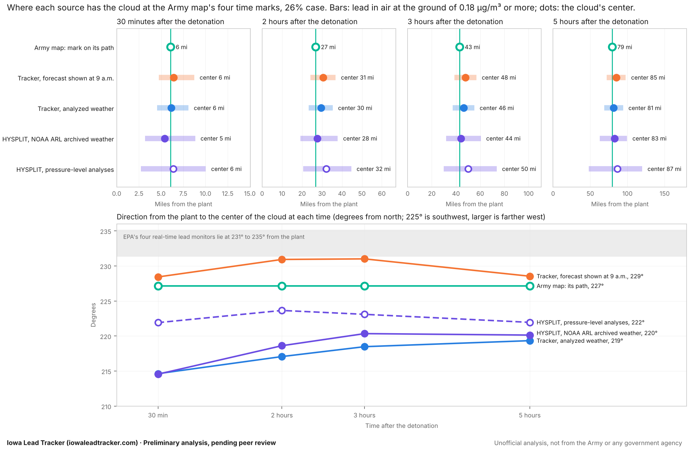
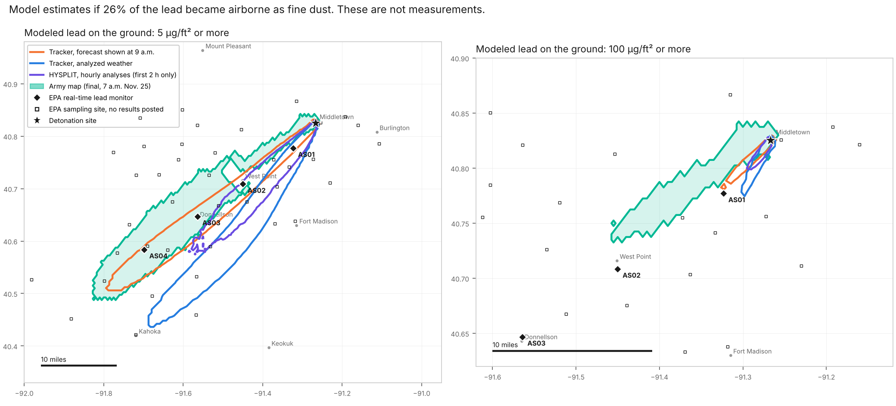
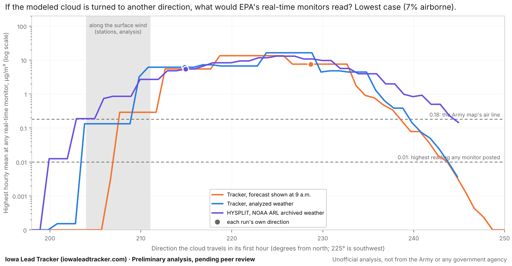

# Initial findings from the Nov. 25 detonation at the Iowa Army Ammunition Plant

**Iowa Lead Tracker (iowaleadtracker.com) · Preliminary analysis, pending peer review**

As of Nov. 26, 2026, 12:26 a.m. CST (06:26 UTC), about 15 hours after the detonation.

> **Unofficial.** This is a screening analysis by a private citizen, not from the Army or
> any government agency. The maps and charts are model estimates for assumed releases. They
> are not measurements, and nothing here says how much lead reached any place. Follow
> official instructions.

This is a short summary of the [first comparison](README.md), which has the methods, data
and code. It answers two questions: did the weather follow the dispersal maps the Army and
the Iowa Lead Tracker published, and why might EPA's lead monitors have read zero? It is a
snapshot. It will not be updated; later findings go in the first comparison.

## The short version

- **The forecasts had the right speed and the right general direction.** Both maps said
  southwest, away from Burlington. The weather as later analyzed agrees.
- **Both missed the exact path by the same 10 to 15 degrees.** On the analyzed weather the
  modeled cloud runs a few miles southeast of where the Army's map and the tracker's
  forecast put it.
- **EPA's four real-time monitors read essentially zero.** Of 244 readings after the
  detonation, 227 were zero and the highest was 0.010 µg/m³.
- **The nearest monitor was placed to catch a cloud of fine dust at the ground.** Even 1%
  of the lead as fine dust would have read hundreds of times above what it posted.
- **That leaves four explanations.** The two likeliest are that very little fine lead got
  out, or that the lead was on particles too coarse for the monitors to measure. Air
  monitors alone can't tell those apart. Soil, wipe and filter results can.

## 1. Did the weather follow the maps?

We compared four things for the same release. Two are predictions made beforehand. Two are
reruns on the weather as NOAA analyzed it afterward.

| Color in the charts | What it is |
|---|---|
| Orange | The tracker's forecast, as shown on the site at 9 a.m. |
| Green | The Army's map, final issue (stamped 7 a.m. Nov. 25) |
| Blue | The tracker rerun on analyzed weather |
| Purple | HYSPLIT on analyzed weather |

### Speed: the forecasts were right

How far from the plant each one has the center of the cloud, at the four times marked on
the Army's map:

| Time after detonation | Army map | Tracker forecast | Tracker, analyzed weather | HYSPLIT, analyzed weather |
|---|---|---|---|---|
| 30 minutes | 6 mi | 6 mi | 6 mi | 5 mi |
| 2 hours | 27 mi | 31 mi | 30 mi | 28 mi |
| 3 hours | 43 mi | 48 mi | 46 mi | 44 mi |
| 5 hours | 79 mi | 85 mi | 81 mi | 83 mi |

### Direction: both forecasts were off the same way

The Army's map and the tracker's forecast pointed along about 227° to 231°, through West
Point and Donnellson. On analyzed weather the path runs along 215° to 221°, toward Kahoka,
Missouri: about 3 miles southeast of West Point and 5 miles southeast of Donnellson. The
forecast wind near the ground came from 9 to 18 degrees too far east all morning. Its speed
was within 0.7 m/s.

*Top row: distance at each time. Everything lines up. Bottom: direction. The lines split
into two groups that never cross, the two forecasts above and the analyzed-weather runs
below. The gray band is where EPA's real-time monitors sit.*

*Where lead would settle if 26% became airborne as fine dust. Orange and green (the
forecasts) lie together. Blue and purple (analyzed weather) lie together, a few miles
southeast. Diamonds are EPA's real-time monitors.*

### Reading the charts

- **HRRR** is NOAA's hourly weather model (Dowell et al. 2022). A forecast is what it
  predicted beforehand. An analysis is NOAA's reconstruction of each hour afterward,
  blending in airport reports, radar, balloons and satellites. It is the closest thing
  available to the actual weather, but it is not a measurement. There is no wind
  instrument at the plant.
- **HYSPLIT** is NOAA's standard program for working out where something in the air
  travels (Stein et al. 2015). It releases thousands of virtual particles and follows them
  through the weather. These are our runs of it, not official NOAA products.
- **Why blue and purple agreeing matters.** They are two different models given the same
  weather, and their footprints overlap by 45% to 66%. The tracker's forecast and
  analyzed-weather footprints overlap by 2% to 14%. So the miss came from the weather
  forecast, not from the tracker's math.

## 2. Why might EPA's monitors read zero?

EPA's four real-time monitors sit 4.5 to 28 miles southwest of the plant. The nearest,
AS01, posted a reading every five minutes through the first hour. Its highest was
0.002 µg/m³.

### The sensitivity tests, in plain English

1. **What if the cloud went a different direction?** We turned the modeled cloud around
   the plant one degree at a time and read off what the monitors would see. For the lowest
   published case (7% of the lead airborne) at least one monitor responds across 30 to 40
   degrees of arc. For 1%, the window is still 213° to 234°. Every direction estimated
   here falls inside it.
2. **How little could they have caught?** At AS01, fine dust from about 0.2% of the lead
   (11 to 16 lb) would reach the Army map's 0.18 µg/m³ line. A 1% release would read 0.8
   to 1.1 µg/m³, hundreds of times the highest reading.
3. **What if the particles were coarse?** We reran the models one particle size at a time.
   Particles of 10 and 30 µm still reach AS01. Only at about 100 µm, the size of fine
   sand, do they fall to the ground first.
4. **What can the instrument see?** Published limits for this kind of monitor put its
   noise near 0.009 µg/m³ for a 5-minute sample (our extrapolation from CARB 2018). So a
   zero means under about 0.01 to 0.03 µg/m³, not none. This kind of monitor also samples
   through a size-selective inlet, often PM10 (EPA 2012), which passes little that is
   larger than 10 µm. EPA hasn't said which model or inlet these four monitors have.

*What the best-placed monitor would read if the modeled cloud traveled in another
direction, for the 7% case. The dots mark each run's own direction. The dashed lines are
0.18 µg/m³ and the highest reading any monitor posted.*

### Four explanations, most to least likely

The order is the author's judgment. The first two are close, and the data so far can't
choose among them.

**1. Very little fine lead became airborne.**

- *What it means:* the barriers, water and foam worked, and the fine airborne share was
  about 0.01% of the lead or less, under a pound.
- *For:* AS01 was inside the modeled cloud in every run and read near zero. It is the
  simplest reading, and it matches what the mitigation was built to do.
- *Against:* it rests on one instrument with an unstated detection limit and inlet.
- *Prior research:* we found no peer-reviewed study of a detonation mitigated this way.
  Aurell et al. (2015) measured particle and metal emissions from open and buried
  detonations in the field by flying samplers through the plumes; we have not extracted
  its lead figures. Sandia technical reports, not peer reviewed, say aqueous foam "scrubs
  particulate material" (Frakes 2011).

**2. The lead was on coarse particles.**

- *What it means:* lead bound to wet soil, droplets and debris. It either fell before
  reaching AS01 or passed it and was too large for the inlet to measure.
- *For:* with a PM10 inlet, anything coarser than about 10 µm could pass AS01 in quantity
  and read zero. The Army's own map puts heavy deposits out to 12 miles, which looks like
  particles of a few tens of micrometers.
- *Against:* a detonation also makes fine fume, which the monitors would have seen. EPA
  hasn't said what inlet these monitors have.
- *Prior research:* in World Trade Center settled dust, particles finer than 2.5 µm were
  under 2% of the mass (Lioy et al. 2002). After the Notre-Dame fire, officials reported no
  air sample over the limit, and soil sampled later held about a ton of excess lead within
  1 km downwind (van Geen et al. 2020). EPA's 2008 lead standard keeps all-size sampling
  because particles larger than 10 µm contribute to exposure by ingestion (EPA 2008). The
  monitor type has been checked against lab filters, with differences put down partly to
  inlet location (Tremper et al. 2018).

**3. The cloud passed over the nearest monitor.**

- *What it means:* a hot cloud rose above the shallow morning layer of air near the
  ground, crossed AS01 aloft and came down 10 or more miles out.
- *For:* the 9 a.m. analysis has a stable layer between about 40 and 240 m. On the
  analyzed path, the monitors farther out are 3 to 7 miles to the side.
- *Against:* the charge was under earth cover and foam. A Sandia report, not peer
  reviewed, says the foam "suppresses cloud buoyancy" (Frakes 2011). Nothing public says
  how high the cloud went.
- *Prior research:* none found for this event type. The evidence is this analysis's own
  weather data.

**4. A small, shallow cloud passed just south of the nearest monitor.**

- *What it means:* a cloud hugging the ground followed the surface wind toward 204° to
  211°. AS01 is at 222°.
- *For:* nearby surface stations had the wind from 28° to 31°, which points that way.
- *Against:* it can only hide a small release. At 1% of the lead the monitors respond from
  213° to 234°. At 0.1% the window shrinks to a few degrees.
- *Prior research:* none specific. This comes from the direction test above.

### What would settle it

- EPA's lab results from its filter samplers on the analyzed path (sites AS06, AS12, AS13,
  AS14 and AS18).
- Soil and wipe samples southwest of the plant. Coarse lead ends up on the ground.
- The monitors' model, inlet size and detection limit from EPA.
- The Army's balloon data or video showing how high the cloud rose.

## What this does not show

- Where lead went, or how much. Every cloud here is a model result for an assumed release.
- That either forecast map was confirmed. Speed and general direction held; the path did
  not.
- That the air was unsafe or safe. Coarse particles are mostly not breathed deep into the
  lungs, but lead on soil and surfaces matters through ingestion, especially for children.
  That is an inference from particle sizes, not a measurement.

## Limits of this summary

- The literature for explanations 1 and 3 was not fully searched. Two searches, on
  detonation mitigation and on cloud rise, could not be run.
- Aurell et al. (2015) and Tremper et al. (2018) are cited from their abstracts only.
- EPA readings are its preliminary public values as posted through 7:14 p.m. CST on
  Nov. 25.
- This summary was drafted with an AI coding assistant. The maintainer has not yet checked
  every number by hand.

## Sources

- Aurell, J., and Coauthors, 2015: Aerostat-based sampling of emissions from open burning
  and open detonation of military ordnance. *J. Hazard. Mater.*, **284**, 108–120,
  doi:10.1016/j.jhazmat.2014.10.029. (Abstract only.)
- CARB, 2018: Standard operating procedure for continuous determination of metals in
  ambient air using an Xact 625i ambient metals monitor. CAMB SOP 450, California Air
  Resources Board ([copy](data/sources/carb_2018_sop450_xact625i.pdf)).
- Dowell, D. C., and Coauthors, 2022: The High-Resolution Rapid Refresh (HRRR): An hourly
  updating convection-allowing forecast model. Part I. *Wea. Forecasting*, **37**,
  1371–1395, doi:10.1175/WAF-D-21-0151.1.
- EPA, 2008: National Ambient Air Quality Standards for Lead; final rule. 73 Fed. Reg.
  66964 ([signed version](data/sources/epa_2008_lead_naaqs_final_rule_signed.pdf)).
- EPA, 2012: Environmental Technology Verification report: Xact 625 particulate metals
  monitor. EPA/600/R-12/680 ([copy](data/sources/epa_2012_etv_xact625.pdf)).
- Frakes, 2011: Containment options for IEDs and RDDs using aqueous foam. Sandia National
  Laboratories, SAND2011-3462C, https://www.osti.gov/servlets/purl/1141006. (Technical
  report, not peer reviewed; quoted as recorded in the [scenario README](../README.md).)
- Lioy, P. J., and Coauthors, 2002: Characterization of the dust/smoke aerosol that settled
  east of the World Trade Center (WTC) in lower Manhattan after the collapse of the WTC
  11 September 2001. *Environ. Health Perspect.*, **110**, 703–714.
- Stein, A. F., and Coauthors, 2015: NOAA's HYSPLIT atmospheric transport and dispersion
  modeling system. *Bull. Amer. Meteor. Soc.*, **96**, 2059–2077,
  doi:10.1175/BAMS-D-14-00110.1.
- Tremper, A. H., and Coauthors, 2018: Field and laboratory evaluation of a high time
  resolution x-ray fluorescence instrument for determining the elemental composition of
  ambient aerosols. *Atmos. Meas. Tech.*, **11**, 3541–3557, doi:10.5194/amt-11-3541-2018.
  (Abstract only.)
- van Geen, A., Y. Yao, T. Ellis, and A. Gelman, 2020: Fallout of lead over Paris from the
  2019 Notre-Dame cathedral fire. *GeoHealth*, **4**, e2020GH000279,
  doi:10.1029/2020GH000279 ([copy](data/sources/vangeen_2020_geohealth_notre_dame.pdf)).
