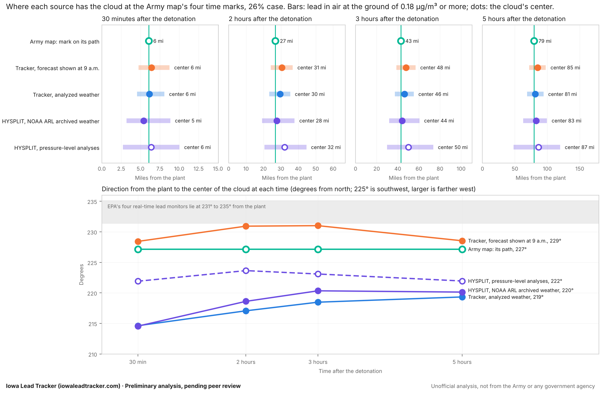
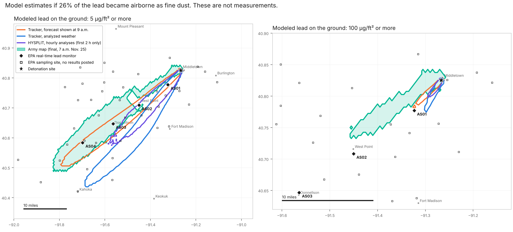
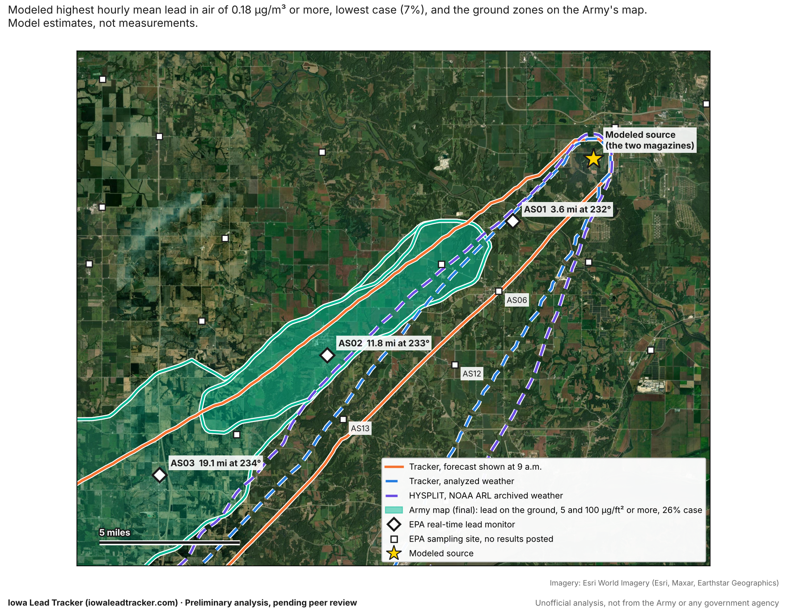
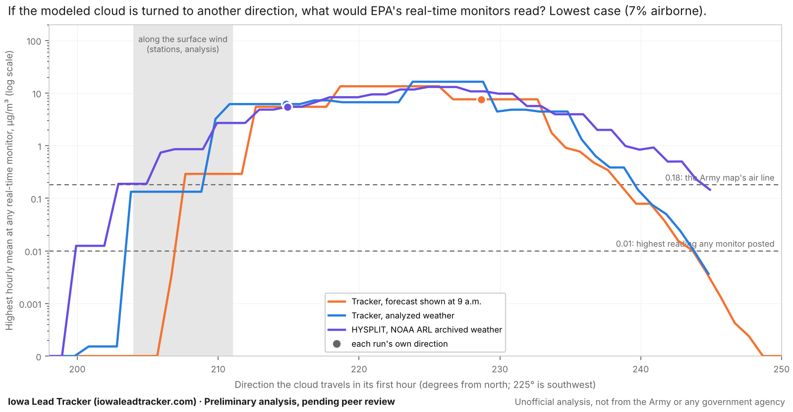

# Initial findings from the Nov. 25 detonation at the Iowa Army Ammunition Plant (third version)

**Iowa Lead Tracker (iowaleadtracker.com) · Preliminary analysis, pending peer review**

As of Nov. 26, 2026, 3:15 a.m. CST (09:15 UTC), about 18 hours after the detonation.
Updated at 3:25 a.m. with the magazines' coordinates and a video of the detonation.

> **Unofficial.** This is a screening analysis by a private citizen, not from the Army or
> any government agency. Don't use it to decide if you're safe; follow official
> instructions. The maps and charts are model estimates for assumed releases. They are not
> measurements, and nothing here says how much lead reached any place.

This replaces the [second version](initial_findings_20261126_0715Z.md). The change is
where the release is modeled from. A reader's tip, checked against published imagery,
puts the two magazines about 1.8 km south of the point used before, and the monitor
section was rerun from them. It summarizes the [first comparison](README.md), which has
the methods, data and code. No one outside this project has reviewed either document; the
reviews so far were by AI referees.

## The short version

- **The forecasts and the reruns agree on speed and on a southwesterly path.** Both the
  Army's map and the tracker's forecast pointed southwest. Reruns of the models on the
  weather as NOAA later analyzed it also point southwest, at the same speed.
- **The reruns put the path 7 to 14 degrees farther south than either forecast.** The
  analyzed weather is itself a model product, so this is the likely size and direction of
  the forecast error, not a measured one.
- **EPA's four real-time monitors posted essentially zero.** Of 253 readings from the
  detonation through 8:40 p.m., 236 were zero and the highest was 0.010 µg/m³. EPA calls
  them "Xact stations monitoring for lead" (EPA 2026). It hasn't published their model,
  inlet or detection limit.
- **The monitors were placed along the forecast path.** Measured from the two magazines,
  all four lie on one line at 232° to 235°. The forecasts pointed along 227° to 231°.
- **On analyzed weather three are outside the modeled cloud and the nearest is on its
  edge.** What that monitor would read then depends on the source's position to within a
  few hundred meters and the wind to within a few degrees.
- **Several explanations fit the near-zero readings, and the data can't rank them.** Lab
  results from EPA's filter samplers, and soil and surface samples, are what can.

## 1. Did the weather follow the maps?

We compared five things for the same release. Two are predictions made beforehand. Three
are reruns on NOAA's HRRR weather for the hours of the event.

| Color in the charts | What it is |
|---|---|
| Orange | The tracker's forecast, as shown on the site at 9 a.m. |
| Green | The Army's map, final issue (stamped 7 a.m. Nov. 25) |
| Blue | The tracker rerun on analyzed weather |
| Purple, solid | HYSPLIT on NOAA's archived weather (the reference rerun) |
| Purple, dashed | HYSPLIT on a coarser form of the analyzed weather |

### Speed: forecasts and reruns agree

How far from the source each one has the center of the cloud, at the four
times marked on the Army's map:

| Time after detonation | Army map | Tracker forecast | Tracker, analyzed weather | HYSPLIT, archived weather |
|---|---|---|---|---|
| 30 minutes | 6 mi | 6 mi | 6 mi | 5 mi |
| 2 hours | 27 mi | 31 mi | 30 mi | 28 mi |
| 3 hours | 43 mi | 48 mi | 46 mi | 44 mi |
| 5 hours | 79 mi | 85 mi | 81 mi | 83 mi |

### Direction: the reruns lie south of both forecasts

The Army's map and the tracker's forecast point along about 227° to 231°. The two
reference reruns point along 215° to 221°, which is 7° to 14° farther south at every time
mark. At 15 miles out that is 2 to 4 miles. The coarser HYSPLIT rerun lies between, at
222° to 224°. The forecast wind near the ground came from 9° to 18° farther east than
NOAA's analysis from 9 a.m. to noon; its speed was within 0.7 m/s in those hours.

These are paths of a modeled cloud. A place outside a modeled
path may still get lead, and a place inside it may get none you could measure.

*Top row: distance at each time. Bottom: direction. The two forecasts (orange, green) run
above the two reference reruns (blue, solid purple). The dashed purple line is HYSPLIT on
the coarser weather file. The gray band is the range of bearings of EPA's four real-time
monitors from the modeled source.*

*Where lead would settle if 26% became airborne as fine dust. The Army's zones are traced
from its map and placed from the tip of its plume. The star is the modeled source.*

### Reading the charts

- **HRRR** is NOAA's hourly weather model (Dowell et al. 2022). A forecast is what it
  predicted beforehand. An analysis is made each hour, in real time, from a one-hour
  forecast and that hour's observations. It is a model product, not a measurement, and
  there is no wind instrument at the plant. Five surface stations within 16 miles averaged
  a wind from 28° to 31° at 9 and 10 a.m., on the analysis's side of the forecast, but
  individually they ranged from 349° to 050°.
- **HYSPLIT** is NOAA's standard program for working out where something in the air
  travels (Stein et al. 2015). These are our runs of it, not official NOAA products.
- **What the agreement between blue and solid purple shows.** They are two different
  models given much the same weather, and for the 26% case their footprints overlap by
  45% to 66%. The tracker's forecast and rerun footprints overlap by 4% to 14%. So the
  difference between the forecast map and the rerun comes from the weather input. That is
  not a validation of either model: the tracker runs 1.5 to 1.8 times higher than HYSPLIT
  in places, and the two forms of analyzed weather move HYSPLIT's own path by up to 7°.

## 2. Why might EPA's monitors read zero?

**Where the release is modeled from.** EPA's permit redacts where the magazines are. A
reader sent the tracker a satellite image, published by Iowa's News Now (2026) and
captioned as showing the barriers around the two magazines that held the lead azide, and
a location for it. Checked against public aerial imagery, the two barricaded magazines are
about 260 m apart and about 1.8 km south of the point this analysis used before:

| | Latitude | Longitude |
|---|---|---|
| Magazine A (north) | 40.8106 | −91.2686 |
| Magazine B (south) | 40.8085 | −91.2698 |

The positions are estimated from the imagery and good to about 15 m. This section models
the release from them, half of the lead from each. A frame of video shot from a plane
(WVLT 2026) shows two separate clouds side by side, which fits two magazines detonated
together. No official source confirms the location.

From there EPA's four real-time monitors are 3.6 to 27 miles out, all along 232° to 235°.
The nearest, AS01, posted a value about every five minutes through the first hour. Its
highest was 0.002 µg/m³.

*Where the highest hourly mean would be 0.18 µg/m³ or more for the lowest published case
(7% of the lead airborne). Orange is the tracker's forecast; blue and purple are the two
reruns on analyzed weather. Diamonds are EPA's real-time monitors, squares its filter
sampling sites, the star the modeled source. Imagery: Esri World Imagery.*

### What the models give at the monitors

Highest hourly mean for the lowest published case (7%), in µg/m³:

| Site | From the source | Tracker, forecast | Tracker, analyzed weather | HYSPLIT, archived weather |
|---|---|---|---|---|
| AS01 (real-time) | 3.6 mi at 232° | 15 | 1.3 | 0.44 |
| AS02 (real-time) | 11.8 mi at 233° | 2.5 | 0 | 0.02 |
| AS03 (real-time) | 19.1 mi at 234° | 1.5 | 0 | 0 |
| AS04 (real-time) | 27.3 mi at 235° | 0.76 | 0 | 0 |
| AS06 (filter) | 5.8 mi at 216° | 0.01 | 5.9 | 6.4 |
| AS12 (filter) | 8.8 mi at 214° | 0 | 6.8 | 4.0 |
| AS13 (filter) | 12.8 mi at 224° | 1.1 | 0.58 | 1.0 |

- **On the forecast, all four real-time monitors are inside the cloud.** EPA placed them
  where the forecasts said the lead would go.
- **On analyzed weather the cloud runs along 215°, about 17° south of the monitors'
  line.** AS01 is on its northwest edge and the other three are outside it.
- **The edge is sharp.** One model cell from AS01 the tracker has 6 µg/m³; with the
  source at the midpoint of the magazines it has 0.01 at AS01 itself.
- **Filter sites AS06 and AS12 are in the body of the analyzed-weather cloud.** No
  results from them are public.

### The tests, in plain English

1. **What if the cloud went a different direction?** We turned the modeled cloud around
   the source one degree at a time. For the lowest case (7%) at least one monitor would
   read 0.18 µg/m³ or more from about 211°–215° to 245°–252°. That level is the line on
   the Army's air map, which labels it a sampling method's detection limit. For 1% of the
   lead the window is 218°–219° to 245°. The forecast path (229° to 230°) is inside both.
   The analyzed path (215°) is at the edge of the first and 3° to 4° outside the second.
2. **How much would the nearest monitor read?** On the forecast path, 0.09% of the lead
   as fine dust would bring AS01 to 0.18 µg/m³. On the analyzed path it takes 1% in the
   tracker and 2.9% in HYSPLIT. A 1% release gives 2.1 µg/m³ at AS01 on the forecast path
   and 0.06 to 0.18 on the analyzed one.
3. **What if the source is a little off?** We moved the modeled cloud so it starts 0.5, 1
   and 2 km from the magazines in 24 directions. On the forecast path the monitors catch
   the 7% case every time. On analyzed weather, with the source half a kilometer off, they
   catch the 7% case in 15 of 24 directions and a 1% release in 5 or 6 of 24.
4. **What if the particles were coarse?** One particle size at a time: at AS06, in the
   body of the cloud, particles of 10 and 30 µm (at the density of soil) arrive in the
   same amount as fine dust. Only at about 100 µm, or 30 µm for particles as dense as the
   lead compound, does most of the lead fall first.
5. **What if the cloud rose higher than modeled?** We ran HYSPLIT with the cloud released
   between 251 and 502 m instead of below 251 m. AS01 then reads 5.0 µg/m³ for the 7%
   case against 0.44, because the wind at that height points along the monitors' line and
   the morning's mixed layer grows past the cloud within the hour. So the lower the cloud
   stayed, the farther south it went. This is one run of one model.
6. **What can the instrument see?** EPA says the stations are Xact monitors, which
   measure metals on a filter tape by X-ray fluorescence, but hasn't given the model, the
   inlet or a detection limit. For the maker's current model, the maker's table gives
   0.0018 µg/m³ for lead at 15 minutes, the shortest time listed, as one standard
   deviation (CARB 2018). If its formula held down to 5 minutes it would give about
   0.009 µg/m³. That is our extrapolation, and the posted readings are quieter than it
   implies, so a posted zero can't be turned into an upper bound. The inlet options are
   PM10, PM2.5, PM1 and total particulate (CARB 2018); EPA's own test of the earlier model
   used PM10 (EPA 2012), and a field study in the United Kingdom used PM10 and PM2.5
   (Tremper et al. 2018). A PM10 inlet passes little that is larger than 10 µm. We could
   not find which inlet the Iowa units have. The Army's own 24-hour lead samplers have a
   PM10 inlet (U.S. Army 2026).

*Test 1, for the 7% case. The dots mark each run's own direction: the forecast run's is in
the high part of the curve, the two analyzed-weather runs' are where the curves fall
away. The gray band is where a cloud would go if it followed the surface wind. The dashed
lines are 0.18 µg/m³ and the highest value any monitor posted.*

### Explanations that fit, not ranked

They can overlap, and there may be others.

**Almost no fine lead reached the nearest monitor at the ground.** Two versions:

- **Little fine lead became airborne.** The barriers, water and foam worked. AS01's
  highest value corresponds to 0.001% of the lead as fine dust on the forecast path and
  0.01% to 0.03% on the analyzed one. In field tests of buried and metal-cased
  detonations of military munitions, most of the data put the share of a munition's metal
  reaching the air near 1% or less, with a range of 0.3% to 22% (Aurell et al. 2015).
  Those tests had no stockpile like this one and no barriers like these. Slides from
  Sandia, not peer reviewed, list "scrubs particulate material" among the benefits of
  aqueous foam around a 100 lb charge (Frakes 2011).
- **The lead was on coarse particles.** It fell before the monitors (test 4) or passed
  them on particles too large for the inlet (test 6). This needs two things EPA hasn't
  confirmed: a PM10 or finer inlet, and nearly all the airborne lead on coarse particles.
  In the same field tests, soil-covered detonations put about 30 times as much particle
  mass in PM10 as in PM2.5, against about 1 to 1 for open detonations (Aurell et al.
  2015). EPA's 2008 lead standard kept total-particle sampling in part because particles
  too coarse for a PM10 sampler add to exposure by ingestion (EPA 2008).

**A cloud of fine lead missed the monitors.** These matter most for exposure. Three
versions:

- **It passed south of AS01.** On analyzed weather this is close to what both models
  show (tests 1 to 3). A cloud that stayed in the lowest 150 m would go farther south
  still: the archived weather has that layer's wind from 24° to 31° at 9 a.m. and the
  wind above it from 51°.
- **It passed over AS01.** Test 5 argues against this for a cloud up to twice the modeled
  height, in one model. The modeled height itself is half of a published formula's value
  for an open-air charge, an assumption that has not been validated.
- **The detonation was somewhere else.** The location is from a tip, and half a kilometer
  matters (test 3).

**The public feed doesn't show what the instruments measured.** EPA says the stations
monitor for lead, but it hasn't said how the feed treats small values, and the posted
values don't behave like raw readings (test 6).

### Two events where air sampling and the ground differed

Neither was a detonation, and neither shows what happened in Iowa.

- In dust that settled after the World Trade Center collapse, particles finer than 2.5 µm
  were under 2% of the mass (Lioy et al. 2002). That is settled dust from a collapse, the
  coarse end of what was in the air.
- After the 2019 Notre-Dame fire, a health agency reported no air sample over the limit,
  without giving the timing. Soil sampled months later held about 1.0 metric ton (0.5 to
  1.5) of excess lead within 1 km downwind. The authors put the gap with official findings
  down to the timing and scale of sampling, not particle size (van Geen et al. 2020).

### What would settle it

- EPA's lab results from its filter samplers in the analyzed-weather path, above all AS06
  and AS12, then AS13, AS14 and AS18.
- Soil and wipe samples southwest of the plant.
- An official statement of where the detonation was.
- The monitors' model, inlet size and detection limit, and how the public feed treats
  small values.
- The Army's balloon data or video showing how high the cloud rose.

As of 1:00 a.m. CST on Nov. 26, none of these was public. EPA's viewer held only the four
real-time monitors and a list of 43 sampling sites.

## What this does not show

- Where lead went, or how much. Every cloud here is a model result for an assumed release
  from a source that no official statement confirms.
- That either forecast map was confirmed. The reruns agree with them on speed and on a
  southwesterly path, and differ on the path by 7° to 14°.
- That the air was unsafe or safe. Lead in particles of all sizes contributes to lead in
  blood (EPA 2008).

## Limits of this summary

- The literature was not fully searched. Two searches, on detonation mitigation and on how
  high detonation clouds rise, could not be run. The second bears on the cloud-overhead
  explanation.
- NOAA's archived weather may hold short forecasts for some hours, not analyses. We have
  not confirmed which.
- The source is from a reader's tip checked against published imagery. The news caption
  is the only source for these being the magazines that held the lead azide.
- The tracker's clouds are moved to the magazines, not rerun from them; HYSPLIT is rerun.
- The source-shift and direction tests move or turn the modeled cloud rigidly. They are
  sensitivity tests, not forecasts.
- EPA readings are its preliminary public values as posted through 1:00 a.m. CST on
  Nov. 26.
- This summary was drafted with an AI coding assistant and corrected after a review by an
  AI referee. The maintainer has not yet checked every number by hand.

## Sources

Journal papers:

- Aurell, J., and Coauthors, 2015: Aerostat-based sampling of emissions from open burning
  and open detonation of military ordnance. *J. Hazard. Mater.*, **284**, 108–120,
  doi:10.1016/j.jhazmat.2014.10.029.
- Dowell, D. C., and Coauthors, 2022: The High-Resolution Rapid Refresh (HRRR): An hourly
  updating convection-allowing forecast model. Part I. *Wea. Forecasting*, **37**,
  1371–1395, doi:10.1175/WAF-D-21-0151.1.
- Lioy, P. J., and Coauthors, 2002: Characterization of the dust/smoke aerosol that settled
  east of the World Trade Center (WTC) in lower Manhattan after the collapse of the WTC
  11 September 2001. *Environ. Health Perspect.*, **110**, 703–714.
- Stein, A. F., and Coauthors, 2015: NOAA's HYSPLIT atmospheric transport and dispersion
  modeling system. *Bull. Amer. Meteor. Soc.*, **96**, 2059–2077,
  doi:10.1175/BAMS-D-14-00110.1.
- Tremper, A. H., and Coauthors, 2018: Field and laboratory evaluation of a high time
  resolution x-ray fluorescence instrument for determining the elemental composition of
  ambient aerosols. *Atmos. Meas. Tech.*, **11**, 3541–3557, doi:10.5194/amt-11-3541-2018
  ([copy](data/sources/tremper_2018_amt_xact625.pdf)).
- van Geen, A., Y. Yao, T. Ellis, and A. Gelman, 2020: Fallout of lead over Paris from the
  2019 Notre-Dame cathedral fire. *GeoHealth*, **4**, e2020GH000279,
  doi:10.1029/2020GH000279 ([copy](data/sources/vangeen_2020_geohealth_notre_dame.pdf)).

Government documents and other sources, not peer reviewed:

- CARB, 2018: Standard operating procedure for an Xact 625i ambient metals monitor, CAMB
  SOP 450. California Air Resources Board. A state procedure that reproduces the maker's
  table ([copy](data/sources/carb_2018_sop450_xact625i.pdf)).
- EPA, 2008: National Ambient Air Quality Standards for Lead; final rule. 73 Fed. Reg.
  66964 ([signed version](data/sources/epa_2008_lead_naaqs_final_rule_signed.pdf)).
- EPA, 2026: U.S. EPA Heartland Region, Facebook post on the equipment used for the
  detonation, Nov. 25, 2026, about 8 p.m. CST,
  https://www.facebook.com/story.php?story_fbid=1424138166543295&id=100068413763562
  ([copy](data/sources/epa_region7_facebook_post_20261125.jpg)).
- EPA, 2012: Environmental Technology Verification report: Xact 625 particulate metals
  monitor. EPA/600/R-12/680. A government test report
  ([copy](data/sources/epa_2012_etv_xact625.pdf)).
- Iowa's News Now, 2026: Understanding the lead plume: What the Army's projected
  dispersion maps show. Nov. 24, 2026, with a satellite image credited to Airbus. News
  article.
- WVLT, 2026: Video of the detonation shot from a plane, credited "WGEM Viewer,
  Middletown, Iowa". Posted on Instagram, Nov. 25, 2026 (news video; one frame seen).
- U.S. Army, 2026: Emergency permit application, controlled detonation of lead azide
  (redacted), Revision 3.0, October 2026, section 6. Posted by EPA at
  https://response.epa.gov/site/site_profile.aspx?site_id=17211.
- Frakes (with Klennert), 2011: Containment options for IEDs and RDDs using aqueous foam.
  Sandia National Laboratories, SAND2011-3462C, https://www.osti.gov/servlets/purl/1141006.
  Conference slides.
