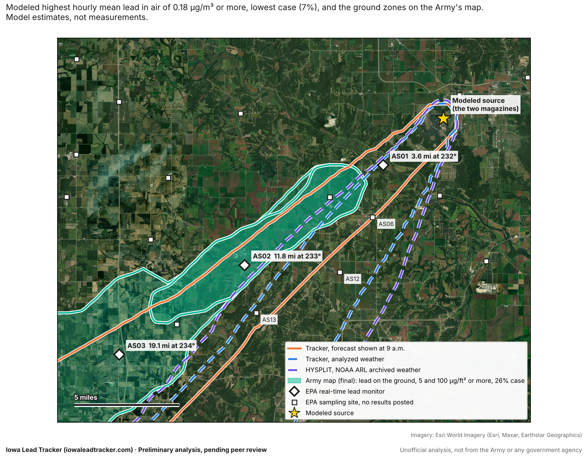

# Were EPA's real-time lead monitors on the cloud's path?

**Iowa Lead Tracker (iowaleadtracker.com) · Preliminary analysis, pending peer review**

A short, reproducible brief on one map. As of Nov. 26, 2026, 6:40 a.m. CST, about 22 hours
after the Army detonated its lead azide stockpile at the Iowa Army Ammunition Plant.

> **Unofficial.** This is a screening analysis by a private citizen, not from the Army or
> any government agency. Don't use it to decide if you're safe; follow official
> instructions. The map shows model estimates for an assumed release. It is not a
> measurement, and nothing here says how much lead reached any place.

## Abstract

The forecasts, including the Army's, pointed the plume toward about 230°, and EPA's four
real-time lead monitors were lined up along that path; models rerun on NOAA's
after-the-fact weather analysis put it along about 215°. On that path three monitors were
outside the modeled cloud and the nearest was on its edge, so their near-zero readings
can't distinguish between little lead escaping and a cloud that passed just south of
them.

## Summary

EPA's four real-time lead monitors for the Nov. 25 detonation were set out along the path
the forecasts showed, an analysis of public data by Iowa Lead Tracker finds. Measured from
the two magazines, the monitors lie on one line to the southwest, at 232° to 235°, from
3.6 to 27 miles out. Placed on the Army's own advisory map, three of them fall inside the
zone the Army shaded for lead on the ground. The fourth, the nearest, is where that map
is covered by its plant marker.

Weather analyzed after the fact points farther south. When two dispersion models are
rerun on NOAA's analysis of that morning's weather, both put the modeled cloud along 210°
to 217°, about 15° south of the forecast and about 20° south of the line of monitors. On
that path three of the four monitors are outside the modeled cloud and the nearest is on
its edge. The analysis is itself a model product, so this is
the likely size and direction of the forecast error, not a measured one.

The monitors posted almost nothing. Of 263 readings from the detonation through 6:36 a.m.
the next day, 246 were zero and the highest was 0.010 µg/m³, about the size of readings
the same instruments posted before the detonation. The Army said that day that "the EPA
has detected zero lead." Because the monitors were lined up along the forecast path and
not spread across it, those readings fit more than one account, and the public data
can't tell them apart: little fine lead got out, or a cloud passed south of the monitors.

The measurements that can tell them apart are the ones not yet public: lab results from
samples of the ground, and from the other instruments EPA set out along the
analyzed-weather path. EPA lists filter samplers at eight sites in that path within
about 30 miles, among them AS06 and AS12, about 6 and 9 miles from the magazines and in the body
of the rerun cloud. No results from them, or from soil and surface sampling, had been
posted when this was written. Until they are, the real-time readings can't settle what
reached the ground or the air south of the monitors.

These are model estimates, not measurements. Nothing here shows that lead reached any
place, or how much. Where the magazines are comes from a reader's tip checked against
published satellite imagery; no official source confirms it. The analysis has not been
peer reviewed. The code and data to redraw the map and recompute every number are in
this folder.

## What is needed now

**The four real-time monitors can't answer this. Two other kinds of measurement can, and
neither is public yet.**

**1. Lab results from the ground.** Soil, surface-wipe and water samples don't depend on
an instrument having been in the right place at the right minute. Lead that came down
stays where it fell, and a sample taken afterward finds it. Ground samples also catch
lead on particles too coarse for an air monitor's inlet. EPA says it collected more than
1,200 air, land and water samples before the detonation (EPA 2026c), so there is a
baseline to compare with. Sampling between about 205° and 245° from the magazines, out
to 15 miles, would span every model run here; the reruns' path runs along 210° to 217°.

**2. Results from the instruments already in the analyzed-weather path.** EPA's site list
has 43 sites. Besides the nearest real-time monitor, eight of them are places where a
rerun on analyzed weather reaches 0.18 µg/m³ for the 7% case:

*Table A. EPA sites within about 30 miles where either rerun on analyzed weather gives a
highest hourly mean of 0.18 µg/m³ or more for the 7% case, nearest first, with the modeled
values (µg/m³) and the instruments EPA lists. Model estimates, not measurements.*

<!-- table:needed -->
| Site | From the modeled source | Tracker, analyzed weather | HYSPLIT, archived weather | Instruments EPA lists there | Results public |
|---|---|---|---|---|---|
| AS01 | 3.6 mi at 232° | 1.3 | 0.44 | Xact real-time lead monitor, DustTrak, AreaRAE, Air Cassette, Summa canister | real-time lead only |
| AS06 | 5.8 mi at 216° | 5.9 | 6.4 | DustTrak, AreaRAE, Air Cassette, Summa canister | none |
| AS12 | 8.8 mi at 214° | 6.8 | 4.0 | Air Cassette, Summa canister | none |
| AS13 | 12.8 mi at 224° | 0.58 | 1.0 | Air Cassette, Summa canister | none |
| AS35 | 13.3 mi at 203° | 0.011 | 0.68 | DustTrak, AreaRAE, Air Cassette, Summa canister | none |
| AS14 | 20.5 mi at 222° | 0.72 | 0.81 | Air Cassette, Summa canister | none |
| AS18 | 24.7 mi at 219° | 1.9 | 1.0 | Air Cassette, Summa canister | none |
| AS36 | 28.8 mi at 213° | 0.52 | 0.16 | Air Cassette, Summa canister | none |
| AS37 | 30.5 mi at 225° | 0.17 | 0.29 | Air Cassette, Summa canister | none |
<!-- /table:needed -->

- **Filter cassettes** are at every one of these sites. A lab measures the lead on the
  filter. AS06 and AS12 matter most: they are in the body of the rerun cloud and read
  almost nothing on the forecast path, so a result there separates the two paths.
- **DustTrak particle monitors** are at AS06 and AS35. They record airborne particles
  continuously, not lead. A record from AS06 for 9 to 11 a.m. on Nov. 25 would show
  whether a particle cloud passed, and when, without waiting for a lab.
- **The Army's own samplers.** Its permit application describes 24-hour filter samples at
  ten locations and five response samples during the event (U.S. Army 2026b). Their locations are not
  public.

If these come back clean along 210° to 220°, that supports little lead having become
airborne. If they don't, the real-time monitors were beside the cloud, not in it.

## The map



*Lines: where the highest hourly mean lead in air at the ground would be 0.18 µg/m³ or
more if 7% of the lead became airborne as fine dust (the lowest of the tracker's published
cases). 0.18 µg/m³ is the line the Army's air map draws, labeled a sampling method's
detection limit. Solid orange is the tracker's forecast, shown on the site at 9 a.m.
Dashed blue and purple are two models rerun on analyzed weather. Green is the Army's final
ground map (lead on the ground of 5 and 100 µg/ft² or more, its 26% case), a different
quantity, shown for where the Army's forecast ran; its first miles are hidden under the
plant marker on the Army's map. Diamonds are EPA's real-time lead monitors, squares its
other sampling sites, the star the modeled source. AS04 is off the map to the lower left.
Imagery: Esri World Imagery.*

## What it shows

**1. The monitors follow the forecast.** They are 3° to 5° from the tracker's forecast
path at every distance, and three are in the Army's ground zone.

*Table 1. Direction from the modeled source at which each run's modeled air is highest,
at three distances, and the monitors' directions.*

<!-- table:paths -->
| Run | 5 miles out | 10 miles out | 20 miles out |
|---|---|---|---|
| Tracker, forecast | 227° | 229° | 231° |
| Tracker, analyzed weather | 212° | 214° | 216° |
| HYSPLIT, archived weather | 210° | 216° | 217° |
| EPA's real-time monitors | 4 mi: 232°, 12 mi: 233°, 19 mi: 234°, 27 mi: 235° | | |
<!-- /table:paths -->

**2. On analyzed weather the modeled cloud passes south of them.** Both reruns are 17° to
22° south of the monitors at the same distance.

*Table 2. Highest hourly mean lead in air at the ground, µg/m³, for the 7% case, in the
model cell at each site. Values below 0.001 are shown as 0. Model estimates, not
measurements. The last column says where the site falls on the Army's final ground map.*

<!-- table:sites -->
| Site | Kind | From the modeled source | Tracker, forecast | Tracker, analyzed weather | HYSPLIT, archived weather | On the Army's ground map |
|---|---|---|---|---|---|---|
| AS01 | real-time lead monitor | 3.6 mi at 232° | 15 | 1.3 | 0.44 | under the plant marker |
| AS02 | real-time lead monitor | 11.8 mi at 233° | 2.5 | 0 | 0.015 | in the zone |
| AS03 | real-time lead monitor | 19.1 mi at 234° | 1.5 | 0 | 0 | in the zone |
| AS04 | real-time lead monitor | 27.3 mi at 235° | 0.76 | 0 | 0 | in the zone |
| AS06 | filter sampler, no results posted | 5.8 mi at 216° | 0.011 | 5.9 | 6.4 | under the plant marker |
| AS12 | filter sampler, no results posted | 8.8 mi at 214° | 0 | 6.8 | 4.0 | 2.5 mi outside the zone |
| AS13 | filter sampler, no results posted | 12.8 mi at 224° | 1.1 | 0.58 | 1.0 | 1.5 mi outside the zone |
<!-- /table:sites -->

- On the forecast all four monitors are inside the modeled cloud, with 15 µg/m³ at AS01.
- On analyzed weather AS01 is on the cloud's edge, with about a tenth to a thirtieth of
  that, and the other three read essentially nothing.
- Filter sites AS06 and AS12 are in the body of the analyzed-weather cloud. They read 4 to
  7 µg/m³ in the reruns and almost nothing on the forecast.
- The edge at AS01 is sharp. The full analysis finds that moving the source half a
  kilometer, or the wind a few degrees, changes AS01's value several-fold.

**3. The monitors posted almost nothing.**

*Table 3. EPA's posted real-time readings from the detonation (9 a.m. CST Nov. 25) through
6:36 a.m. CST Nov. 26, and the highest each monitor posted in the two hours before.*

<!-- table:readings -->
| Monitor | Readings posted | Zero | Highest, µg/m³ | Highest before, µg/m³ |
|---|---|---|---|---|
| AS01 | 63 | 61 | 0.002 | 0.000 |
| AS02 | 76 | 74 | 0.004 | 0.003 |
| AS03 | 64 | 60 | 0.004 | 0.000 |
| AS04 | 60 | 51 | 0.010 | 0.006 |
| All four | 263 | 246 | 0.010 | 0.006 |
<!-- /table:readings -->

EPA calls these "Xact stations monitoring for lead." It has not published their model,
inlet size or detection limit, or how the public feed treats small values.

**4. So the readings alone can't say what happened.** A line of monitors along one
direction sees a cloud only over a narrow range of directions. In the full analysis the
four monitors would read 0.18 µg/m³ or more for the 7% case over about 35° of arc, from
211°–215° to 245°–252°, and over about 27° for a release of 1%. The analyzed path is at
the southern edge of the first range and outside the second.

## How it was made

1. **Source.** The release is modeled from two barricaded magazines at 40.8106, −91.2686
   and 40.8085, −91.2698, half of the lead from each. A reader's tip pointed to them; they
   were checked against a published satellite image (Iowa's News Now 2026) and public
   aerial imagery. A frame of video shot from a plane (WVLT 2026) shows two separate
   clouds. No official source confirms the location.
2. **Forecast.** The tracker's own forecast as shown on the site at 9 a.m. on Nov. 25,
   from NOAA's HRRR forecast weather.
3. **Reruns.** The tracker rerun on NOAA's hourly HRRR analyses, and NOAA's HYSPLIT model
   (Stein et al. 2015) run on NOAA ARL's archive of HRRR. HYSPLIT is run from the two
   magazines. The tracker's fields are moved to them, because its saved weather can't be
   pulled again for a new point.
4. **Army map.** The Army's final "Mitigated 0.26" ground map (U.S. Army 2026a) is a small
   picture, 0.6 mile per pixel. It is placed by fitting public county boundaries to the
   county lines printed on it (`place_army_map.py`). About two thirds of the boundary points land within a
   pixel and a half of a line, and the placement is good to about a pixel.
5. **EPA.** Site positions and readings are from the public layers behind EPA's response
   data viewer (EPA 2026a), downloaded at 6:37 a.m. CST on Nov. 26.

The full analysis behind this brief, with the weather checks and the sensitivity tests,
is a longer paper that is still being revised. It is on the working branch
[`claude/fervent-turing-led5z2`](https://github.com/iowaleadtracker/iowaleadtracker/tree/claude/fervent-turing-led5z2/scenarios/iowa-aap-lead-azide/postmortem)
and is not part of this folder. Statements here marked "the full analysis" come from it
and are not recomputed by this folder's code.

## Limits

- **Model estimates, not measurements.** Every line is a model result for an assumed
  release. None says where lead went, or how much.
- **The source is from a tip.** If the detonation was somewhere else, the directions to
  the monitors change.
- **Analyzed weather is a model product.** It blends observations into a forecast. There
  is no wind measurement at the plant. Surface stations within 16 miles side with the
  analysis over the forecast but disagree with each other by 30° to 60°.
- **The 7% case is an assumption.** No one has published how much lead became airborne.
  The lines show where a cloud would be detectable, not that there was one.
- **The Army's zones are a different quantity and case.** They are lead on the ground for
  its 26% case. They are on the map to show where the Army's forecast ran.
- **Cloud height.** A cloud that rose above the modeled top would have gone less far
  south, in one test run of one model (the full analysis).
- **No peer review.** The only reviews so far were by AI referees.

## Reproduce it

From the repository root, with Python 3.10 or later:

```bash
pip install numpy scipy matplotlib pillow
python3 scenarios/iowa-aap-lead-azide/postmortem/monitor-placement-brief/brief.py
```

That redraws `monitor_placement_map.png`, rewrites `numbers.json` and rewrites the four
tables above from the files in [`data/`](data/README.md). It needs the
network only for the aerial imagery; `--no-map` skips the map. The run takes under a
minute.

| To check | Run | Needs |
|---|---|---|
| The map and the tables, from the saved fields | `brief.py` | Python; network for imagery |
| EPA's sites and readings | `epa_fetch.py OUT_DIR` | network; EPA's layer keeps changing, so a new pull will differ |
| Where the Army's map sits | `place_army_map.py` | network for county boundaries; about a minute |
| The model fields themselves | the full analysis's `scripts/reproduce.sh`, on the working branch | HYSPLIT 5.4, NOAA ARL's HRRR archive files, about an hour |

The code is four short files: `brief.py` (the numbers and tables), `brief_map.py` (the
map), `brief_lib.py` (the source, distances and the Army's map) and `place_army_map.py`.
The inputs are described in [`data/README.md`](data/README.md).

## Questions and answers

**Does this show lead reached my town, or that an area is unsafe?**
No. It shows where models put a cloud for an assumed release. It can't say whether lead
reached any place. Don't use it to decide if you're safe; follow official instructions.

**Does it mean EPA's monitors missed a lead cloud?**
No. It means that if a cloud took the path the reruns show, three of the four monitors
were not in a position to see it and the fourth was at its edge. Whether there was such a
cloud isn't known from public data.

**Did EPA put its monitors in the wrong place?**
They are where the forecasts available before the detonation pointed, including the
Army's. The question this raises is about coverage: four monitors on one line see a
narrow range of directions. EPA also lists 39 other sampling sites with filter samplers
and other instruments, several of them in the reruns' path. Their results are what would
answer the question.

**The Army and EPA said no lead was detected. Does this contradict that?**
No. The posted readings are near zero, as they said. This brief is about what near-zero
readings at these four places can and can't rule out.

**What is "analyzed weather," and why not just trust the forecast?**
After the fact, NOAA's HRRR system produces an hourly analysis that blends weather
observations into its model. It is usually closer to what happened than a forecast made
hours earlier, but it is still a model product. Here it moves the modeled cloud's path
about 15° from the forecast's.

**Why are there two dashed lines?**
They are two different models given the analyzed weather: the tracker's own, and HYSPLIT,
a standard NOAA dispersion model. They agree on the path to within a few degrees.

**How do you know where the detonation was?**
We don't, officially. EPA's permit redacts the location. A reader pointed to two
barricaded magazines shown in a satellite image published by a news station. The image
matches public aerial imagery at that place, and aerial video shows two clouds. The
coordinates are in "How it was made."

**How much does the location matter?**
A lot at the nearest monitor. Half a kilometer changes what AS01 would read on analyzed
weather several-fold. It matters little for the three farther monitors.

**How was the Army's map put on the aerial photo?**
By its county lines. The Army's map prints them, and public county boundaries were fitted
to them. That places the map to about 0.6 mile. The start of the Army's plume is hidden
under the plant marker on its map and is not drawn.

**Why is the Army's shape lead on the ground when the lines are lead in air?**
The Army's ground map is the clearer of its two maps near the plant; county names are
printed across the cloud on its air map. The point of showing it is its direction. Its
sizes can't be compared with the lines, which are for a different case and quantity.

**What is the 7% case?**
The lowest of the tracker's four published cases: 7% of the lead becomes airborne as fine
dust. The Army's mitigated maps assume 26%. No one has published what the detonation
actually released, and it may have been much less.

**What can the monitors detect?**
EPA says they are Xact monitors, which measure metals on a filter tape by X-ray
fluorescence. It hasn't said which model, what inlet size or what detection limit. The
full analysis covers what is published for this kind of instrument.

**What other explanations fit the near-zero readings?**
The full analysis lists them without ranking: little fine lead became
airborne; the lead was on particles too coarse to stay up or to pass the monitors' inlet;
a cloud passed south of or over the monitors; the detonation was somewhere else; or the
public feed doesn't show what the instruments measured.

**What would settle it?**
Lab results from the ground and from the instruments in the analyzed-weather path; see
"What is needed now." Above all, EPA's filter samples at AS06 and AS12, its DustTrak
record at AS06 for the morning of Nov. 25, and soil and surface samples between about
205° and 245° from the magazines out to 15 miles. Also an official statement of where
the detonation was, and the monitors' model, inlet and detection limit.

**Has anyone checked this?**
No one outside the project. It has had AI referee reviews, which found and led to
corrections of several errors. The code and data are public so that others can check it.

**Can the map be republished?**
The code and text are under the repository's MIT license. The background is Esri World
Imagery and needs its credit line (Esri, Maxar, Earthstar Geographics); check Esri's
terms for your use. Please keep the "model estimates, not measurements" line and the
unofficial notice with the map.

**Who made this?**
Iowa Lead Tracker, an unofficial public project by a private citizen
(iowaleadtracker.com). It has no connection to the Army or any government agency.

## Sources

- EPA, 2026a: Iowa Army Ammunition Plant Response Data Viewer, public layers
  `IAAAP_Xact_Data_Public_Viewer` and `Air_Sampling_and_Monitoring_Location`,
  https://experience.arcgis.com/experience/1ddcf8b9d8314971b00dac8893ae9cd6 (retrieved
  Nov. 26, 2026, 12:37 UTC; preliminary data).
- EPA, 2026b: U.S. EPA Heartland Region, Facebook post on the equipment used for the
  detonation, Nov. 25, 2026,
  https://www.facebook.com/story.php?story_fbid=1424138166543295&id=100068413763562.
  Source of "Xact stations monitoring for lead."
- EPA, 2026c: EPA collects over 1,200 air, land, and water samples ahead of Iowa Army
  Ammunition Plant controlled detonation. News release, Nov. 25, 2026,
  https://www.epa.gov/newsreleases/epa-collects-over-1200-air-land-and-water-samples-ahead-iowa-army-ammunition-plant.
- Esri: World Imagery (Esri, Maxar, Earthstar Geographics), and USA Counties Generalized
  Boundaries, from the Census Bureau's county boundaries.
- Iowa's News Now, 2026: Understanding the lead plume: What the Army's projected
  dispersion maps show. Nov. 24, 2026, with a satellite image credited to Airbus. News
  article.
- KCRG, 2026: Army says Iowa ammunition plant detonation exceeded expectations for lead
  containment. Nov. 25, 2026,
  https://www.kcrg.com/2026/11/25/watch-army-gives-update-after-lead-azide-detonation/.
  Source of the Army's "the EPA has detected zero lead."
- NOAA: High-Resolution Rapid Refresh (HRRR) forecasts and analyses, and NOAA Air
  Resources Laboratory's archive of HRRR for HYSPLIT.
- Stein, A. F., and Coauthors, 2015: NOAA's HYSPLIT atmospheric transport and dispersion
  modeling system. *Bull. Amer. Meteor. Soc.*, **96**, 2059–2077,
  doi:10.1175/BAMS-D-14-00110.1.
- U.S. Army, 2026a: Public advisory maps, "Mitigated 0.26" dispersion and deposition,
  detonation 25 Nov 2026 0900 CST, issued Nov. 25, 2026, a/o 250700NOV26 (in
  `data/army/`; the ground map only).
- U.S. Army, 2026b: Emergency permit application for treatment of lead azide, Quality
  Assurance Project Plan (redacted). Posted by EPA at
  https://response.epa.gov/site/site_profile.aspx?site_id=17211.
- WVLT, 2026: Video of the detonation shot from a plane, credited "WGEM Viewer,
  Middletown, Iowa". Posted on Instagram, Nov. 25, 2026 (one frame seen).
